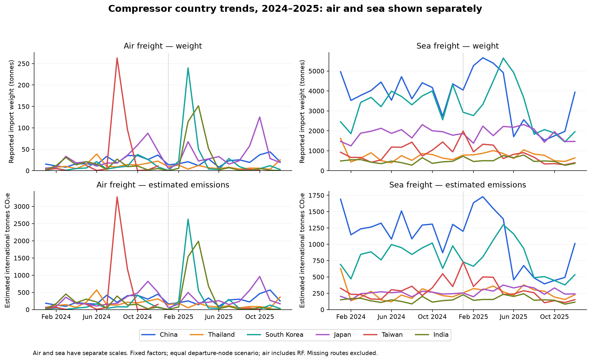
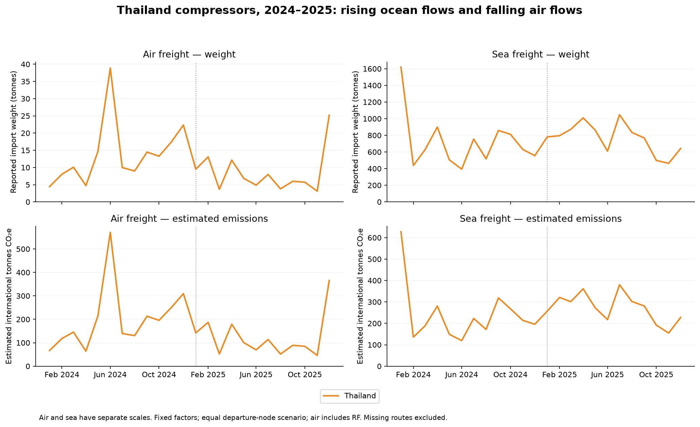

## Country and mode trends: January 2024–December 2025

Monthly charts separate **air** and **sea**, showing reported weight above and estimated international
emissions below. The same six country colors are used in every panel; the CSV includes all configured
countries with observations. Each panel has its own vertical scale. Gaps are missing observations or
unsupported emissions, not measured zero emissions. The charts are descriptive, not seasonally adjusted.

Thailand illustrates why volume and carbon can move differently. In May–December 2025 versus the same
months of 2024, its **sea weight rose from 5,025.6 to 5,725.0 tonnes (+13.9%)**, while
**air weight fell from 140.0 to 63.5 tonnes (−54.6%)**. Total air/sea weight rose 12.1%.
Air's factor per tonne-km is much higher than sea's. The observed mode shift therefore helps explain
why the scenario estimate for Thailand's supported international flows falls from about **3,683 to
2,949 tonnes CO₂e**, despite higher total weight. These totals use all supported arrivals in each period;
coverage and port composition can change, so they are not the fixed common-support headline comparison.

The finished-refrigerator production evidence is separate from compressor trade. No production transfer,
company shipment route, tariff causation or measured emissions inventory is established here.

