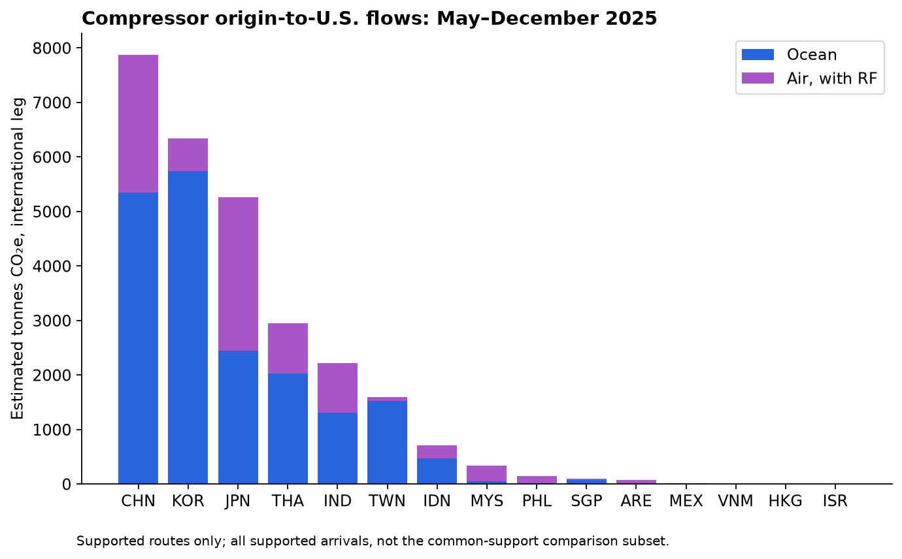
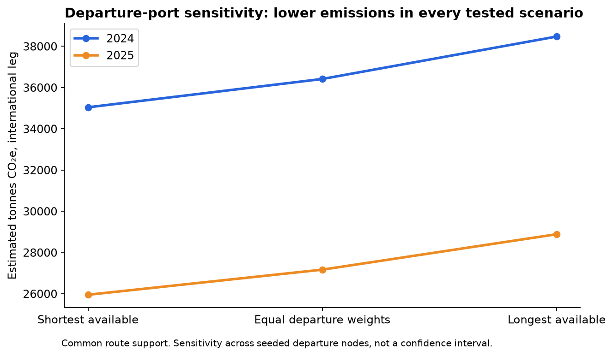
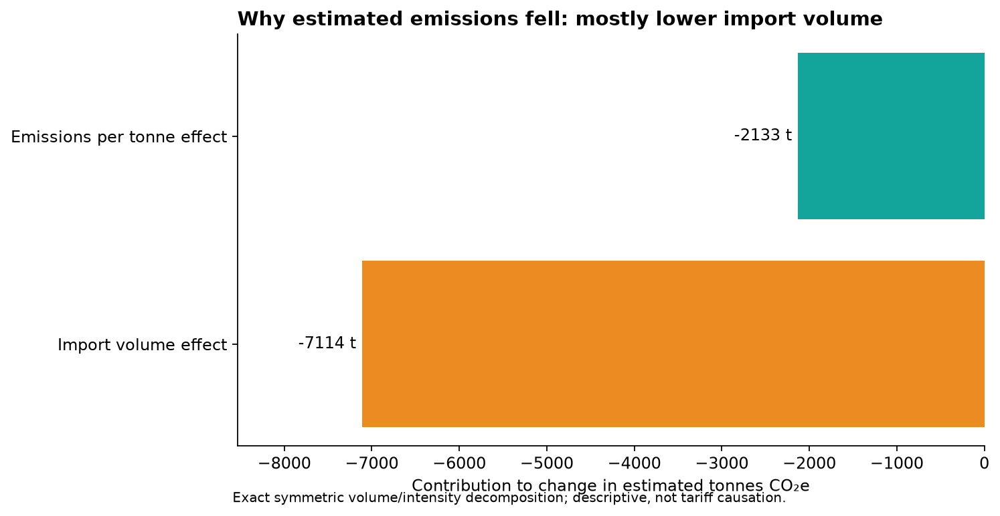
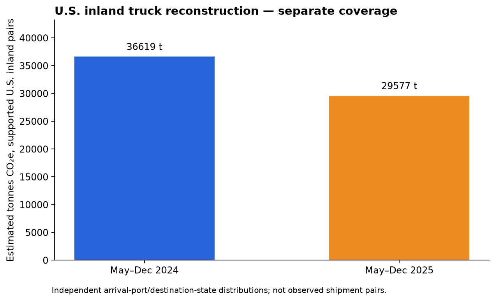
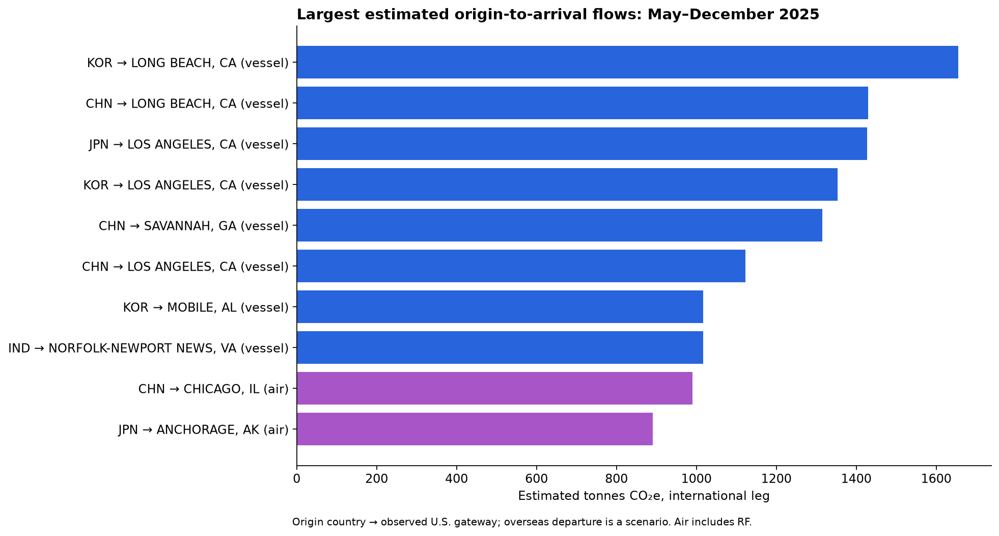
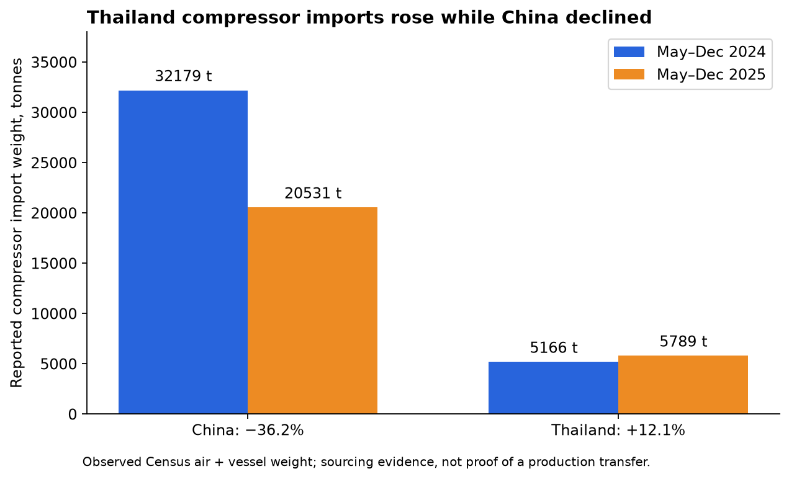
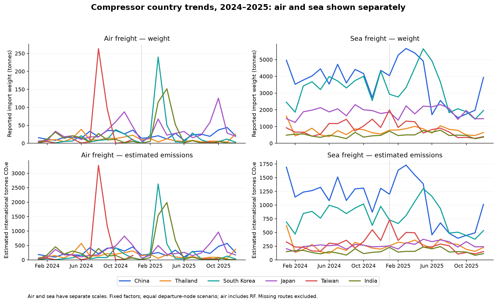
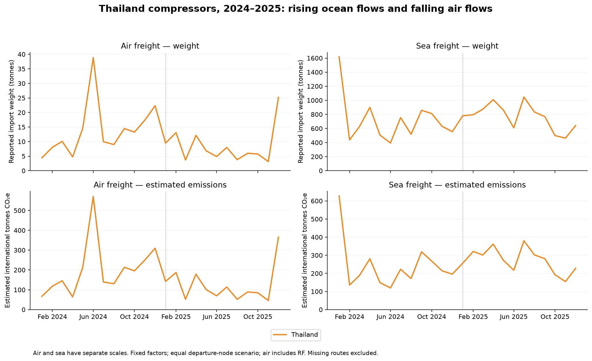

# Compressor freight emissions — aggregate scenario estimate

**Result:** On common supported origin/mode/arrival-port cells, estimated international emissions fall
from **36,412 to 27,166 tonnes CO₂e (−25.4%)**.
This compares May–December 2024 with May–December 2025 using fixed factors and equal weights across available foreign departure nodes.
This is a transport scenario estimate, not an observed carbon inventory or a Haier shipment result.

The common supported mass is 91,578 tonnes in 2024 and 73,085 tonnes in 2025:
**93.8% and 95.9%** of reported compressor air/sea weights.
Estimated intensity falls from **397.6 to 371.7 kg CO₂e/tonne**.
Lower volume accounts for **7,114 tonnes** of the reduction;
intensity changes account for **2,133 tonnes**.

## Coverage and interpretation

Thailand compressor imports increased from **5,166 to 5,789 tonnes (+12.1%)** while China declined
from **32,179 to 20,531 tonnes (−36.2%)** in the matched months. Thailand's weight share rose
from 5.3% to 7.6%. The 2025 emissions ranking is a level comparison, not a year-to-year change chart;
the separate China/Thailand import chart answers this sourcing question. Compressor import shifts
do not establish that the same production physically transferred between these countries.

Across all supported arrivals (a different subset from the common-support comparison), the equal-departure scenario estimates
41,503 tonnes CO₂e in 2024 and
27,611 tonnes in 2025.
Distance coverage is 94.7% and 96.3%;
uncovered mass remains missing, not zero carbon. The origin chart uses this supported subset; do not sum it against the common-support headline.

U.S. inland truck estimates, shown separately because coverage differs, are
36,619 and 29,577 tonnes CO₂e.
Supported pair-weight coverage is 99.3% and 99.7%.
No full-lane grand total is claimed.

## Assumptions

- HS 841430 includes compressors for refrigerating equipment beyond household refrigerators; configured Asia/Mexico origins, not all U.S. imports.
- Census supplies observed aggregate weights, origin countries, U.S. ports, modes and months. Foreign departure nodes and inland shipment pairings are not observed.
- Each available seeded departure node in the origin country gets equal weight for each supported arrival. Availability is not evidence of representative export-port market shares.
- Route sensitivity takes the shortest/longest available seeded departure route per arrival; open-passage sea routes. This is not a confidence interval or an exhaustive physical bound. Origin country need not be the actual loading country when transshipment occurs.
- Ocean uses average container ship; U.S. inland assumes truck and independent port/state distributions. Actual vessel/load factor and inland mode are unknown.
- UK 2026 revised factors are held fixed over both historical windows. WTW includes fuel production; air has RF and no-RF alternatives. Aviation RF includes non-CO₂ climate effects, so the two are distinct reporting views.
- Truck combustion uses EPA 2025 Table 8 and Table 11 GWPs, converted from short ton-mile; WTT is estimated with the UK mineral-diesel upstream/combustion ratio, not a measured U.S. upstream factor.
- Excludes foreign inland, unmeasured transshipment, unsupported routes, Mexico truck/rail, manufacturing, refrigerant leakage and product use. No company attribution or causal tariff claim.

## Sensitivity

Common-support change with aviation RF: −25.9% (shortest), −25.4% (equal weights), −24.9% (longest).
Without aviation RF: −25.3%, −24.9%, −24.6%, respectively. These do not cover every source of uncertainty.

## Sources and reproduction

[Census port imports](https://www.census.gov/foreign-trade/data/dataproducts.html),
[UK DESNZ 2026 revised factors](https://www.gov.uk/government/publications/greenhouse-gas-reporting-conversion-factors-2026),
[EPA 2025 factors](https://www.epa.gov/climateleadership/ghg-emission-factors-hub),
[OurAirports](https://ourairports.com/data/). Shared ShockT weighted-distance and lane-intensity functions; existing sea/air/road distance seeds.
The source manifest records SHA-256 hashes, workbook URLs and assumptions. Factor row IDs and values are in `factors.csv`.
`calculate_compressor_emissions.py` regenerates numerical outputs; `verify_emissions.py` reconciles source weights, units, route arithmetic and decomposition closure.

## Country and mode trends: January 2024–December 2025

Monthly charts separate **air** and **sea**, showing reported weight above and estimated international
emissions below. The same six country colors are used in every panel; the CSV includes all configured
countries with observations. Each panel has its own vertical scale. Gaps are missing observations or
unsupported emissions, not measured zero emissions. The charts are descriptive, not seasonally adjusted.

Thailand illustrates why volume and carbon can move differently. In May–December 2025 versus the same
months of 2024, its **sea weight rose from 5,025.6 to 5,725.0 tonnes (+13.9%)**, while
**air weight fell from 140.0 to 63.5 tonnes (−54.6%)**. Total air/sea weight rose 12.1%.
Air's factor per tonne-km is much higher than sea's. The observed mode shift therefore helps explain
why the scenario estimate for Thailand's supported international flows falls from about **3,683 to
2,949 tonnes CO₂e**, despite higher total weight. These totals use all supported arrivals in each period;
coverage and port composition can change, so they are not the fixed common-support headline comparison.

The finished-refrigerator production evidence is separate from compressor trade. No production transfer,
company shipment route, tariff causation or measured emissions inventory is established here.

