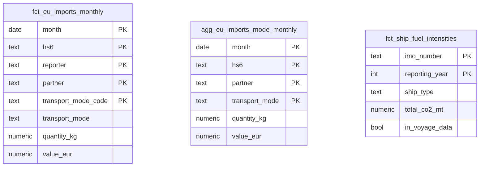
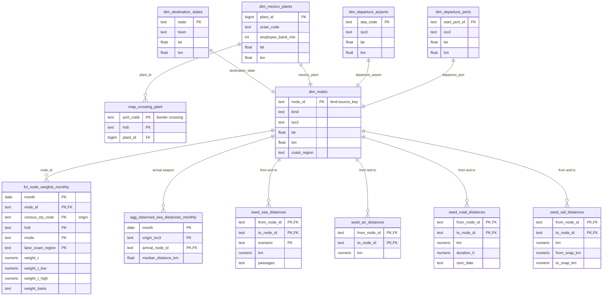

# data-pipelines

Ingestion pipelines and dbt models that build the `raw` and `core` layers of the ShockT Climate database. Design: [../docs/plans/data-ingestion-pipelines.md](../docs/plans/data-ingestion-pipelines.md).

## Local setup

1. **Install uv** (`brew install uv`, or see the [uv docs](https://docs.astral.sh/uv/getting-started/installation/)). uv installs the Python version this project pins.
2. **Install the dependencies:**
  ```sh
   cd data-pipelines
   uv sync
   cp .env.example .env
  ```
3. **Ask Molly for the credentials** and paste them into `.env`. The team shares one login per database role, so everyone uses the same values:

  | Variable                                                                     | What it is                                                          |
  | ---------------------------------------------------------------------------- | ------------------------------------------------------------------- |
  | `DATABASE_URL`                                                               | Postgres connection string for `shockt_ingest`, used by the loaders |
  | `DBT_DATABASE_URL`                                                           | Postgres connection string for `shockt_transform`, used by dbt      |
  | `NEON_S3_ENDPOINT_URL`, `NEON_S3_ACCESS_KEY_ID`, `NEON_S3_SECRET_ACCESS_KEY` | The archive bucket where loaders store every downloaded file        |

   Keep `NEON_S3_REGION` and `ARCHIVE_BUCKET` as they are in `.env.example`.
4. **Get a Census API key** at [api.census.gov/data/key_signup.html](https://api.census.gov/data/key_signup.html) and set `CENSUS_API_KEY`. It's free; click the activation link in the email before using it, and allow a few minutes for it to take effect.
5. **Check the setup** by listing recent loads:
  ```sh
   uv run shockt loads list
  ```

`.env` is gitignored. Never commit it, and don't paste credentials into chat or issues.

Values in `.env` take priority over variables exported in your shell, so a `DATABASE_URL` or `AWS_PROFILE` you use for other work won't redirect this project.

**Analysts** working only in notebooks don't need this setup. Ask Molly for the read-only `shockt_analyst` connection string instead.

### Database roles


| Role               | Access                                                    |
| ------------------ | --------------------------------------------------------- |
| `shockt_ingest`    | Reads and writes `raw`                                    |
| `shockt_transform` | Reads `raw`, creates `raw.seed_*` and builds `core` (dbt) |
| `shockt_analyst`   | Reads `raw` and `core`                                    |
| `shockt_app`       | Reads `core`                                              |


## Migrations

Alembic manages the `raw` schema, the load manifest, roles and grants. Migrations run as the database owner (`MIGRATIONS_DATABASE_URL`), so Molly applies them; open a pull request with the new migration and ask her to run it.

```sh
uv run alembic upgrade head          # apply
uv run alembic upgrade head --sql    # print the SQL without connecting
```


## Loading data

Loaders connect as `shockt_ingest` (`DATABASE_URL`), archive each response in the bucket, then
parse it into `raw`. Reloading a partition replaces its earlier load. A Census partition is one
month of one HS prefix (`2025-03:847150`), so after adding HS codes to `config/hs_codes.yaml`,
`--skip-existing` fetches only the new prefixes.

```sh
uv run shockt ingest census --from 2022-01                  # all three endpoints, through the latest month
uv run shockt ingest census -d hs --from 2024-12 --to 2024-12
uv run shockt ingest census --from 2022-01 --skip-existing   # resume after a failure, or load new HS codes
uv run shockt ingest census --from 2022-01 --from-archive    # re-parse archived responses, e.g. after a filter change
uv run shockt loads list                                     # recent loads and raw table sizes
```

BTS TransBorder data can't be downloaded by script (bts.gov blocks it), so download each month's ZIP from the [raw data page](https://www.bts.gov/topics/transborder-raw-data) in a browser into `data/manual/bts/`, unchanged. File names don't matter; the loader reads the month from the files inside. It reports any ZIP it can't read, which usually means the download was cut short.

```sh
uv run shockt ingest bts-transborder                  # every month in data/manual/bts
uv run shockt ingest bts-transborder --skip-existing  # only months not loaded yet
uv run shockt ingest bts-transborder --from-archive   # re-parse archived ZIPs, e.g. after a filter change
```

Reference datasets used to place nodes (airports, cities, border crossings) are each one `latest` snapshot; a reload replaces it:

```sh
uv run shockt ingest ourairports            # airports with an IATA code
uv run shockt ingest geonames-cities        # US and Mexican cities of 5,000+
uv run shockt ingest bts-border-crossings   # US-Mexico ports of entry, monthly, with coordinates
uv run shockt ingest census-concordance     # HS-10 → NAICS, one workbook per year (start year to now)
uv run shockt ingest denue                  # Mexican manufacturers in the case industries; needs the concordance
```

DENUE keeps only establishments in the industries the import concordance maps from `config/hs_codes.yaml`. After changing HS codes, reload it without downloading again: `uv run shockt ingest denue --from-archive`.

IMF PortWatch daily chokepoint transits come from a public API, one chokepoint-year per load. Each year is fetched and archived whole, and only days inside `date_range` (or `--from`/`--to`, as `YYYY-MM`) load. The current year is always reloaded, since PortWatch keeps adding days:

```sh
uv run shockt ingest portwatch                       # all configured chokepoints, over date_range
uv run shockt ingest portwatch --skip-existing       # skip years already loaded for the same months
```

Climate TRACE ship voyages come from its public BigQuery dataset, one year per load, billed to your sandbox project (`GCP_PROJECT_ID`, after `gcloud auth application-default login`). Every query is dry-run first and refused above `BQ_MAX_BYTES`; the full 2022-onward load scans about 30 GB of the free 1 TB a month:

```sh
uv run shockt ingest climatetrace-voyages --dry-run        # bytes each year would scan; no quota used
uv run shockt ingest climatetrace-voyages                  # load voyages starting inside date_range
uv run shockt ingest climatetrace-voyages --from-archive   # re-parse archived Parquet; no quota used
```

Census State/Port Imports come as one fixed-width file per quarter, for all goods. Only quarters entirely inside `date_range` load; with no end month, quarters Census hasn't published yet are reported and skipped. The filter (origins, the destination states in `census_state_port.states`, rows with air or vessel weight) is in `config/sources.yaml`:

```sh
uv run shockt ingest census-state-port                     # every whole quarter in date_range
uv run shockt ingest census-state-port --skip-existing     # only quarters not yet loaded
uv run shockt ingest census-state-port --from-archive      # re-parse archived ZIPs, e.g. after a filter change
```

BTS T-100 International Segment gives air freight by origin airport, for all goods, one year per load. TranStats has no file download for it, so the loader fills in its download form; a year the form doesn't offer yet is reported and skipped. The filter (origin countries, segments that carried freight) is in `config/sources.yaml`:

```sh
uv run shockt ingest bts-t100                     # every year in date_range
uv run shockt ingest bts-t100 --skip-existing     # only finished years not loaded for the same months and filters
uv run shockt ingest bts-t100 --from-archive      # re-parse archived ZIPs, e.g. after a filter change
```

Rows dropped while loading (country groups, all-zero rows, and for the port and state
endpoints, countries outside the origins in `config/origins.yaml`) are set in `config/sources.yaml`
and recorded in each load's manifest `params`.

## Building `core`

dbt builds the `core` schema from `raw`, connecting as `shockt_transform` (`DBT_DATABASE_URL`). Run it after loading data; it reads only succeeded loads, so it's safe to run while a load is in progress.

```sh
uv run shockt build                               # install dbt packages, load seeds, build models, run tests
uv run shockt dbt build -s fct_imports_monthly    # any dbt command, e.g. one model
uv run shockt dbt test                            # tests only
```

Seeds (reference CSVs) live in `dbt/seeds/` and load into `raw.seed_*`. **None is edited by hand**: each is written by a `shockt ref` command from config or an archived source (see `dbt/seeds/README.md`). Rules applied to them, such as coast and country regions, are dbt macros with tests.

```sh
uv run shockt ref config-seeds       # HS case codes, from config/
uv run shockt ref census-schedules   # Census country and port lists
```

The distance seeds are measured between the nodes in `core`, so they run after a build, and a second build loads them. Road and rail archive what they download; `--from-archive KEY` re-parses an archived bundle instead of fetching again. Road needs `ORS_API_KEY` and uses about four requests of the openrouteservice quota:

```sh
uv run shockt build                   # builds the nodes and weights the generators read
uv run shockt ref sea-distances       # searoute, every scenario in config/sources.yaml
uv run shockt ref air-distances       # geodesic, departure airports to air gateways
uv run shockt ref road-distances      # openrouteservice heavy-vehicle matrix (archived)
uv run shockt ref rail-distances      # BTS North American Rail Network, shortest track (archived)
uv run shockt build                   # loads the distance seeds and runs their tests
```

Freight emission factors are loaded whole from the UK government conversion factors and the EPA GHG Emission Factors Hub (workbooks pinned under `emission_factors` in `config/sources.yaml`); `core.ref_emission_factors` derives every per-tonne-km factor from them:

```sh
uv run shockt ingest uk-ghg-factors   # every row of the UK flat file
uv run shockt ingest epa-ghg-hub      # EPA Hub Tables 8 (transport) and 11 (GWPs)
```

EMSA THETIS-MRV per-ship fuel consumption and emissions come from the THETIS-MRV public API, one reporting year per load. No API key needed. The xlsx is archived unchanged, then parsed:

```sh
uv run shockt ingest thetis-mrv                       # every year from start_year to the latest available
uv run shockt ingest thetis-mrv --skip-existing       # only years not yet loaded
uv run shockt ingest thetis-mrv --from-archive        # re-parse archived xlsx files
uv run shockt ingest thetis-mrv --from-year 2023 --to-year 2024
```

Eurostat Comext extra-EU imports by transport mode come from the SDMX 2.1 REST API, one month × HS-6 code per partition. No API key needed. Partners are the configured origins; reporters are the EU-27 member states in `config/eu_reporters.yaml`:

```sh
uv run shockt ingest comext --from 2022-01            # all months through now, for every case HS-6 code
uv run shockt ingest comext --from 2022-01 --skip-existing
uv run shockt ingest comext --from 2024-01 --to 2024-06 --from-archive
```

Census ports and Climate TRACE arrival ports get their coast region from the same rule, `macros/coast_region.sql`, applied to each port's coordinates. `dim_port` places Census ports from BTS border crossings, OurAirports and GeoNames; ports it can't place are `unknown`, and a test bounds their share of case tonnage.

### The `core` schema

The tables dbt builds in `core`, with their keys, main columns and joins. [`docs/core-schema.md`](../docs/core-schema.md) has every column; `dbt/models/core/_core.yml` describes them.

**Imports, weights and reference tables.** The three dimensions are the hubs. `ref_emission_factors` is a lookup the engine chooses from through `engine/config/leg_factors.yaml`; the chokepoint transits are time series compared with the imports by month.

```mermaid
erDiagram
  dim_country {
    text census_cty_code PK
    text iso3
    text region
  }
  dim_hs {
    text hs10 PK
    text hs6
    text_array cases
  }
  dim_port {
    text port_code PK
    float lat
    float lon
    text coast_region
    bool is_border_crossing
  }
  dim_census_air_ports {
    text port_code PK, FK
    text iata_code
    float lat
    float lon
  }
  dim_climatetrace_ports {
    text end_port_id PK
    float lat
    float lon
    text coast_region
  }
  fct_imports_monthly {
    date month PK
    text hs10 PK, FK
    text census_cty_code PK, FK
    text mode PK
    numeric weight_t
    bigint charges_usd
  }
  fct_import_duties_monthly {
    date month PK
    text hs10 PK, FK
    text census_cty_code PK, FK
    bigint calculated_duty_usd
  }
  fct_imports_port_monthly {
    date month PK
    text hs6 PK
    text census_cty_code PK, FK
    text port_code PK, FK
    text mode PK
    numeric weight_t
  }
  fct_imports_state_monthly {
    date month PK
    text hs6 PK
    text census_cty_code PK, FK
    text state PK
    text mode PK
    numeric weight_t
  }
  fct_imports_state_port_quarterly {
    date quarter PK
    text state PK
    text unlading_port_code PK, FK
    text entry_port_code PK, FK
    text census_cty_code PK, FK
    text mode PK
  }
  agg_air_vessel_kg_per_usd {
    text hs6 PK
    text census_cty_code PK, FK "null for all origins"
    numeric kg_per_usd
    numeric kg_per_usd_low
    numeric kg_per_usd_high
  }
  fct_mexico_overland_monthly {
    date month PK
    text hs6 PK
    text port_code PK, FK "border crossing"
    text mode PK "truck or rail"
    numeric weight_t
    numeric weight_t_low
    numeric weight_t_high
  }
  fct_voyages {
    text asset_identifier PK
    timestamptz started_at PK
    text start_iso3 FK
    text end_port_id FK
    float distance_km
  }
  agg_voyage_lanes_monthly {
    date month PK
    text origin_iso3 PK, FK
    text end_coast_region PK
    float median_distance_km
  }
  ref_emission_factors {
    text source PK
    text source_row_id PK
    text mode
    text vehicle_type
    text size_class
    text haul
    bool radiative_forcing
    float wtw_kg_co2e_per_tkm
  }
  fct_chokepoint_transits_monthly {
    date month PK
    text chokepoint_id PK
    bigint n_container
    numeric container_t
  }

  dim_hs ||--o{ fct_imports_monthly : "hs10"
  dim_country ||--o{ fct_imports_monthly : "census_cty_code"
  dim_hs ||--o{ fct_import_duties_monthly : "hs10"
  dim_country ||--o{ fct_import_duties_monthly : "census_cty_code"
  dim_country ||--o{ fct_imports_port_monthly : "census_cty_code"
  dim_port ||--o{ fct_imports_port_monthly : "port_code"
  dim_country ||--o{ fct_imports_state_monthly : "census_cty_code"
  dim_country ||--o{ fct_imports_state_port_quarterly : "census_cty_code"
  dim_port ||--o{ fct_imports_state_port_quarterly : "unlading and entry port"
  dim_port ||--o| dim_census_air_ports : "port_code"
  dim_country |o--o{ agg_air_vessel_kg_per_usd : "census_cty_code"
  agg_air_vessel_kg_per_usd ||--o{ fct_mexico_overland_monthly : "hs6 ratio and range"
  dim_port ||--o{ fct_mexico_overland_monthly : "crossing"
  dim_climatetrace_ports ||--o{ fct_voyages : "end_port_id"
  dim_country ||--o{ fct_voyages : "start_iso3 = iso3"
  dim_country ||--o{ agg_voyage_lanes_monthly : "origin_iso3 = iso3"
  fct_eu_imports_monthly ||--o{ agg_eu_imports_mode_monthly : "summed across reporters"
  fct_voyages ||..o{ fct_ship_fuel_intensities : "IMO from asset_identifier"
```



**EU imports and ship fuel intensities.** Eurostat Comext extra-EU imports by transport mode, and EMSA THETIS-MRV per-ship fuel intensity joined to Climate TRACE voyages by IMO number.



**Nodes, weights and distances.** Each location model places one kind of node; `dim_nodes` combines them with the arrival seaports and crossings from `dim_port` and the air gateways from `dim_census_air_ports`, keyed `kind:source_key`. The `seed_*` distance tables load into `raw` from the `shockt ref` generators.



## Tests

```sh
uv run pytest
```

Integration tests start a throwaway Postgres container for the session (testcontainers), using the image in `compose.yaml`, and remove it afterwards. They need Docker running and fail without it; they never touch the development database or Neon.


## Layout

```
config/       source settings and case HS codes
dbt/          dbt project: seeds, staging views (core_staging) and core tables
migrations/   Alembic migrations for raw, roles and grants
src/shockt/   Python package: CLI, archive, manifest and source loaders
tests/        unit and integration tests, with fixtures from real responses
```

