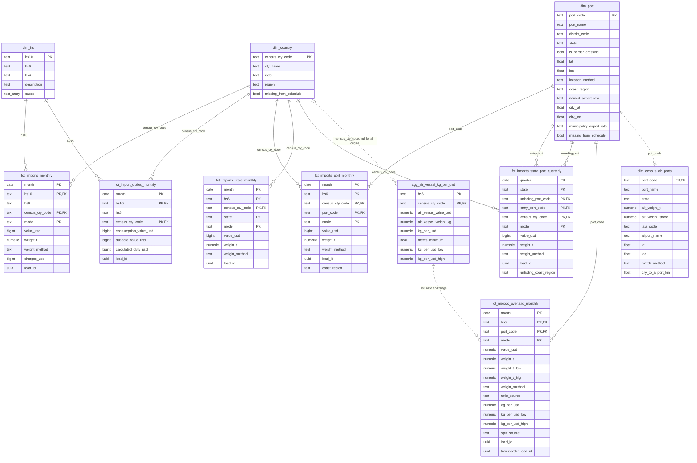
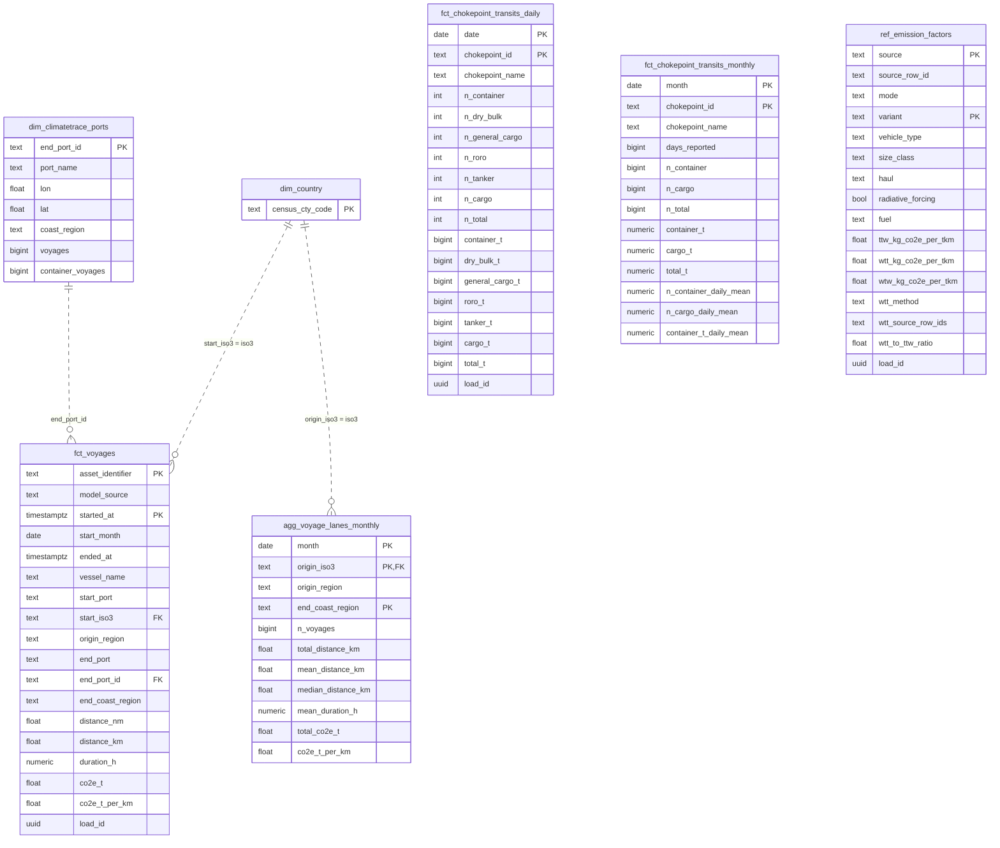
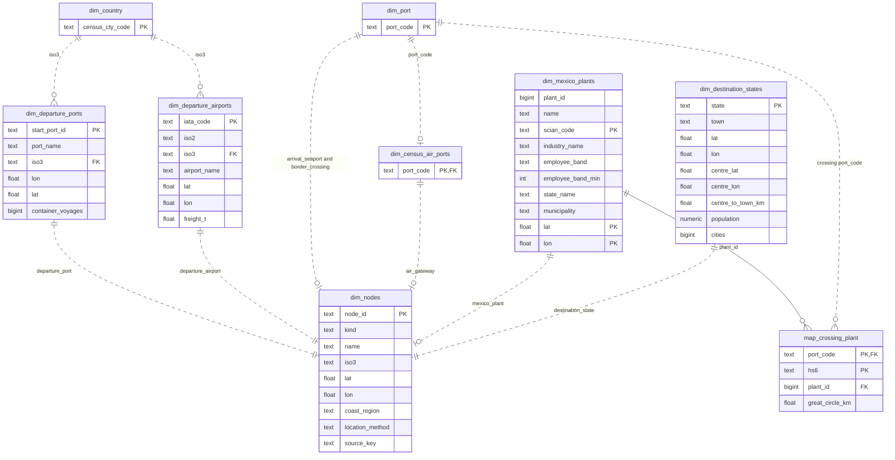
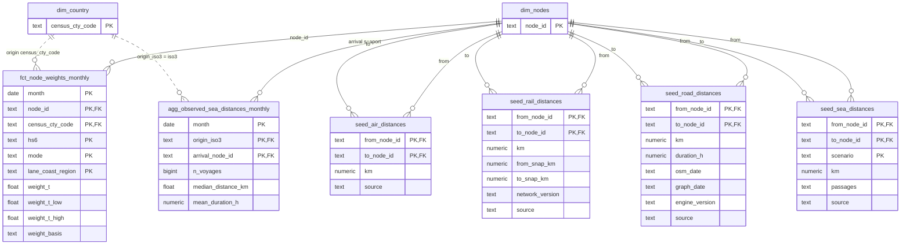

# Core Schema

Every table dbt builds in the `core` schema of the ShockT Climate database, and the distance seeds it loads into `raw`, with every column. Columns are as the models produce them; each table's purpose and column notes are in `data-pipelines/dbt/models/core/_core.yml` and `data-pipelines/dbt/seeds/_seeds.yml`, and the design is in the [data ingestion plan](plans/data-ingestion-pipelines.md). The `data-pipelines` README has a compact version of these diagrams.

**Reading the diagrams:** `PK` columns are a table's key (its uniqueness test), `FK` columns join another table. A solid line is a join a dbt relationships test enforces; a dotted line is a join the models use without one. A table that already appeared in an earlier diagram shows only its key.

When a model's columns, keys or joins change, update this file in the same pull request.

## Imports and weight ratios

Census imports at country, port, state and state-port grain, with the kg-per-dollar ratios and the Mexico overland estimate built on them. `dim_country`, `dim_port` and `dim_hs` are the hubs.

- `dim_country`: Census Schedule C countries with ISO3 and analysis region.
- `dim_hs`: HS-10 codes seen in the country-level data, with the cases they belong to.
- `dim_port`: Census Schedule D ports, each placed at a point (a US–Mexico crossing, a named airport, its GeoNames city or an airport in its municipality) and given a coast region by `coast_region`, the same rule as the Climate TRACE ports.
- `dim_census_air_ports`: Census ports with air imports of the case HS codes, each placed at an OurAirports airport by a scripted match: by airport name when the port name names an airport, else the nearest large airport within `air_ports.city_radius_km` (config/transforms.yaml) of the port's GeoNames city, else the nearest airport; a city GeoNames lacks is matched by airport municipality.
- `fct_imports_monthly`: Country-level imports by month, HS-10, country and mode, with Census's import charges (`charges_usd`: freight, insurance and other costs to the first US port; `other` is general minus air and vessel charges). Null for partitions loaded before charges were requested.
- `fct_import_duties_monthly`: Duty on country-level imports for consumption by month, HS-10 and country: consumption value, dutiable value and Census's calculated duty. Duty isn't reported by mode.
- `fct_imports_port_monthly`: Imports by month, HS-6, country, port of unlading and mode, with the port's coast region.
- `fct_imports_state_monthly`: Imports by month, HS-6, country, state of destination and mode.
- `fct_imports_state_port_quarterly`: Imports of all goods (no HS code) by quarter, state of destination, port of unlading, port of entry, country and mode (air and vessel only), from Census State/Port Imports, with the unlading port's coast region.
- `agg_air_vessel_kg_per_usd`: Kg per dollar of air and vessel imports by HS-6 and origin over the loaded months, and across all origins (`census_cty_code` null): the basis for estimating overland weight from value.
- `fct_mexico_overland_monthly`: Imports from Mexico across the land border by month, HS-6, border crossing and mode (truck, rail): Census overland value at each crossing, split by TransBorder's truck and rail shares for the chapter, with weight estimated from the code's kg per dollar in air and vessel shipments and a range from value-weighted percentiles across origins (plan section 7.3).

## Voyages, chokepoints and emission factors

Climate TRACE voyages and their lanes, PortWatch chokepoint transits (time series compared with the imports by month), and the emission factors the engine chooses from through `engine/config/leg_factors.yaml`.

- `dim_climatetrace_ports`: US arrival ports in the Climate TRACE voyages, rebuilt on every run: median coordinates of the voyages' end points, the most common port name, the coast region from the `coast_region` macro, and voyage counts (all ship types and container ships) for the loaded years and lanes.
- `fct_voyages`: Container-ship voyages (Climate TRACE) from the configured Asian origins and Mexico to US ports.
- `agg_voyage_lanes_monthly`: Container-ship voyages by start month, origin country and US coast region: voyage count, distance sailed, duration and CO2e.
- `fct_chokepoint_transits_daily`: Daily ship transits through the configured chokepoints (IMF PortWatch), by ship type, with estimated trade volume in metric tons (each ship's estimated payload share × deadweight tonnage).
- `fct_chokepoint_transits_monthly`: Monthly totals and daily means of chokepoint transits; a partial month has fewer `days_reported`.
- `ref_emission_factors`: Every freight emission factor per tonne-km in the UK government conversion factors and the EPA GHG Emission Factors Hub, in kg CO2e: tank-to-wheel, well-to-tank and well-to-wheel.

## Nodes

Every place a leg starts or ends. One model places each kind; `dim_nodes` combines them, keyed `kind:source_key`.

- `dim_departure_ports`: Climate TRACE start ports in the origin countries that container ships sailed from to the US, each at the median start point of its voyages.
- `dim_departure_airports`: Airports in the origin countries that flew freight to the US in BTS T-100, placed by IATA code and country with OurAirports.
- `dim_mexico_plants`: DENUE establishments in the case industries whose employee band starts at or above `mexico_sites.min_employees`, one per industry and location.
- `map_crossing_plant`: The nearest large plant, by great-circle distance, for each border crossing and HS-6 code with overland imports, among codes whose industries DENUE covers.
- `dim_destination_states`: US states of destination with case imports, each at the GeoNames town nearest the population-weighted centre of its cities.
- `dim_nodes`: Every place a leg starts or ends: departure ports and airports, US arrival seaports, air gateways and border crossings, Mexican plants and US destination states.

## Node weights and distances

How much case freight each node carries, and the distances between nodes. The `seed_*` tables are written by the `shockt ref` distance commands and load into `raw`.

- `fct_node_weights_monthly`: Case tonnage each node carries by month, origin country, HS-6 and mode, with a low–high range where the tonnage is estimated.
- `agg_observed_sea_distances_monthly`: Observed sea distance by month, origin country and US arrival seaport, from container voyages ending within `arrival_ports.voyage_radius_km` of the port.
- `seed_sea_distances`: searoute distances from departure ports to arrival seaports, per scenario (`shockt ref sea-distances`).
- `seed_air_distances`: Geodesic distances from departure airports to air gateways (`shockt ref air-distances`).
- `seed_road_distances`: openrouteservice heavy-vehicle distances for truck legs (`shockt ref road-distances`).
- `seed_rail_distances`: Shortest-track distances for rail legs on the BTS North American Rail Network (`shockt ref rail-distances`).
