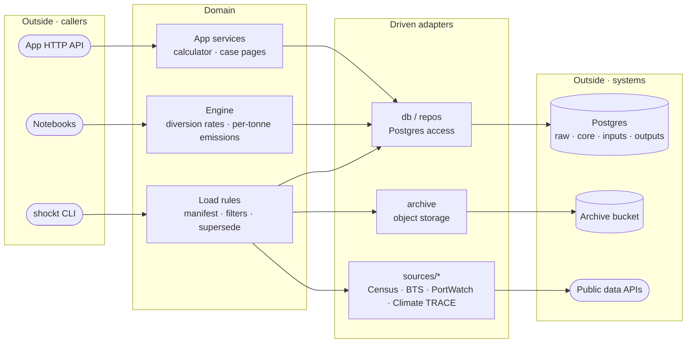

# Domain-Driven Design and Hexagonal Architecture

- **Status:** working agreement for ShockT Climate
- **Companions:** [Working Agreement](./working-agreement.md) (the rules in citable form), [Ubiquitous Language](./ubiquitous-language.md) (the vocabulary)

Where each kind of code belongs, and why the boundaries are drawn where they are. We borrow from domain-driven design selectively: hexagonal architecture plus the few DDD ideas that pay for themselves at our size. DDD is a toolkit, not a checklist.

---

## The shape

Read it left to right: **outside → adapter → domain → adapter → outside.** Every arrow points into the domain from callers and out of it toward infrastructure, never back. The domain knows nothing about the CLI or HTTP on its left, or Postgres and S3 on its right. That one-way property is the architecture.

The acceptance test comes from Alistair Cockburn's [Ports and Adapters](https://alistair.cockburn.us/hexagonal-architecture/): the application should be equally drivable by a user, a test, or a script, and equally able to run against real infrastructure or a stub. For us that means:

- **The engine must be usable from a notebook** with plain values in and plain values out, without a database or an HTTP server.
- **Loaders must be testable with an in-memory archive and recorded HTTP responses.** `tests/test_census_load.py` does this with `MemoryArchive`.

If a piece of logic can only be reached through a request handler or a live database, the boundary isn't real.

---

## Quick reference

| Term | Means |
|---|---|
| **Port** | A contract: what can be asked, with no commitment to how it's answered |
| **Adapter** | An implementation of a port against one specific technology |
| **Driving** | The outside calls in (CLI, HTTP API, notebook) |
| **Driven** | We call out (Postgres, object storage, public data APIs) |

**Where does this code go?**

1. Does it translate a CLI command, HTTP request or notebook call into a domain call? → **driving adapter** (`cli.py`, the app's API handlers). No business rules.
2. Is it a rule about the data or the calculation (filters, supersede semantics, diversion rates, emissions)? → **domain**.
3. Does it talk to a database, a bucket or an external API? → **driven adapter** (`db.py`, `archive.py`, `sources/*`, the app's repos).
4. None of the above and no substitution needed? → a plain function. Don't add a layer.

---

## Bounded contexts

A bounded context is a boundary within which a term means exactly one thing. Ours, and the contract each publishes:

| Context | Language | Writes | Reads | Published contract |
|---|---|---|---|---|
| **Data pipelines** (`data-pipelines/`) | Python, dbt | `raw`, `core` | Public data sources | The `core` schema |
| **Analysis** (`analysis/`, `inputs/`) | Notebooks, YAML | `inputs` (loaded by CI) | `raw`, `core`, `outputs` | The input file schema |
| **Engine** (`engine/`) | Python | `outputs` | `core`, `inputs` | The `outputs` schema |
| **App** (`app/`) | TypeScript, Effect | Nothing in the database | `inputs`, `outputs` | Its HTTP API |

**Contexts communicate through the database layers, never by importing each other's code.** The app doesn't import the engine; it reads `outputs`. The engine doesn't import loader code; it reads `core`. The app never reads `raw`. A change to a published schema (`core`, `inputs`, `outputs`) is a contract change and gets reviewed as one.

Isolation extends to credentials: each context connects with its own database role (`shockt_ingest`, `shockt_transform`, `shockt_analyst`, `shockt_app`), so a role's grants enforce the boundary rather than convention alone.

---

## Patterns worth naming

### Anti-corruption layer

An anti-corruption layer stops another system's model from leaking into ours. Every source loader is one: `sources/census_api.py` maps Census's columns, by name, into typed rows, treats `LAST_UPDATE = "0"` as text rather than a date, and fails the load on a value it can't parse. Census can add a column or reorder its response; the blast radius is one parser.

**Rule:** every upstream response is decoded through a parser or schema we own. Raw JSON never crosses into domain code. In Python that's typed parsing (pydantic, explicit conversion); in TypeScript it's Effect `Schema`.

### One emissions engine

All emissions numbers come from one Python package. Notebooks import it; CI runs it; the app reads its precomputed outputs and only multiplies by the user's tonnes. Reimplementing a factor or a distance calculation in TypeScript or in a notebook creates two answers to one question.

### Transactions are consistency boundaries

A load's manifest row and its data rows are one fact, so they're written in one transaction (`manifest.run_load`). If you want a transaction that spans two contexts, you've found a boundary error, not a transaction problem.

### Plain data, rules at the boundary

Our models are plain data with rules in functions, which looks like Martin Fowler's [AnemicDomainModel](https://martinfowler.com/bliki/AnemicDomainModel.html) anti-pattern. The critique assumes encapsulation is the only way to guarantee an invariant; types and decoding are the other way. A value that fails a schema never gets past the boundary, so nothing downstream has to re-check it. Scott Wlaschin's [_Domain Modeling Made Functional_](https://pragprog.com/titles/swdddf/domain-modeling-made-functional/) is the long version.

### Separate wire and storage types

The app's API schemas and its row models describe overlapping data and stay separate types on purpose. Collapsing them couples the API to the tables: the day you add a column you don't want to publish, the shared type breaks. Map between them explicitly at the repo boundary.

### Ubiquitous language

The vocabulary lives in [Ubiquitous Language](./ubiquitous-language.md). If a term is in that table, the code spells it that way; if the code needs a new term, add it there in the same PR. Our domain is partly ours to define ("diversion rate", "Carbon Delta"), so the vocabulary has to be written down and defended rather than discovered.

---

## Troubleshooting

**Symptom:** Engine or load-rule code imports `psycopg`, `boto3` or `httpx` directly.
**Fix:** Move the access into an adapter and pass the result in. The domain should run in a test without a database.

**Symptom:** The CLI or an API handler is growing conditionals and defaults.
**Fix:** Those are business rules. Move them into the domain call; the adapter only translates.

**Symptom:** The app needs a number the engine doesn't output.
**Fix:** Add it to the engine's `outputs`. Don't compute it in TypeScript.

**Symptom:** Two contexts need the same logic and importing feels easier.
**Fix:** Either it belongs to one context and the other reads its published output, or it's a small, stable, shared utility that needs an owner. "It was easier to import" isn't a third option.

---

## Reading list

1. Martin Fowler, [DomainDrivenDesign](https://martinfowler.com/bliki/DomainDrivenDesign.html) and [UbiquitousLanguage](https://martinfowler.com/bliki/UbiquitousLanguage.html): ten minutes, and they frame everything else.
2. Alistair Cockburn, [Hexagonal Architecture (Ports and Adapters)](https://alistair.cockburn.us/hexagonal-architecture/): the original, and short.
3. Netflix, [Ready for changes with Hexagonal Architecture](https://netflixtechblog.com/ready-for-changes-with-hexagonal-architecture-b315ec967749): the same idea with a worked example.
4. Scott Wlaschin, [_Domain Modeling Made Functional_](https://pragprog.com/titles/swdddf/domain-modeling-made-functional/): DDD without objects, the closest match to how we use schemas.
5. Eric Evans, [_Domain-Driven Design_](https://www.domainlanguage.com/ddd/) (2003) and Vaughn Vernon, _Implementing Domain-Driven Design_ (2013): the sources, when the short versions stop answering your question.
