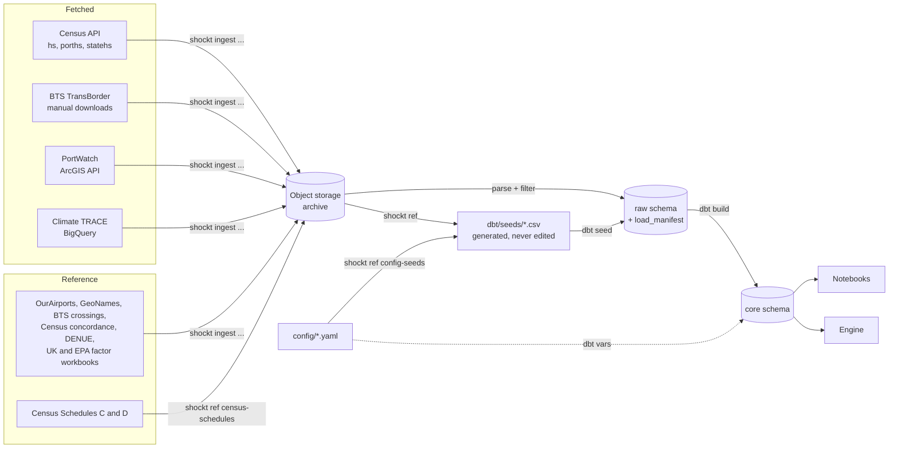

# Data Ingestion Pipelines: Technical Design

**Status:** Draft · **Workstream:** Data engineering · **Date:** 2026-10-08 · **Updated:** 2026-10-12

This plan covers getting source data into the `raw` and `core` layers of the ShockT Climate Postgres database: the fetched pipelines (Census, BTS TransBorder, IMF PortWatch, Climate TRACE) and the reference data (country and port codes, locations for ports, airports, crossings and assembly sites, emission factors, distances). It does not cover the `inputs` and `outputs` layers, the engine, or the app.

## 1. Decisions

| Area | Decision |
|---|---|
| Emission factors | One factor per mode, chosen by where the leg runs: UK government conversion factors 2026 for ocean and international air; EPA GHG Emission Factors Hub 2025 for North American truck and rail. Both workbooks are loaded whole and `core.ref_emission_factors` derives every factor (Section 6.1). GLEC pending a licence request. |
| Database | One Neon Postgres project in AWS us-east-2 on the free tier (1 GB Postgres storage, 100 compute-hours a month). Local Docker Postgres for development; a throwaway Postgres testcontainer per test session. |
| Archive | Neon Object Storage in the same project (S3-compatible, 5 GB on the free tier, separate from Postgres storage). Every downloaded source file is archived before it's parsed. |
| Layers in scope | `raw` (data as fetched) and `core` (cleaned, modeled tables). |
| Language and tooling | Python, managed with `uv`. `httpx` for HTTP, `polars` for parsing, `psycopg` for Postgres, `pydantic` for config validation, `typer` for the CLI, `tenacity` for retries. |
| Schema management | Alembic migrations (raw SQL inside each migration) for the `raw` schema, roles and grants. dbt (`dbt-core` + `dbt-postgres`) builds `core` from `raw`. |
| Running | A Python CLI (`shockt`), run by hand. One idempotent command per source. No orchestrator or schedule. |
| Refresh | Load once for the MVP. Each load records its source version in `raw.load_manifest`. |
| Adding cases | Adding HS codes to `config/hs_codes.yaml` and rerunning the loaders and `shockt build` regenerates everything downstream. Census loads are partitioned by month × HS prefix, so a new prefix fetches only that prefix. Staging reads only loads whose prefix is in the config, so a removed prefix drops out of `core` at the next build; `shockt loads retire` then deletes its rows from `raw` (the archive keeps its files). No prefix may start with another, so no row is loaded twice. |
| Nodes | **Planned.** Built by a dbt model (`dim_nodes`) from loaded data, including **every** port, airport, crossing and assembly site that carries case freight, weighted by volume; no top-N cutoff (Section 6.2). |
| Distances | **Planned.** Measured, never estimated with a detour factor: sea from Climate TRACE distance sailed and `searoute` for closed passages; road by the openrouteservice `driving-hgv` matrix; rail by shortest track on the BTS North American Rail Network; air per open question 12 (Section 6.3). |
| HS level | HS-10 from the `hs` endpoint; the port and state endpoints serve HS-6 at most (spike 1). `core` models at HS-6 and keeps HS-10 as a column where it exists. |
| Case codes | Set in `config/hs_codes.yaml`: HS-6 847150 (servers) for both cases; for Case 2's heavy electrical gear, liquid-dielectric transformers (850421, 850422, 850423), larger dry transformers (850433, 850434) and switchgear above 1,000 V (853720). Census's description of each code is in `core.dim_hs`. |
| Date range | `date_range` in `config/sources.yaml`: January 2022 through the latest month available at load time. Every loader honors both ends: monthly sources request only those months, and year-partitioned sources (PortWatch, Climate TRACE) archive the whole year and load only the rows inside the range. The resolved range is recorded per load. |
| Climate TRACE access | The public BigQuery dataset `trace-data-383422.climate_trace`, queried from a BigQuery sandbox project (no billing account). |
| Census State/Port file | The full quarterly files are archived; Postgres holds a filtered subset (Section 5.4). Only quarters entirely inside the date range load. |

## 2. Source access summary

| Source | Access | Auth | Grain | Weight available | Notes |
|---|---|---|---|---|---|
| Census imports by HS (`hs`) | REST API | API key (required on every data request) | Month × HS-10 × country | Air and vessel shipping weight | `api.census.gov/data/timeseries/intltrade/imports/hs` |
| Census imports by port (`porths`) | REST API | API key | Month × HS × country × port of unlading | Air and vessel | Includes `PORT_NAME` |
| Census imports by state (`statehs`) | REST API | API key | Month × HS × country × state of destination | Air and vessel | `STATE` is state of destination; `XX` = unidentified |
| Census State/Port Imports | Quarterly ZIP of fixed-width files | None | Quarter × state × port of unlading × port of entry × country, all goods | Air, vessel and containerized vessel | No HS code (Section 5.4) |
| BTS TransBorder | CSV/ZIP files | None, but scripted downloads return HTTP 403 | Month × state or port × HS-2 × mode × Canada/Mexico | Weight for imports by land modes only, not air or vessel | Manual download fallback (Section 5.5) |
| IMF PortWatch chokepoints | ArcGIS FeatureServer query API | None | Day × chokepoint | Vessel counts and capacity by ship type | Page size from the layer's `maxRecordCount` (1,000) |
| OurAirports | CSV download | None | Airport | n/a | Airport coordinates, by IATA code; public domain |
| GeoNames cities5000 | ZIP download | None | City (population ≥ 5,000) | n/a | City coordinates; CC BY 4.0 |
| BTS Border Crossing Entry Data | data.bts.gov API | None | Port of entry × month × measure | n/a | Crossing coordinates by Census port code |
| BTS T-100 International Segment (All Carriers) | TranStats download form (one scripted POST per year returns a ZIP) | None | Month × carrier × origin airport × destination airport × service class | Freight in pounds, all goods | Origin-airport shares for air legs (Section 5.8, question 15) |
| INEGI DENUE, manufacturing (sector 31–33) | ZIP download (57.6 MB) | None | Establishment | n/a | Mexican manufacturing establishments with industry (SCIAN), coordinates and employee band; INEGI free-use terms, attribution |
| Census import concordance | Excel download (yearly) | None | HS-10 | n/a | HS-10 → NAICS industry |
| UK government GHG conversion factors | XLSX download (flat file) | None | Factor row | n/a | Ocean and air freight factors, and fuel well-to-tank ratios (Section 6.1); Open Government Licence |
| EPA GHG Emission Factors Hub | XLSX download | None | Vehicle type; gas | n/a | North American truck and rail factors (Table 8) and GWPs (Table 11); public domain |
| Census Schedules C and D | Text and HTML downloads | None | Country; district and port | n/a | Census country and port code lists (Section 6) |
| Climate TRACE `shipping_voyages` | BigQuery public dataset | Google account + sandbox project | Voyage | Distance and emissions per voyage; no cargo tonnage | Port fields in generic `other*` columns (Section 5.7) |

The Climate TRACE REST API (`api.climatetrace.org/v7`) only serves shipping as annual totals per port. It has no voyages and no monthly data, so it isn't used.

## 3. Architecture



Config holds only declared choices (case HS codes, date range, origin regions, load filters, source URLs and versions). Everything a source publishes is fetched, archived and loaded; seeds are generated by `shockt ref` commands from config or archived sources. The distance generators (Section 6.3) are planned.

### 3.1 Repository layout

The pipelines live in their own Python project, `data-pipelines/`, next to the other parts of the monorepo:

```
shockt-climate/
  data-pipelines/   # this plan
  engine/           # emissions engine package (Python, later)
  analysis/         # notebooks (Python, later)
  inputs/           # YAML inputs
  content/          # case-study markdown
  app/              # React / TypeScript
  docs/
```

When `engine/` and `analysis/` exist, a uv workspace (a root `pyproject.toml` listing the Python projects as members) can give them one lockfile. Until then `data-pipelines/` is a standalone uv project. Every path in the rest of this plan is relative to `data-pipelines/`.

```
data-pipelines/
  pyproject.toml              # uv project; CLI entry point `shockt`
  compose.yaml                # Docker Postgres for development; tests use the same image
  .env.example                # MIGRATIONS_DATABASE_URL, DATABASE_URL, DBT_DATABASE_URL, NEON_S3_*, ARCHIVE_BUCKET, CENSUS_API_KEY, GCP_PROJECT_ID, BQ_MAX_BYTES
  config/
    hs_codes.yaml             # case HS prefixes
    origins.yaml              # origin regions in scope, by Census Schedule C code
    sources.yaml              # date range, source URLs and versions, load filters
    transforms.yaml           # settings dbt models read, passed in as dbt vars
  src/shockt/
    cli.py                    # typer app
    config.py                 # pydantic models for config/*.yaml (unknown keys fail)
    settings.py               # environment settings; .env takes priority over the shell
    db.py                     # connection, transactions, bulk COPY
    loading.py                # archive-then-parse load of one partition
    manifest.py               # load_manifest helpers: supersede, retire, list
    http.py                   # httpx client with retries and rate limiting
    archive.py                # boto3 client for Neon Object Storage; upload, checksum, fetch
    dbt.py                    # runs dbt with the connection and config vars
    months.py                 # month ranges for the date range
    origins.py                # ISO2 and ISO3 codes of the configured origins, from seed_census_countries
    sources/
      census_api.py           # hs, porths, statehs
      bts_transborder.py
      bts_t100.py             # T-100 International Segment, through the TranStats download form
      portwatch.py
      climatetrace.py
      reference.py            # OurAirports, GeoNames cities, BTS border crossings
      census_concordance.py   # Census HS-10 → NAICS import concordance
      denue.py                # INEGI DENUE establishments in the case industries
      ghg_factors.py          # UK conversion factors and EPA Hub workbooks, loaded whole
      census_state_port.py    # quarterly State/Port fixed-width files
    reference/
      config_seeds.py         # writes seed_hs_case_codes.csv from config
      census_schedules.py     # writes the Census country and port seeds
      sea_distances.py        # planned (Section 6.3)
      air_distances.py        # planned (Section 6.3)
  migrations/                 # Alembic: raw schema, roles, grants
  dbt/
    dbt_project.yml
    profiles.yml              # connection from DBT_* variables that `shockt` sets from DBT_DATABASE_URL
    seeds/                    # generated reference CSVs (Section 6)
    models/
      staging/                # stg_* views over raw (schema: core_staging)
      core/                   # core tables
    macros/                   # rules (coast_region, census_country_region, freight_mode, …) and generate_schema_name
    tests/                    # singular tests that pin rules to known cases
  data/manual/                # manually downloaded files (gitignored), e.g. BTS
  tests/
    fixtures/                 # small real samples of each source format
```

### 3.2 Load manifest and idempotency

Every fetch is a **load** of one **partition** of one dataset, for example `census_hs` for `2025-03:847150` (month × HS prefix). A load writes one `raw.load_manifest` row and its data rows in a single transaction.

- **Archive, then parse.** Each load first uploads what it fetched, unchanged, to the archive bucket at `raw/{dataset}/{partition}/{filename}`. That covers the Census JSON responses, the State/Port ZIPs, the BTS files, the PortWatch pages, and Climate TRACE query results as Parquet. The loader then parses the archived copy. The manifest records the object key and its SHA-256, so any `raw` row can be traced to the exact file it came from. Re-parsing a partition (for example with a wider filter) reads the archive instead of fetching again.
- **Rerunning a partition replaces it.** The new load inserts its rows, marks the earlier successful load `superseded`, and deletes the earlier load's data rows. The manifest keeps the history. Deleting superseded rows is a storage trade-off for the free tier: `raw` holds one copy per partition, and the manifest records what was replaced.
- **A failed load leaves nothing behind.** The transaction rolls back and a separate `failed` manifest row records the error.
- **A load whose partition left the config is retired.** `shockt loads retire --apply` deletes its data rows and marks it `retired` in one transaction; its archived file stays, so it can be reloaded if the config changes back.
- **Each load records** its parameters, its source version (which edition of the source it came from, as the source exposes it: the Climate TRACE release label, the PortWatch last-edited date, a `Last-Modified` header or the fetch time), the archived file's key and SHA-256, its row count and the git commit of the code. A reload from the archive keeps the version recorded when the file was archived.

```sql
CREATE SCHEMA raw;

CREATE TABLE raw.load_manifest (
  load_id         uuid PRIMARY KEY DEFAULT gen_random_uuid(),
  dataset         text        NOT NULL,             -- e.g. 'census_hs', 'portwatch_chokepoints'
  partition_key   text        NOT NULL,             -- e.g. '2025-03:847150', '2024', 'chokepoint2:2023', 'latest'
  params          jsonb       NOT NULL,             -- request parameters and filters applied
  source_version  text,                             -- release label, last-edited date, Last-Modified or fetch time
  status          text        NOT NULL CHECK (status IN ('running','succeeded','failed','superseded','retired')),
  row_count       integer,
  bytes_processed bigint,                           -- BigQuery only
  error           text,
  object_key      text,                             -- archived source file: raw/{dataset}/{partition}/{filename}
  object_sha256   text,
  code_version    text        NOT NULL,             -- git commit
  started_at      timestamptz NOT NULL DEFAULT now(),
  finished_at     timestamptz,
  superseded_by   uuid REFERENCES raw.load_manifest(load_id)
);

CREATE UNIQUE INDEX load_manifest_one_live_partition
  ON raw.load_manifest (dataset, partition_key) WHERE status = 'succeeded';
```

Every raw data table has `load_id uuid NOT NULL REFERENCES raw.load_manifest(load_id)`. Raw columns keep the source's field names in snake case and are typed (numbers as `bigint`/`numeric`, dates as `date`). Nothing is renamed, recoded or aggregated in `raw`. The only change is filtering, which is recorded in `params`.

#### Archive bucket

The archive is one bucket (`ARCHIVE_BUCKET`, default `shockt-raw-archive`) in the Neon project's object storage. Neon Object Storage speaks the S3 API, so `archive.py` uses `boto3` with Neon's branch endpoint, path-style addressing, and a Neon credential as the access key. It isn't an AWS bucket in our own account, so there's no AWS console or IAM. The settings use project-specific names (`NEON_S3_ENDPOINT_URL`, `NEON_S3_ACCESS_KEY_ID`, `NEON_S3_SECRET_ACCESS_KEY`, `NEON_S3_REGION`), and `archive.py` passes them to `boto3` explicitly. A developer's own `AWS_PROFILE`, `AWS_REGION` or `~/.aws` credentials therefore never reach the Neon endpoint.

Storage is branch-scoped like the database: a child branch sees its parent's files as of the fork, and its own writes stay on that branch. The team works off `main`, so all loads use `main`'s endpoint and credential.

### 3.3 Roles

The Alembic migrations create these roles and grants. Neon role creation may need its console or API; the migration then grants to existing roles.

| Role | `raw` | `core` |
|---|---|---|
| `shockt_ingest` | read and write | none |
| `shockt_transform` (dbt) | read | read and write |
| `shockt_analyst` | read | read |
| `shockt_app` | none | read (later the app reads `inputs` and `outputs` only) |

### 3.4 CLI

```
uv run alembic upgrade head                          # migrations, run by the database owner (MIGRATIONS_DATABASE_URL)
shockt ingest census [-d hs|porths|statehs] [--from 2022-01] [--to 2026-08] [--skip-existing] [--from-archive]
shockt ingest bts-transborder [--from-dir data/manual/bts] [--from …] [--to …] [--skip-existing] [--from-archive]
shockt ingest portwatch [--from 2022-01] [--to 2026-08] [--chokepoint …] [--skip-existing] [--from-archive]
shockt ingest climatetrace-voyages [--from 2022-01] [--to 2026-08] [--dry-run] [--skip-existing] [--from-archive]
shockt ingest census-state-port [--from 2022-01] [--to 2026-06] [--skip-existing] [--from-archive]   # whole quarters inside the range
shockt ingest bts-t100 [--from …] [--to …] [--skip-existing] [--from-archive]   # one year per form request
shockt ingest ourairports [--from-archive]
shockt ingest geonames-cities [--from-archive]
shockt ingest bts-border-crossings [--from-archive]
shockt ingest census-concordance [--year 2024 …] [--from-archive]
shockt ingest denue [--from-archive]                 # after census-concordance
shockt ingest uk-ghg-factors [--from-archive]        # UK conversion factors workbook, every row
shockt ingest epa-ghg-hub [--from-archive]           # EPA Hub Tables 8 and 11
shockt ref config-seeds                              # seed_hs_case_codes from config/hs_codes.yaml
shockt ref census-schedules                          # seed_census_countries and seed_census_ports
shockt ref sea-distances                             # seed_sea_distances, searoute, every scenario
shockt ref air-distances                             # seed_air_distances, geodesic
shockt ref road-distances [--from-archive KEY]       # seed_road_distances, openrouteservice (archived)
shockt ref rail-distances [--from-archive KEY]       # seed_rail_distances, BTS rail network (archived)
shockt loads list [--dataset …]                      # manifest summary and raw table sizes
shockt loads retire [--apply]                        # Census loads whose HS prefix left the config
shockt build                                         # dbt deps (first run) and dbt build, with the config vars
shockt dbt <command> …                               # any dbt command, with the config vars
```

The four distance commands read their node pairs from `core`, so they run after `shockt build`, and a second build loads their seeds (Section 6.3).

`--from` and `--to` default to `date_range` in `config/sources.yaml`. When the end month is unset there too, it resolves to the latest month the source has published, and the resolved value is stored in the manifest. `shockt build` and `shockt dbt` pass `config/transforms.yaml` and the regions of `config/origins.yaml` to dbt as vars; `dbt_project.yml` defines none, so running dbt without them fails.

## 4. Shared behavior

- **HTTP:** retries on transport errors, 429 and 5xx responses, with exponential backoff and jitter. Loaders send one request at a time, with no added delay. User agent: `shockt-climate/<version>`.
- **Config:** every section of `config/*.yaml` is parsed by a pydantic model that forbids unknown keys, so a misspelled or unread key fails the command instead of being ignored.
- **Validation:** each parser checks the shape and types of every row it reads (expected columns, numeric fields, the partition's period) and raises on anything unexpected, which fails the load. Partial loads are never committed.
- **Bulk insert:** rows are written with `COPY` through `psycopg`.
- **Secrets:** read from the environment (`.env` in development). `CENSUS_API_KEY` is never written to the manifest or into archived request metadata; `params` stores the request without it. The object storage secret is shown once by Neon when the credential is created, so it goes straight into `.env` or a password manager.
- **Object storage:** `boto3` runs in its standard retry mode (6 attempts), which retries the `503 SlowDown` Neon returns when it throttles heavy use.
- **Observability:** each command prints a one-line summary per partition (rows, duration), and `shockt loads list` reads the manifest.

## 5. Fetched pipelines

### 5.1 Census imports by HS (`census_hs`)

- **Endpoint:** `GET https://api.census.gov/data/timeseries/intltrade/imports/hs`
- **Request, one per month × HS prefix:** `get=I_COMMODITY,I_COMMODITY_SDESC,CTY_CODE,CTY_NAME,SUMMARY_LVL,GEN_VAL_MO,AIR_VAL_MO,AIR_WGT_MO,VES_VAL_MO,VES_WGT_MO,CNT_VAL_MO,CNT_WGT_MO,CON_VAL_MO,GEN_QY1_MO,UNIT_QY1,GEN_QY2_MO,UNIT_QY2,LAST_UPDATE&time=YYYY-MM&COMM_LVL=HS10&I_COMMODITY={prefix}*&key=...`. Each endpoint's deepest HS level (`COMM_LVL`) is a constant in `census_api.py`, not config.
- **Charges and duty** (built 2026-10-13). The request includes `GEN_CHA_MO,AIR_CHA_MO,VES_CHA_MO,CNT_CHA_MO,DUT_VAL_MO,CAL_DUT_MO`, and `raw.census_hs` the matching `bigint` columns (migration `0015`), for the [Cost Calculator](./cost-calculator.md). Only `hs` offers them; `porths` and `statehs` don't. Verified 2026-10-13: the same rows come back with the fields added, and they reconcile (Cost Calculator, Section 1). `RP` (rate provision) stays out, because it splits rows by provision and changes the grain. Responses archived before then don't hold the fields, so they arrive only with a reload from the API, not `--from-archive`; the parser reads the six as optional, so re-parsing an older archive loads them as null instead of failing.
- **Quantities:** `GEN_QY1_MO` with `UNIT_QY1` (for example a count of units) covers all modes combined. It isn't used for weight: weight per unit varies about fortyfold across origins for 847150, while weight per dollar is nearly constant (Section 7.3).
- **Partition:** month × HS prefix (`2025-03:847150`), one request per partition, so adding a case's HS codes fetches only the new prefixes and leaves existing loads and archives untouched. Applies to all three Census API endpoints. **Version:** the fetch time. `LAST_UPDATE` comes back as `"0"`, so it can't serve as a version.
- **Filter on load** (per endpoint in `config/sources.yaml`, recorded in the manifest `params` with the number of rows received): every endpoint drops country-group rows and rows whose values, weights and quantities are all zero; `porths` and `statehs` also keep only the origins in `config/origins.yaml` (`origins_only`) and the all-countries total. Unfiltered, one month of the three endpoints took 24.7 MB in Postgres, about 1.4 GB for 2022–2026; the archive keeps every response, so `--from-archive` can reload with a wider filter.
- **Rows:** the response includes country-group rows (`SUMMARY_LVL = 'CGP'`) and a world total (`CTY_CODE = '-'`). Raw keeps them, and `core` excludes them.
- **Prefix wildcards work** (spike 1): `I_COMMODITY=847150*` with `COMM_LVL=HS10` returns both HS-10 codes. One request per prefix per month. An HS-4 prefix at HS-10 can take about a minute (`8504*` returned 2,989 rows in 57 s), so the HTTP timeout is at least 5 minutes.


```sql
CREATE TABLE raw.census_hs (
  load_id            uuid    NOT NULL REFERENCES raw.load_manifest(load_id),
  time               text    NOT NULL,     -- 'YYYY-MM'
  i_commodity        text    NOT NULL,     -- HS-10
  i_commodity_sdesc  text,
  cty_code           text    NOT NULL,     -- Census Schedule C, 4 digits
  cty_name           text,
  summary_lvl        text,
  gen_val_mo         bigint,               -- USD
  con_val_mo         bigint,
  air_val_mo         bigint,
  air_wgt_mo         bigint,               -- kg
  ves_val_mo         bigint,
  ves_wgt_mo         bigint,               -- kg
  cnt_val_mo         bigint,
  cnt_wgt_mo         bigint,               -- kg, subset of vessel
  gen_cha_mo         bigint,               -- USD charges, all modes (migration 0015; null before)
  air_cha_mo         bigint,
  ves_cha_mo         bigint,
  cnt_cha_mo         bigint,               -- subset of vessel
  dut_val_mo         bigint,               -- dutiable value, imports for consumption
  cal_dut_mo         bigint,               -- calculated duty
  gen_qy1_mo         bigint,               -- quantity, all modes
  unit_qy1           text,                 -- unit of quantity 1
  gen_qy2_mo         bigint,
  unit_qy2           text,
  last_update        text,                 -- comes back as "0"
  PRIMARY KEY (load_id, time, i_commodity, cty_code)
);
```

### 5.2 Census imports by port (`census_porths`)

- **Endpoint:** `.../imports/porths`, with the same request shape as 5.1 plus `PORT,PORT_NAME`.
- **Partition:** month × HS prefix, as in 5.1.
- **HS-6 is the deepest level** (spike 1): `COMM_LVL=HS10` returns HTTP 204 (no content), even for an exact code. Requests use `COMM_LVL=HS6`; `comm_lvl` stays in the row in case Census adds detail later.
- **Total rows:** besides country groups (`SUMMARY_LVL = 'CGP'`) and the world total (`CTY_CODE = '-'`), each country has an all-ports total (`PORT = '-'`). Raw keeps them; `core` excludes them.

```sql
CREATE TABLE raw.census_porths (
  load_id            uuid    NOT NULL REFERENCES raw.load_manifest(load_id),
  time               text    NOT NULL,
  comm_lvl           text    NOT NULL,     -- 'HS6' (deepest level served)
  i_commodity        text    NOT NULL,
  cty_code           text    NOT NULL,
  cty_name           text,
  port               text    NOT NULL,     -- Schedule D district (2) + port (2)
  port_name          text,
  summary_lvl        text,
  gen_val_mo         bigint,
  air_val_mo         bigint,
  air_wgt_mo         bigint,
  ves_val_mo         bigint,
  ves_wgt_mo         bigint,
  cnt_val_mo         bigint,
  cnt_wgt_mo         bigint,
  last_update        text,
  PRIMARY KEY (load_id, time, i_commodity, cty_code, port)
);
```

### 5.3 Census imports by state of destination (`census_statehs`)

- **Endpoint:** `.../imports/statehs`, with the same request shape plus `STATE`. It supports the Case 2 inland-routing check: imports of the case HS codes by state of destination, by vessel and air. It loads all states.
- **Partition:** month × HS prefix, as in 5.1. **HS-6 is the deepest level**, as in 5.2.
- **Total rows:** besides country groups and the world total, each country has an all-states total (`STATE = '-'`). Raw keeps it; `core` excludes it, and `assert_state_weights_reconcile_with_country_totals` fails if a total row doubles the state sum.

```sql
CREATE TABLE raw.census_statehs (
  load_id            uuid    NOT NULL REFERENCES raw.load_manifest(load_id),
  time               text    NOT NULL,
  comm_lvl           text    NOT NULL,
  i_commodity        text    NOT NULL,
  cty_code           text    NOT NULL,
  cty_name           text,
  state              text    NOT NULL,     -- USPS code; 'XX' = unidentified
  summary_lvl        text,
  gen_val_mo         bigint,
  con_val_mo         bigint,
  air_val_mo         bigint,
  air_wgt_mo         bigint,
  ves_val_mo         bigint,
  ves_wgt_mo         bigint,
  cnt_val_mo         bigint,
  cnt_wgt_mo         bigint,
  last_update        text,
  PRIMARY KEY (load_id, time, i_commodity, cty_code, state)
);
```

### 5.4 Census State/Port Imports (`census_state_port`)

- **Download:** `https://www.census.gov/trade/downloads/additional/ISTPORT/ISTPORT{YY}Q{N}.ZIP` (`census_state_port.url_template`). Each ZIP holds one data file; its name changed from `IQ953_{YYYY}_Q{N}.dat` to `ISTPORT{YY}Q{N}.TXT` in 2026, so the loader reads whichever single file is inside. Every line is a 104-character record in the layout below, unchanged across 2022 Q1–2026 Q2; `state` is the two-letter postal code.
- **Format:** fixed width, per the [Census record layout](https://www.census.gov/foreign-trade/reference/products/layouts/istport.html):

| Position | Field | Description |
|---|---|---|
| 1–2 | `state` | State of destination |
| 3 | filler | |
| 4–5 | `district_unlading` | Customs district of unlading |
| 6–7 | `port_unlading` | Customs port of unlading |
| 8–9 | `district_entry` | Customs district of entry |
| 10–11 | `port_entry` | Customs port of entry |
| 12–15 | `country` | Country of origin (Schedule C) |
| 16 | `time_period` | Quarter `1`–`4` in quarterly files; `5` = annual |
| 17–28 | `value` | Total value |
| 29–40 | `air_val` | Air value |
| 41–52 | `air_swt` | Air shipping weight |
| 53–64 | `ves_val` | Vessel value |
| 65–76 | `cnt_val` | Containerized vessel value |
| 77–88 | `ves_swt` | Vessel shipping weight |
| 89–100 | `cnt_swt` | Containerized vessel shipping weight |
| 101–104 | `stat_year` | Statistical year |

- **Archive:** the full ZIP is archived unfiltered. Only the filtered rows below go into Postgres, so a wider filter later means re-parsing the archive, not downloading again.
- **Filter on load** (set in `config/sources.yaml` and recorded in `params`):
  - `country` in the origins in `config/origins.yaml`.
  - `state` in `census_state_port.states`: VA, GA, OH, CA, OR, WA, AZ, TX and IL, the destination states the case analyses look at. The list exists because every state doesn't fit in the free tier, not as an analytical grouping: which states a case compares, and how, is that case's decision, made in its analysis, not in `core`.
  - Rows where both `air_swt` and `ves_swt` are zero are dropped.
- **No overland mode:** the weight filter drops the overland-only rows, so overland value in the rows that remain is an unknown fraction of the total. `fct_imports_state_port_quarterly` therefore keeps air, vessel and containerized vessel only. Overland imports by destination state come from `census_statehs`, which keeps every row and has the HS code.
- **Partition:** quarter (`2024Q1`). **Version:** the file's `Last-Modified` header (Census republished the whole series on 2026-10-06); the manifest also records the archived file's SHA-256.
- **Quarters loaded:** those that fall entirely inside the date range, since a quarter can't be cut at a month. With the range's end open, quarters after the latest published one (a 404) are reported as not yet published; a quarter inside an explicit `--to` that returns 404 fails. 2026 Q2 is the latest published quarter as of 2026-10-12.
- **Validation:** every line is 104 characters and numeric where the layout says; `time_period` and `stat_year` must match the partition.
- **Size:** about 20,000 rows a quarter pass the filter (369,096 across 2022 Q1–2026 Q2), about 4.5 MB a quarter in Postgres with its index, so about 80 MB for the full range.
- **Each file holds one quarter, not the year to date** (spike 3). 2024 Q1 totals $755.6B and Q2 $812.2B, against roughly $3.2T of US goods imports a year, and only 52% of rows grow from Q1 to Q2. Each ZIP is about 2.2 MB (about 18.5 MB unzipped, ~175k rows).

```sql
CREATE TABLE raw.census_state_port (
  load_id            uuid    NOT NULL REFERENCES raw.load_manifest(load_id),
  stat_year          smallint NOT NULL,
  time_period        text    NOT NULL,
  state              text    NOT NULL,
  district_unlading  text    NOT NULL,
  port_unlading      text    NOT NULL,
  district_entry     text    NOT NULL,
  port_entry         text    NOT NULL,
  country            text    NOT NULL,
  value              bigint,
  air_val            bigint,
  air_swt            bigint,
  ves_val            bigint,
  cnt_val            bigint,
  ves_swt            bigint,
  cnt_swt            bigint,
  PRIMARY KEY (load_id, state, district_unlading, port_unlading, district_entry, port_entry, country)
);
```

### 5.5 BTS TransBorder Freight (`bts_transborder`)

- **What it adds:** truck and rail imports from Mexico with shipping weight. TransBorder captures weight for imports by land modes, not by air or vessel ([BTS](https://www.bts.gov/statistical-products/transborder-freight-data/north-american-transborder-freight-data-faqs)).
- **Commodity detail is HS-2 only** (`COMMODITY2`). Chapter 84 includes all computers, so TransBorder can't isolate 847150. TransBorder is an input, not its own fact: `fct_mexico_overland_monthly` (Section 7.3) takes overland value by crossing and case code from Census, and uses TransBorder only to split it into truck and rail. `dot3` gives each crossing's mode shares for the chapter; `dot2`'s national shares are the fallback. `dot2` and `dot3` are two breakdowns of the same totals and are never summed together.
- **Access (spike 4):** there's no API. data.bts.gov publishes only TransBorder dashboards and a national total (Monthly Transportation Statistics, `crem-w557`, value only), and bts.gov blocks scripted downloads with HTTP 403. One person downloads each month from the [raw data page](https://www.bts.gov/topics/transborder-raw-data) into `data/manual/bts/<Mon><YYYY>/` (e.g. `Jan2024/dot2_0124.csv`), and `--from-dir` archives the files before parsing. After that, anyone can reload from the archive.
- **Files:** one folder per month with three CSVs (`dot1`, `dot2`, `dot3`) and a header row. `dot1` is state × port with no commodity, so it isn't loaded. `dot2` and `dot3` give identical Mexico totals per mode, and every kept row has a weight, including air and vessel. `MONTH` is zero-padded (`01`).
- **Fields** (confirmed against January 2024): `TRDTYPE, USASTATE, COMMODITY2, DISAGMOT, MEXSTATE, CANPROV, COUNTRY, VALUE, SHIPWT, FREIGHT_CHARGES, DF, CONTCODE, MONTH, YEAR` in `dot2`; `dot3` has `DEPE` and no state columns. Codes: [BTS codes document](https://www.bts.gov/sites/bts.dot.gov/files/docs/browse-statistical-products-and-data/transborder-freight-data/220171/all-codes-north-american-transborder-freight-raw-data.pdf).
- **The chapter-level weight ratio is only a cross-check.** For servers it is far too heavy: chapter 84 imports from Mexico by truck average about 47 kg per $1,000 (2022 onward) because the chapter mixes servers with heavy machinery, against about 2.4–3.2 kg per $1,000 for servers' own air and vessel shipments. For the Case 2 electrical gear, chapter 85's 54 kg per $1,000 falls inside the range across origins.
- **Filter on load:** `TRDTYPE = 2` (imports), `COUNTRY` in the origins in `config/origins.yaml` (TransBorder's only one is Mexico), and `COMMODITY2` in the HS-2 chapters of every case code in `config/hs_codes.yaml` (today 84 for servers and 85 for the Case 2 electrical gear). Chapter 85 keeps Mexico's overland supply of Case 2 gear measurable, though Case 2's lanes don't use it.
- **Partition:** month, covering both `dot2` (state × commodity) and `dot3` (port × commodity); `source_table` records which. Each month's ZIP is archived unchanged at `raw/bts_transborder/{YYYY-MM}/transborder_{YYYY-MM}.zip`, with the downloaded file name in the manifest `params`. The month comes from the CSV names inside the ZIP (BTS's ZIP names vary: `Feb-2022.zip`, `sept2023.zip`, `February_2026.zip`), and every row's `YEAR`/`MONTH` must match it. Year-to-date (`dotN_ytd_MMYY.csv`), annual (`dotN_YYYY.csv`) and `dot1` files are ignored. About 775 rows a month are kept.
- **Browser downloads can be cut short:** 6 of 56 ZIPs arrived truncated. The loader checks each ZIP before loading and names any it can't read.

```sql
CREATE TABLE raw.bts_transborder (
  load_id         uuid    NOT NULL REFERENCES raw.load_manifest(load_id),
  source_table    text    NOT NULL,     -- 'dot2' or 'dot3'
  year            smallint NOT NULL,
  month           smallint NOT NULL,
  trdtype         smallint NOT NULL,    -- 2 = import
  usastate        text,                 -- dot2
  depe            text,                 -- dot3: port code
  commodity2      text    NOT NULL,     -- HS-2
  disagmot        smallint NOT NULL,    -- 1 vessel, 3 air, 4 mail, 5 truck, 6 rail, 7 pipeline, 8 other, 9 FTZ
  mexstate        text,
  country         text    NOT NULL,     -- 2010 = Mexico
  value           bigint,               -- USD
  shipwt          bigint,               -- kg
  freight_charges bigint,
  df              smallint,             -- domestic/foreign
  contcode        text                  -- containerized indicator
);
CREATE INDEX ON raw.bts_transborder (load_id);
```

### 5.6 IMF PortWatch chokepoint transits (`portwatch_chokepoints`)

- **Endpoint:** `https://services9.arcgis.com/weJ1QsnbMYJlCHdG/arcgis/rest/services/Daily_Chokepoints_Data/FeatureServer/0/query`
- **Request, one per chokepoint and year:** `where=portid='chokepoint2' AND year=2023`, `outFields=*`, `returnGeometry=false`, `orderByFields=date`, `f=json`, paged with `resultOffset` and `resultRecordCount` set to the layer's `maxRecordCount`, read from its metadata.
- **Fields:** daily ship counts (`n_*`) and estimated trade volume in metric tons (`capacity_*`) by ship type: container, dry bulk, general cargo, ro-ro, tanker. Volume is each ship's estimated payload share × its deadweight tonnage. There is no commodity or destination.
- **Chokepoints (config, by PortWatch ID):** `chokepoint1` (Suez Canal), `chokepoint2` (Panama Canal), `chokepoint4` (Bab el-Mandeb Strait), `chokepoint7` (Cape of Good Hope). Names come from PortWatch's `portname`.
- **Partition:** chokepoint × year (`chokepoint2:2023`); about 365 rows each, archived as one JSON bundle at `raw/portwatch_chokepoints/{portid}_{year}/responses.json`. The whole year is fetched and archived; only days inside the date range load, and the manifest `params` record the first and last month loaded. **Version:** the layer's `dataLastEditDate`. `--skip-existing` skips a partition only when its loaded months match the requested ones, and never skips the current year, which PortWatch keeps extending.
- **Errors arrive as HTTP 200** with an `error` object, so the loader checks every response body.
- **Core:** `fct_chokepoint_transits_daily` (day × chokepoint) and `fct_chokepoint_transits_monthly` (totals, daily means and `days_reported`).

```sql
CREATE TABLE raw.portwatch_chokepoints (
  load_id                 uuid    NOT NULL REFERENCES raw.load_manifest(load_id),
  object_id               bigint  NOT NULL,
  date                    date    NOT NULL,
  portid                  text    NOT NULL,
  portname                text,
  n_container             integer,
  n_dry_bulk              integer,
  n_general_cargo         integer,
  n_roro                  integer,
  n_tanker                integer,
  n_cargo                 integer,
  n_total                 integer,
  capacity_container      bigint,
  capacity_dry_bulk       bigint,
  capacity_general_cargo  bigint,
  capacity_roro           bigint,
  capacity_tanker         bigint,
  capacity_cargo          bigint,
  capacity                bigint,       -- estimated trade volume, metric tons (all ship types)
  PRIMARY KEY (load_id, portid, date)
);
```

### 5.7 Climate TRACE ship voyages (`climatetrace_voyages`)

- **Source:** `trace-data-383422.climate_trace.shipping_voyages`. Climate TRACE describes it as individual voyages with vessel identifiers (IMO/MMSI), voyage emissions, distances and port information, for domestic and international shipping ([BigQuery guide](https://media.climatetrace.org/Climate_TRACE_Big_Query_Data_8713215f81.pdf)). The data is licensed CC BY 4.0.
- **Access, confirmed:**
  - The BigQuery sandbox needs no billing account and gives the free tier's 1 TB of query processing a month and 10 GB of storage. Its own tables expire after 60 days, and DML and streaming are unavailable ([Google](https://cloud.google.com/bigquery/docs/sandbox)). None of those limits matter here, because results go straight to Postgres.
  - Querying a public dataset is billed to the querying project. Climate TRACE pays for storage only.
- **Setup:** create a GCP project in sandbox mode. Run `gcloud auth application-default login`, then set `GCP_PROJECT_ID`.
- **Cost guard:** BigQuery bills by bytes scanned in the selected columns. A `WHERE` on dates reduces bytes only if the table is partitioned on that column. Every query therefore:
  1. Runs as a **dry run** first, and the CLI prints the bytes it would scan.
  2. Aborts if the estimate exceeds `BQ_MAX_BYTES` (default 100 GB).
  3. Runs with `maximum_bytes_billed` set to the same cap, so BigQuery refuses anything larger.
  4. Selects only the needed columns, never `SELECT *`.
  5. Records `bytes_processed` in the manifest.
- **Result download:** use the standard REST result pages (`create_bqstorage_client=False`). The BigQuery Storage Read API is billed separately, so the loader doesn't use it.
- **Archive:** each query's result is archived as Parquet, so `raw` can be rebuilt without spending BigQuery quota again.
- **Table (spike 5, release `v5_11_0`, modified 2026-09-24):** 266.8 million voyages, 130 GB, partitioned by year on `start_date`, not clustered. Two models are mixed: OceanMind (`asset_identifier` `om-imo-…`) and Global Fishing Watch (`gfw-imo-…`, or `gfw-mmsi-…` for ships without an IMO number), with different ship-type names (`container` vs. `cargo.container`). A check on 2026-10-12 found no IMO number under both models, and no MMSI-identified container voyage matching an IMO-identified one on route and timing, so voyages aren't double-counted.
- **Columns.** The port and voyage fields are in generic `other*` columns with no definitions in BigQuery; their meanings below were read from sample voyages and checked where possible:

  | Column | Meaning | How we know |
  |---|---|---|
  | `activity` | Distance sailed, nautical miles | **Confirmed**: Kaohsiung → Long Beach voyages show 6,268–6,468 nm against `searoute`'s 6,191 nm shortest path |
  | `CO2_emissions_factor` | t CO2 per nautical mile | **Confirmed**: factor × `activity` is within 2% of the voyage's emissions |
  | `total_CO2e_100yrGWP` | Voyage emissions, t CO2e (100-year GWP) | Column name |
  | `other1` | Duration, `d.hh:mm:ss` | Matches `end_date − start_date` |
  | `other2` / `other3` | Start / end port name (e.g. `Kaohsiung`, `Port of Long Beach,CA`) | Sample values |
  | `other4` / `other5` | Start / end port country, ISO3 | Sample values |
  | `other6` / `other7` | Start / end port ID | Sample values |
  | `other8` | International voyage flag | Inferred: `true` on international, `false` on domestic samples |
  | `other9` / `other10` | Start / end exclusive economic zone | Sample values |
  | `capacity` | Probably gross tonnage | Inferred from ship sizes; unconfirmed |
  | `other11` | Probably deadweight tonnage | Inferred from ship sizes; unconfirmed |
  | `capacity_factor`, `other12` | Unknown | Not used until Climate TRACE confirms |

- **Lane volume:** the full load for the 42-country origins (2022 to July 2026) has 56,428 voyages to US ports across all ship types, 12,741 by container ships; `core` keeps container ships whose end point doesn't contradict their end port (12,739). Widening the origins from 12 countries added only about 2,000 voyages: nearly all US-bound traffic from Asia starts in the original 12.
- **Query size:** the full extraction for 2022 onward scans 29.5 GB (6.7 GB for one year), about 3% of the free monthly 1 TB. Partition pruning on `start_date` works.
- **Filter:** `start_date` in the date range's years, `other5 = 'USA'` (the product's scope, a constant rather than config), `other4` in the ISO3 codes of the origins in `config/origins.yaml`, looked up in `seed_census_countries` (Census Schedule C). All ship types.
- **Partition:** calendar year of `start_date`, matching the table's partitioning. A year costs the same to scan whole or in part, so the whole year is queried and archived; only voyages starting inside the date range load, and the manifest `params` record the first and last month loaded. `--skip-existing` skips a year only when its loaded months and origin countries both match the request, so widening the origins reloads every year. **Version:** the table's `release` label.

Raw keeps the source column names, including `other*`; staging renames them using the meanings above.

**Built:** migration `0006` creates the raw table below. `shockt ingest climatetrace-voyages` passes values as query parameters, dry-runs each year (5.9–7.0 GB per full year, 29.5 GB in total) and archives the result as Parquet at `raw/climatetrace_voyages/{year}/voyages_{year}.parquet`, with the query, release label and bytes scanned in the file metadata; the manifest records `bytes_processed`. Duplicate (`asset_identifier`, `start_date`) rows are dropped. `stg_climatetrace_voyages` names the `other*` columns and flags `end_point_contradicts_end_port`: a voyage labeled as arriving in the US whose recorded end point the `coast_region` rule can't place in any US region. Such a voyage is excluded from `fct_voyages` and from the port locations. The first full load found 2 of 12,741 container voyages like this (a Singapore departure labeled "Manhattan, NY" that sailed 154 nm to Port Klang, Malaysia, and a "Tacoma" arrival whose end point is in the Philippines); voyages with no recorded end point are kept. `assert_contradicting_end_points_within_limit` fails if the flagged share of container voyages exceeds `climatetrace.max_contradicting_end_point_share` (`config/transforms.yaml`), so a systematic problem in a new release surfaces instead of being filtered away. and `fct_voyages` keeps container ships by the `is_container_ship` rule (`container` from OceanMind, `cargo.container` from Global Fishing Watch). `dim_climatetrace_ports` places each US arrival port from the voyages' own coordinates: the source `location` is a two-point line from start port to end port, and migration `0007` loads its end points (`start_lon`, `start_lat`, `end_lon`, `end_lat`, adding 7.3 GB to the full extraction, 36.8 GB in total). The model takes each port ID's median coordinates (from voyages whose end point doesn't contradict their end port) and most common name, assigns a coast region with the `coast_region(lon, lat)` macro (Hawaii, Alaska and Puerto Rico `noncontiguous`; Pacific `west`; Texas to Florida's west coast `gulf`; Atlantic `east`; the Great Lakes and the rest of the contiguous interior `inland`; no coordinates `unknown`; anything no rule matches `other`), and counts voyages. It rebuilds on every run, so new years, lanes or ports are classified automatically; `assert_coast_region_rules` pins the macro to known ports, and `assert_no_container_ports_in_other_region` fails the build if a port classed `other` has container voyages, so a gap in the rules surfaces instead of being absorbed into a region. `agg_voyage_lanes_monthly` (month × origin country × US coast region) is built.

```sql
CREATE TABLE raw.climatetrace_voyages (
  load_id                    uuid        NOT NULL REFERENCES raw.load_manifest(load_id),
  start_date                 timestamptz NOT NULL,
  end_date                   timestamptz,
  asset_identifier           text        NOT NULL,   -- e.g. om-imo-9347566
  model_number               text,
  asset_name                 text,
  iso3_country               text,                   -- flag state
  type                       text,                   -- ship type
  capacity                   double precision,
  capacity_factor            double precision,
  activity                   double precision,       -- distance sailed, nautical miles
  co2_emissions_factor       double precision,       -- t CO2 per nautical mile
  co2_emissions              double precision,
  total_co2e_100yrgwp        double precision,
  other1                     text,                   -- duration
  other2                     text,                   -- start port
  other3                     text,                   -- end port
  other4                     text,                   -- start port country (ISO3)
  other5                     text,                   -- end port country (ISO3)
  other6                     text,                   -- start port ID
  other7                     text,                   -- end port ID
  other8                     boolean,                -- international voyage (inferred)
  other11                    double precision,       -- deadweight tonnage (inferred)
  other12                    double precision,       -- unknown
  original_inventory_sector  text,
  start_lon                  double precision,       -- start and end points of `location` (migration 0007)
  start_lat                  double precision,
  end_lon                    double precision,
  end_lat                    double precision,
  PRIMARY KEY (load_id, asset_identifier, start_date)
);
```

### 5.8 BTS T-100 International Segment (`bts_t100_segments`)

- **Download:** TranStats has no file download or API for this table, so the loader uses its download form (`bts_t100.form_url` in `config/sources.yaml`). It reads the form's hidden ASP.NET fields from a GET, then posts them back with the year, all months, every country and the requested fields; the response is a ZIP holding `T_T100I_SEGMENT_ALL_CARRIER.csv` and `Documentation.csv`. The page nests a search form inside the download form, so the loader tracks forms by depth. A year the form's year menu doesn't offer is not published yet. A response that isn't a ZIP fails the load.
- **Partition:** calendar year, archived whole; rows outside the date range are dropped at parse. The source version is the latest month in the file (`data through 2026-07` on 2026-10-12), since the form gives no release date.
- **Filters** (recorded in the manifest): origin airports in the configured origin countries (`origins_only`, by ISO2 code from `seed_census_countries`), and segments that carried freight (`drop_rows_without_freight`). Census-specific ISO2 codes (Gaza Strip `GZ`, West Bank `WE`) match no T-100 country.
- **Grain:** month × carrier × airport pair × service class × aircraft type and configuration. The source repeats some rows exactly (95 of 108,860 in 2024), so each row is keyed by its line in the file.
- **Measured** 2026-10-12: 2026 to July is 64,589 rows, of which 4,225 are freight from the origin countries; 2024 keeps about 7,600 of 108,860.

```sql
CREATE TABLE raw.bts_t100_segments (
  load_id               uuid              NOT NULL REFERENCES raw.load_manifest (load_id),
  line_number           integer           NOT NULL,
  year                  smallint          NOT NULL,
  month                 smallint          NOT NULL,
  unique_carrier        text              NOT NULL,
  origin_airport_id     integer           NOT NULL,   -- BTS airport ID, stable across code changes
  origin                text              NOT NULL,   -- IATA code
  origin_country        text              NOT NULL,   -- ISO2
  origin_wac            integer           NOT NULL,
  dest_airport_id       integer           NOT NULL,
  dest                  text              NOT NULL,
  dest_country          text              NOT NULL,
  dest_wac              integer           NOT NULL,
  aircraft_group        smallint          NOT NULL,
  aircraft_type         smallint          NOT NULL,
  aircraft_config       smallint          NOT NULL,
  class                 text              NOT NULL,   -- service class
  departures_performed  double precision  NOT NULL,
  freight               double precision  NOT NULL,   -- pounds
  mail                  double precision  NOT NULL,   -- pounds
  distance              double precision  NOT NULL,   -- miles
  PRIMARY KEY (load_id, line_number)
);
```

`stg_bts_t100_segments` converts freight and mail to tonnes (1 lb = 0.45359237 kg).

## 6. Reference data

Reference data reaches the database in two ways, both reproducible from the repo:

- **Loaded into `raw`** by `shockt ingest`, archived like any other source: OurAirports, GeoNames cities, BTS Border Crossing Entry Data, the Census import concordance, INEGI DENUE, and the UK and EPA emission factor workbooks.
- **Seeds** in `dbt/seeds/`, loaded with `dbt seed` into `raw` as `raw.seed_*`. **Every seed is generated by a `shockt ref` command** from config or an archived source; none is edited by hand (see `CLAUDE.md`, Data Provenance, and `dbt/seeds/README.md`).

| Seed | Command | Input | Columns |
|---|---|---|---|
| `seed_hs_case_codes` | `shockt ref config-seeds` | `config/hs_codes.yaml` | `hs_prefix, cases, source` |
| `seed_census_countries` | `shockt ref census-schedules` | Census Schedule C; ISO3 via `pycountry`, and for Census-specific ISO2 codes, `census_schedules.iso3_overrides` in `config/sources.yaml` (Gaza Strip and West Bank → PSE). A Census code with neither, such as Kosovo, has no ISO3 | `census_cty_code, cty_name, iso2, iso3, source` |
| `seed_census_ports` | `shockt ref census-schedules` | Census Schedule D | `port_code, port_name, district_code, source` |
| `seed_sea_distances`, `seed_air_distances` | planned (Section 6.3) | `dim_nodes` port pairs and `searoute` | |
| `seed_road_distances` | planned: `shockt ref road-distances` (Section 6.3) | `dim_nodes` road pairs and an archived openrouteservice matrix response | |
| `seed_rail_distances` | planned: `shockt ref rail-distances` (Section 6.3) | `dim_nodes` rail pairs and the archived BTS North American Rail Network Lines | |

Rules applied to reference data live in dbt macros or models, each with a test pinning it to known cases.

`dim_country` and `dim_port` combine the Census lists with any code seen in the loaded data and flag codes missing from the published lists. `dim_country` applies `census_country_region`, which `shockt build` generates from `config/origins.yaml` (Asia is Schedule C's `5` block, from the Middle East to Japan; Mexico is `2010`); `assert_census_region_rules` pins it to known countries. `dim_port` places each port at a point and classifies it with the same `coast_region(lon, lat)` rule as the Climate TRACE ports, so one tested rule assigns every coast region. The point comes, in order, from the port's US–Mexico crossing in BTS Border Crossing Entry Data; the OurAirports airport its Schedule D name names ("LOS ANGELES INTL AIRPORT"); its city in GeoNames, in the port's state ("SAVANNAH, GA"); or an airport in its state whose municipality is the city, for cities GeoNames lacks ("SAN JUAN, PR", "NEW YORK, NY"). A port with no point gets `unknown`; `assert_census_ports_located` fails if those ports carry more than `census_ports.max_unlocated_share` (`config/transforms.yaml`) of case vessel or air tonnage, and `assert_no_case_ports_in_other_region` fails if a port with case vessel or air tonnage matches no coast rule. Whether a port is a land border crossing is its own column, `is_border_crossing`, from the BTS crossing data, not a region; the trade mode says whether freight came by land. The World Port Index was considered for port coordinates but blocks scripted downloads.

### 6.1 Emission factors

Factors are loaded whole, not selected. `shockt ingest uk-ghg-factors` and `shockt ingest epa-ghg-hub` archive the two workbooks pinned under `emission_factors` in `config/sources.yaml` (URL, version, publication page) and load every row into `raw`:

| Raw table | From |
|---|---|
| `raw.uk_ghg_conversion_factors` | UK DESNZ conversion factors 2026, flat file, sheet "Factors by Category": every row, with its ID, Level 1–4, Column Text, unit, GHG unit and factor |
| `raw.epa_ghg_transport_factors` | EPA GHG Emission Factors Hub 2025, Table 8: every vehicle type and unit |
| `raw.epa_ghg_gwp` | The same workbook, Table 11: every gas's 100-year GWP |

`core.ref_emission_factors` holds every freight factor per tonne-km from both sources, in kg CO₂e, split into tank-to-wheel (fuel burned), well-to-tank (producing and delivering the fuel) and their sum, well-to-wheel. Each rule below is a dbt macro or model with a test:

- **UK factors:** the `Freighting goods` rows in tonne-km and kg CO₂e that have a published value (the UK leaves some blank, such as 0%-laden HGVs). Each is paired with its well-to-tank row, which the UK file keeps under `WTT- delivery vehs & freight` with the same labels and `WTT- ` before Level 2. A test fails unless every freight row has exactly one pair.
- **EPA factors:** the short ton-mile rows of Table 8. CO₂ plus CH₄ and N₂O weighted by the Table 11 GWPs, converted at 1 short ton-mile = 0.90718474 t × 1.609344 km. EPA covers combustion only, so well-to-tank is tank-to-wheel × the UK ratio for the vehicle's fuel: well-to-tank ÷ combustion per litre, from the UK `WTT- fuels` and `Fuels` rows. The `epa_vehicle_fuel` macro names the fuel each EPA vehicle burns (truck and rail: `Diesel (100% mineral diesel)`); a vehicle without a fuel gets no well-to-wheel value. Mineral diesel because EPA counts fossil CO₂ only, while the UK biofuel-blend rows reflect the UK's own blend.
- **Mode:** the `freight_mode` macro maps the UK Level 2 and the EPA vehicle type to `ocean`, `air`, `truck` or `rail`.
- **Columns:** `source`, `source_row_id`, `mode`, `variant` (the source's labels, joined), the three factors, `wtt_method`, the well-to-tank source row and the `load_id`s.

**Why two sources:** the EPA Hub reflects the US truck and rail fleet, and its rail factor is well below the UK's. The EPA has no ocean container or international air factors, which the UK set has, with size classes and radiative-forcing variants.

**Which factor a leg uses** is a declared choice of the emissions method, so it belongs to the engine: `engine/config/leg_factors.yaml` names each mode's factor by its attributes, not the sources' labels. This pipeline publishes every factor with those attributes; the engine chooses.

```yaml
leg_factors:
  ocean:
    source: uk_desnz
    vehicle_type: container_ship
    size_class: average
  air:
    source: uk_desnz
    vehicle_type: freight_flight
    haul: international
    radiative_forcing: true
  truck:
    source: epa_hub
    vehicle_type: medium_heavy_duty_truck
  rail:
    source: epa_hub
    vehicle_type: rail
```

- **Structured columns:** `core.ref_emission_factors` gains `vehicle_type`, `size_class`, `haul` and `radiative_forcing`, set from the source labels by a tested macro (for example UK `Cargo ship / Container ship / Average` → `container_ship`, `average`; `Freight flights / International, to/from non-UK / With RF` → `freight_flight`, `international`, with radiative forcing). The macro names every label it knows; a dbt test fails if a freight row gets no `vehicle_type`, so a new label in a future workbook needs a decision. The joined `variant` label stays for display.
- **Validation:** the engine's config model checks each value against the vocabulary (`container_ship`, `international` and so on), so a typo fails when config loads; `select_factors` fails if a mode's settings match no factor with a well-to-wheel value, or several, and its tests pin the committed choices.
- **Lookup:** the engine (`shockt_engine.select_factors`) takes each leg's mode, picks the one factor matching its settings, and fails if none or several match. A leg in a mode with no settings is an error, so a new leg type needs a decision before it gets a number.
- **The current choices:** ocean, the UK container-ship average; air, the UK international factor with radiative forcing (the method page shows it without alongside); truck, the EPA medium- and heavy-duty truck; rail, the EPA rail factor. Changing one, such as dropping radiative forcing, is a one-word config edit.
- **Ocean legs use the container-ship average.** The UK factors vary about threefold by ship size class (container capacity in TEU), and no source we load gives a ship's TEU, so every ocean leg uses the fleet average.
- **Licences:** UK factors under the Open Government Licence (attribution required); EPA factors are US government works in the public domain.

### 6.2 Nodes

**Built.** Nodes are the places that distances are measured between, built by dbt from loaded data, not declared. One model per kind places them (`dim_departure_ports`, `dim_departure_airports`, `dim_mexico_plants` with `map_crossing_plant`, `dim_destination_states`, and the existing `dim_port` and `dim_census_air_ports`), and `dim_nodes` combines them with `node_id` = kind and source key (e.g. `arrival_seaport:2704`, `departure_airport:TPE`). Checked against the loaded data on 2026-10-13: 441 nodes, 100 departure ports, 108 departure airports, 52 arrival seaports, 104 air gateways, 19 crossings, 7 plants and 51 states. The weights are in `fct_node_weights_monthly` (month × node × origin × HS-6 × mode, with a low–high range where estimated); checked read-only on 2026-10-13, air tonnage agrees across departure airports, gateways and states (about 539,700 t) and vessel across departure and arrival ports (about 931,000 t). It includes every node that carries case freight, with a volume weight, so lane distances can be volume-weighted averages and the long tail contributes little. When HS codes or cases change, the nodes and weights change with them.

| Kind | Which nodes | Coordinates | Weight |
|---|---|---|---|
| Asian and Mexican departure ports | Every Climate TRACE start port in an origin country with container voyages to the US (`dim_departure_ports`) | Median voyage start point | Two steps: each origin country's case vessel tonnage to a US coast region (`fct_imports_port_monthly`), spread across its start ports in proportion to their container voyages to that region over the loaded months; an origin with no voyages to the region uses its voyages to every region (7% of vessel tonnage, e.g. India and Taiwan to the Gulf). `weight_basis` records which |
| US arrival seaports | Every Census port of unlading with case vessel imports from an origin country | `dim_port` | Case vessel tonnage per origin country (`fct_imports_port_monthly`). Climate TRACE end ports are not nodes: container voyages supply the observed sea distance to each Census port (Section 6.3) |
| US air gateways | Every Census port with air imports of the case HS codes | OurAirports airports in the US and its territories (Schedule C's `1000` and `9` block, from `seed_census_countries`) of the types in `air_ports.airport_types`, with scheduled service if `air_ports.scheduled_service_only` (`config/transforms.yaml`), by a scripted match in `dim_census_air_ports`: by airport name when the port name names an airport, else the nearest large airport within `air_ports.city_radius_km` of the port's GeoNames city, in any state. Unmatched ports are dropped; a dbt test fails if they carry more than `air_ports.max_unmatched_share` of air tonnage. All these settings are in `config/transforms.yaml` | Air tonnage |
| Asian and Mexican departure airports | Every airport in an origin country with freight to the US in BTS T-100 International Segment (`raw.bts_t100_segments`, Section 5.8) | OurAirports, by IATA code | The airport's share of its country's freight to the US that month, all goods |
| Mexico–US border crossings | Every crossing with overland imports of the case codes in `fct_mexico_overland_monthly` | BTS Border Crossing Entry Data, by Census port code (`dim_port`) | Estimated truck and rail tonnage of the case codes (`fct_mexico_overland_monthly`) |
| Mexican assembly sites | For each Mexico–US border crossing and HS-6 code it carries, the **nearest large plant** by great-circle distance: DENUE establishments in the code's industries (its HS-10 codes → NAICS via the Census concordance → DENUE industries matched at 5 digits, for the cases in `reference_sources.denue.cases`) whose employee-size band starts at or above `mexico_sites.min_employees` (`config/transforms.yaml`, 251), read by the `employee_band_min` macro. Establishments at the same industry and coordinates count once. A crossing and code with no large plant gets no Mexican leg, and a warning lists it (`warn_crossings_without_a_plant`) | DENUE coordinates | None of their own: the leg from the plant to the crossing carries the crossing's tonnage of the code (`fct_mexico_overland_monthly`) |
| US destination states | Every state with case imports in `census_statehs` | The GeoNames town nearest the population-weighted centre of the state's cities (`dim_destination_states`) | Case tonnage by state **per origin country and mode**, not pooled across them: air and vessel weight as Census reports it; overland (`other`) weight estimated as value × kg per dollar by the rule `fct_mexico_overland_monthly` uses, applied per origin: the origin's own air and vessel kg per dollar for the code when those shipments reach `overland_weight.min_air_vessel_value_usd`, else the all-origins ratio; the low–high range from the all-origins percentiles (`agg_air_vessel_kg_per_usd`), widened to include the estimate when the origin's own ratio falls outside them (China's server ratio is about twice the all-origins band). Tonnage in the unidentified state `XX` has no destination node and is left out, with a warning |

- **Destination limits:** state of destination is where the importer says the goods are going, which can be an integrator or distributor rather than a data center (Texas's share of Mexico's servers may partly be distributors near the border), and a state's population centroid is not its data-center market (Virginia's is not at Ashburn). Against a cross-country inland leg the error is modest, and it applies equally to the baseline and to a shock.
- **Overland isn't only Mexico:** Asian goods that enter over a land border (through Canada or Mexico) are `other` too: $1.44B of the case codes since 2022, Taiwan $0.83B of it, against Mexico's $290.0B. The per-origin ratio covers them.
- **Why destinations aren't pooled:** Census gives `statehs` no weight for overland imports, and Mexico's servers arrive almost entirely overland (2022 onward: $277.9B overland against 5,129 t by air), so a pooled air-and-vessel weight would give the Mexico lane about 1% of the weight. Its destinations also differ: Texas takes 73% of Mexico's overland server value, while Asian air imports spread across the air-gateway states.
- **Arrival port limits:** Census ports are placed at their city (`dim_port`), often 25–40 km from the container terminals (downtown Los Angeles is 34 km from the San Pedro terminals). That is small against inland legs of thousands of kilometres and sea legs of about 10,000 km. Matching Climate TRACE end ports to Census ports was considered and set aside: distance alone pairs the Port of Los Angeles terminals with Long Beach, names in Climate TRACE are unreliable, and neighbouring ports in one metro area have nearly the same distances, so nothing is gained by splitting their tonnage.
- **Departure port limits:** Census doesn't record the foreign port, so within a country the ports are weighted by container voyages of any cargo, a deliberate approximation. Across countries the weight is case tonnage: by voyages alone Mexico would carry 23.8% of the weight against 0.3% of case vessel tonnage, and Korea 22.5% against 51.7%.
- **Country of origin, not of departure:** Census `CTY_CODE` is where goods were made, so goods transshipped through Hong Kong, Singapore or Busan are placed at the ports and airports of the country that made them. For air, T-100 counts Hong Kong's freight under Hong Kong, so Chinese-made goods flown from HKG are placed at Chinese airports instead. HKG is 6.4–7.8% farther than China's T-100 airport mix from the five largest US gateways (great-circle, checked 2026-10-12); that is the ceiling if all of it left through HKG, and the bias always shortens China's air legs. Case 1's Taiwan lane is unaffected (TPE only). Pooling Hong Kong's airports with China's would be a declared config choice; it isn't made, because Hong Kong's freight also includes its own exports and other countries' transshipments.
- **Departure airport limits:** T-100 counts all goods, so a product's departure airports can differ from its country's mix (Chinese electronics may leave from Shenzhen or Guangzhou more than the country mix suggests). T-100 records each flight's last nonstop segment, which for Asia is often Anchorage; the origin airport is still the foreign one, and the leg runs to the Census gateway.
- **Airport match limits:** OurAirports has no traffic figures, so a city port gets the large airport nearest the city centre, which is not always the cargo gateway (Chicago gets Midway, not O'Hare; Dallas/Fort Worth gets Love Field). Within the match radius the difference is small against an air leg.
- **Crossing-anchored Mexican legs:** the tonnage of the Mexican leg is measured where it crosses (`fct_mexico_overland_monthly`); DENUE only says where the goods plausibly start, and no source links a plant to a crossing (TransBorder's `MEXSTATE` is blank on imports from Mexico in `dot1`, `dot2` and `dot3`; it is filled only for US exports). Weighting sites by employees was rejected: headcount is not output, and the bands are wide. The rule that reads a band's lower bound from its label (`"251 y más personas"` → 251) is a function in code with a test.
- **The Mexican leg is a lower bound.** Starting at the nearest large plant assumes border assembly. That holds where the plants sit at the crossing (Ciudad Juárez, 67% of overland server tonnage, plants within 11 km) and understates the leg where goods come from the interior: Laredo (30%) starts at Apodaca, 201 km away, while the Monterrey, Guadalajara and Mexico City plants average about 740 km in straight line. At the EPA truck factor that is up to about 86 kg CO₂e per tonne on Laredo's tonnage, about 6% across overland servers; small beside air (about 1,035 kg per tonne per 1,000 km). The bias always understates the Mexico route, and the method page says so. Rules that assign interior plants to crossings were considered and set aside: each needed thresholds tuned to one industry's geography, with no data to check them against.
- **DENUE caveats:** it records establishments, not their products or customers; a computer plant may not make servers. Only Case 1's codes select industries (847150 → NAICS 33411, computer and peripheral equipment manufacturing), which keeps out industries the Case 2 headings brought in, such as ceramics through 8504.
- **Industry level:** DENUE's SCIAN and the concordance's NAICS are matched at 5 digits (`industry_digits`), the industry level at which the US, Canada and Mexico agreed a comparable classification; manufacturing isn't among the exceptions ([2022 NAICS Manual](https://www.census.gov/naics/reference_files_tools/2022_NAICS_Manual.pdf); [Statistics Canada, three-country comparability](https://www.statcan.gc.ca/en/subjects/standard/manual2002)).
- **DENUE load filter:** only the HS prefixes of the cases in `reference_sources.denue.cases` (Case 1, whose route runs through Mexican assembly) select industries. The loader reads those industries from `raw.census_import_concordance` (every loaded year) and records them in the manifest `params`, so the concordance loads first. After an HS code change, `shockt ingest denue --from-archive` re-filters the archived ZIP.

### 6.3 Distances

**Built.** Every generator measures the node pairs that carry freight from a common origin in `fct_node_weights_monthly` (`reference/node_pairs.py`), pairing the modes that connect: departure port → arrival seaport (sea), departure airport → air gateway (air), seaport, gateway or crossing → destination state in the mode each carries, and plant → crossing (road, rail). Each writes a seed whose rows record their method and source version; the seeds' tests warn when a seed names a node that no longer exists, meaning it needs regenerating. Settings are under `distances` in `config/sources.yaml`. Observed sea distances come from Climate TRACE's distance sailed: for each origin country and Census arrival port, the typical distance of the container voyages from that country whose end point lies within a configured radius of the port (`arrival_ports.voyage_radius_km` in `config/transforms.yaml`: 50 km, within which 98.4% of case vessel tonnage has voyages), built as `agg_observed_sea_distances_monthly`. A voyage can count for two nearby ports (Los Angeles and Long Beach), which then get nearly the same distance. A port with no such voyage falls back to the `searoute` open-route distance from the origin's departure ports, and a column records which source each distance came from. Counterfactual sea distances (Panama or the Red Sea closed) come from `searoute`, a Python library, so they're computed outside dbt for every observed port pair and each scenario, and written to a seed by `shockt ref sea-distances`. Air distances (`shockt ref air-distances`) between air nodes are geodesic distances on the WGS84 ellipsoid from `geographiclib`, with no uplift, because the UK air factors already include one (open question 12). Origin airports are the T-100 departure airports (Sections 5.8 and 6.2).

`shockt ref sea-distances` uses `searoute` (tested at 1.6.0), which supports closing passages through `restrictions`. Kaohsiung → Savannah, for example, measures:
- 19,813 km with all passages open
- 22,876 km with Panama closed
- 26,021 km with Panama and Bab el-Mandeb closed

Each run writes the `searoute` version into every row, with the passages the route crosses. The scenarios (`open`, `panama_closed`, `red_sea_closed`, `panama_and_red_sea_closed`) are config, checked against the passage names `searoute` itself has. Generated 2026-10-13: 2,554 port pairs × 4 scenarios; air: 5,345 airport pairs.

**Road and rail distances are measured on networks**, not estimated from straight-line distance with a detour (circuity) factor:

- **Road: `shockt ref road-distances`** sends the road node pairs (nearest large plants → crossings; crossings, seaports and air gateways → destination states) to the [openrouteservice](https://openrouteservice.org) matrix endpoint with the `driving-hgv` (heavy goods vehicle) profile, archives each JSON response and writes `seed_road_distances` from the archived copy. Distances are along the route the profile finds fastest, and are kept for each direction, since one-way roads make them differ (Laredo crossing → Norfolk 2,733.7 km, back 2,743.4 km, measured 2026-10-12).
  - **Version:** every response carries `metadata.engine` (`version`, `graph_date`, `osm_date`); the load records them as its source version, and each seed row carries `osm_date`. A rerun on a newer graph is a new recorded version, like a Census revision.
  - **Key and quota:** `ORS_API_KEY` in `.env`, read through `Settings`. The live quota is in the response headers (`x-ratelimit-limit`, `x-ratelimit-remaining`); the generator stops with an error when it would exceed what remains rather than retrying. One matrix request takes every location for one batch of pairs.
  - **Licence:** routes are built from OpenStreetMap data under the ODbL; each response's `metadata.attribution` ("openrouteservice.org | OpenStreetMap contributors") is shown wherever the distances are.
  - **Why hosted:** the OSRM demo server forbids building distance tables, and self-hosting a router for a network spanning Mexico and the US needs a North America extract (14.5 GB) and tens of GB of memory to build. Pointing the generator at a self-hosted router later changes only its endpoint.
- **Rail: `shockt ref rail-distances`** archives the BTS [North American Rail Network Lines](https://catalog.data.gov/dataset/north-american-rail-network-lines) (US, Mexico and Canada; a US government work), builds a graph of its segments with lengths in metres, snaps each rail node to the nearest network vertex and writes the shortest-track distance per pair to `seed_rail_distances`.
  - **Limit:** shortest track is not necessarily the route a railroad runs; accepted for the MVP.
  - **Checks:** a pair whose end snaps farther than `distances.rail.max_snap_km` (150) from track, or has no connecting path, gets no rail distance; the command lists them. Each row records both snap distances, so the engine can add the drayage.
  - **Checked live** on 2026-10-13 (dry run, not archived): the bundle is 12.3 MB gzipped and takes about 19 minutes, mostly downloading about 280 pages; the connected network has 238,869 rail nodes (lines and nodes last edited 2026-07-22). 2,563 pairs get a distance (Laredo → Virginia 2,818 km, → Georgia 1,992 km; largest snap 114 km, Nevada); 244 don't, all to or from places off the connected network (Alaska, Hawaii and island seaports such as Honolulu and San Juan).
  - **Batching (road):** each family of pairs (plant → crossing; crossing, seaport and gateway → state) is requested as a grid of origins × destinations, at most 3,500 cells per request, so the whole run is four requests. Checked live on 2026-10-13: the plant legs return in one request (Juárez plants 10–11 km by road to their crossings; Apodaca → Laredo 423 km).

## 7. `core` schema (dbt)

Every table and column, with keys and joins, is drawn in [Core Schema](../core-schema.md).

`core` is built by dbt. Staging models (`stg_*`) are views in `core_staging` that rename, cast and filter one raw table each. Every staging model reads only rows whose load is `succeeded`; the Census staging models also read only loads whose HS prefix is in `config/hs_codes.yaml`. Core models are tables. `macros/generate_schema_name.sql` makes dbt write to `core` and `core_staging` exactly.

### 7.1 Conventions

- **Units:** weight in tonnes (`weight_t = kg / 1000`), value in USD, distance in km, emissions in t CO2e.
- **Month:** `month date` set to the first of the month.
- **Mode:** one long-format column (`air`, `vessel`, `vessel_containerized`, `other`; `truck` and `rail` in `fct_mexico_overland_monthly`) instead of one column per mode, which suits the diversion-rate calculation. `vessel_containerized` is a subset of `vessel` and is never summed with it.
- **Excluded from core:** Census country-group rows (`SUMMARY_LVL = 'CGP'`), world totals (`CTY_CODE = '-'`), all-ports totals (`PORT = '-'`) and all-states totals (`STATE = '-'`).
- **Lineage:** every core fact row carries the `load_id` it came from.

### 7.2 Dimensions

```sql
-- core.dim_country
census_cty_code   text PRIMARY KEY,
cty_name          text NOT NULL,
iso3              text,
region            text NOT NULL,           -- a region of config/origins.yaml, or other
missing_from_schedule boolean NOT NULL     -- a code seen in the data but not in Schedule C

-- core.dim_port
port_code         text PRIMARY KEY,        -- district (2) + port (2)
port_name         text,
district_code     text NOT NULL,
state             text,                    -- from the Schedule D name
is_border_crossing boolean NOT NULL,       -- a US–Mexico crossing in BTS Border Crossing Entry Data
lat, lon          double precision,        -- the port's point (see Section 6)
location_method   text NOT NULL,           -- border_crossing | airport_name | geonames_city | airport_municipality | unmatched
coast_region      text NOT NULL,           -- coast_region(lon, lat), or unknown without a point
named_airport_iata, municipality_airport_iata text,  -- airport matches, reused by dim_census_air_ports
city_lat, city_lon double precision,       -- the port's GeoNames city, reused by dim_census_air_ports
missing_from_schedule boolean NOT NULL     -- a code seen in the data but not in Schedule D

-- core.dim_hs
hs10              text PRIMARY KEY,
hs6               text NOT NULL,
hs4               text NOT NULL,
description       text,
cases             text[] NOT NULL          -- cases whose HS prefix this code matches
```

### 7.3 Facts

```sql
-- core.fct_imports_monthly            grain: month × hs10 × country × mode
month date, hs10 text, hs6 text, census_cty_code text, mode text,
value_usd bigint, weight_t numeric,        -- weight null for `other`, which Census doesn't weigh
weight_method text,                        -- 'reported' | null; Mexico's overland weight is in fct_mexico_overland_monthly
load_id uuid
charges_usd bigint                         -- freight, insurance and other charges to the first US port; `other` = general − air − vessel; null before the fields were requested

-- core.fct_import_duties_monthly      grain: month × hs10 × country
month date, hs10 text, hs6 text, census_cty_code text,
consumption_value_usd bigint, dutiable_value_usd bigint, calculated_duty_usd bigint, load_id uuid

-- core.fct_imports_port_monthly       grain: month × HS-6 × country × port × mode
month date, hs6 text, census_cty_code text, port_code text, mode text,
value_usd bigint, weight_t numeric, weight_method text, load_id uuid, coast_region text

-- core.fct_imports_state_monthly      grain: month × HS-6 × country × state × mode
month date, hs6 text, census_cty_code text, state text, mode text,
value_usd bigint, weight_t numeric, weight_method text, load_id uuid

-- core.fct_imports_state_port_quarterly   grain: quarter × state × port of unlading × port of entry × country × mode (air, vessel, containerized vessel; all goods)
quarter date, state text, unlading_port_code text, unlading_coast_region text,
entry_port_code text, census_cty_code text, mode text, value_usd bigint, weight_t numeric,
load_id uuid

-- core.fct_mexico_overland_monthly    grain: month × HS-6 × border crossing × mode (truck, rail)
month date, hs6 text, port_code text, mode text,
value_usd numeric,                         -- the crossing's Census overland value for the code × the mode's TransBorder share
weight_t numeric, weight_t_low numeric, weight_t_high numeric,
weight_method text,                        -- 'estimated_value_ratio'
ratio_source text,                         -- 'origin' (Mexico's own air and vessel ratio) | 'all_origins'
kg_per_usd numeric, kg_per_usd_low numeric, kg_per_usd_high numeric,
split_source text,                         -- 'crossing' (dot3) | 'district' (dot3 DDXX row) | 'national' (dot2)
load_id uuid, transborder_load_id uuid

-- core.fct_chokepoint_transits_daily  grain: day × chokepoint
date date, chokepoint_id text, chokepoint_name text,
n_container, n_dry_bulk, n_general_cargo, n_roro, n_tanker, n_cargo, n_total int,
container_t, dry_bulk_t, general_cargo_t, roro_t, tanker_t, cargo_t, total_t bigint,  -- estimated trade volume, metric tons
load_id uuid

-- core.fct_chokepoint_transits_monthly   monthly sums and daily means of the above

-- core.fct_voyages                    grain: container-ship voyage (Asia or Mexico → US)
asset_identifier text, model_source text, started_at timestamptz, start_month date, ended_at timestamptz,
vessel_name text, start_port text, start_iso3 text, origin_region text, end_port text, end_port_id text,
end_coast_region text, distance_nm float, distance_km float, duration_h numeric, co2e_t float,
co2e_t_per_km float, load_id uuid

-- core.agg_voyage_lanes_monthly       grain: month × origin country × US coast region
month date, origin_iso3 text, origin_region text, end_coast_region text, n_voyages int,
total_distance_km float, mean_distance_km float, median_distance_km float, mean_duration_h numeric,
total_co2e_t float, co2e_t_per_km float

-- core.ref_emission_factors        every UK and EPA freight factor per tonne-km (Section 6.1)
```

**Built:** `dim_country`, `dim_port`, `dim_hs`, `dim_census_air_ports`, `dim_climatetrace_ports`; the node locations `dim_departure_ports`, `dim_departure_airports`, `dim_mexico_plants`, `map_crossing_plant`, `dim_destination_states` and `dim_nodes` (Section 6.2); `fct_imports_monthly`, `fct_imports_port_monthly`, `fct_imports_state_monthly`, `fct_imports_state_port_quarterly`, `fct_mexico_overland_monthly`, `agg_air_vessel_kg_per_usd`; `fct_chokepoint_transits_daily` and `_monthly`; `fct_voyages`, `agg_voyage_lanes_monthly`; `ref_emission_factors`. Every Census fact unpivots air, vessel, containerized vessel and `other` (general imports value minus air and vessel value; overland for Mexico and Canada) with the `unpivot_modes` macro, except `fct_imports_state_port_quarterly`, which keeps no `other` (Section 5.4), and drops rows with neither value nor weight; `weight_method` is `reported` wherever Census gives a weight.

**Planned:**

- `dim_nodes` (Section 6.2) and the distance tables (Section 6.3). Inland legs will be built from the nodes; they have no separate source.

**`fct_mexico_overland_monthly`.** Census weighs only air and vessel imports, and Mexico ships almost everything overland: 99% of its servers ($278B, 2022 onward). The overland trade is built from three inputs:

| Input | Gives |
|---|---|
| Census `porths`: Mexico's `other` rows (general imports value minus air and vessel value) at ports with `dim_port.is_border_crossing` | Overland value by month × HS-6 case code × crossing. Of Mexico's $278B in overland servers, $277.7B is recorded at 15 crossings (Ysleta, Laredo and Santa Teresa carry most of it). |
| Census `hs`: air and vessel shipments of the same HS-6 code from every origin | kg per dollar, and its range across origins |
| BTS TransBorder `dot3` (crossing × chapter × mode), with its district rows and `dot2` (national) as fallbacks | The truck and rail shares of each crossing's value for the chapter that month |

For each month × HS-6 × crossing, the overland value is split into `truck` and `rail` in proportion to the crossing's TransBorder truck and rail value for the chapter that month. TransBorder's other land codes are left out of the shares: code 9 records entry through a foreign trade zone, a customs status rather than a mode (BTS codes document), and mail, pipeline and "other" are negligible for these chapters. Goods entered through a foreign trade zone still crossed by truck or rail, so they take the crossing's truck and rail shares. Each mode's value gets an estimated weight from value, because for these codes shipped weight tracks value far more closely than unit count: across origins, 847150's weight per unit varies about fortyfold while its weight per dollar stays within about 2.4–3.2 kg per $1,000 (China, at about 6, is the exception).

- **Ratio:** kg per dollar of the code's air and vessel shipments over the loaded date range, at HS-6 (from `fct_imports_monthly`'s `air` and `vessel` rows; `vessel_containerized` is a subset and isn't added). Mexico's own ratio when its air and vessel shipments of the code reach `overland_weight.min_air_vessel_value_usd` (`config/transforms.yaml`, starting at $50M); otherwise the ratio across all origins. Mexico's servers use Mexico's own ratio (about $1.9B of air and vessel shipments); Mexico ships the Case 2 gear almost entirely overland, so those codes use the all-origins ratio. `ratio_source` records which.
- **Weight (`weight_method = 'estimated_value_ratio'`):** value × the ratio.
- **Range (`weight_t_low`, `weight_t_high`):** value × the value-weighted percentiles of the ratio across origins that reach the minimum: order those origins by kg per dollar, and take the ratio of the first origin whose cumulative share of the code's air and vessel value reaches each percentile in `overland_weight.range_percentiles` (`config/transforms.yaml`, 5th and 95th). A plain lowest-to-highest range was tried first and rejected: for servers, two small origins just over the minimum (the United Arab Emirates and Indonesia, shipping $200–300 units) set the high end at about 11 times the estimate. With the percentiles, the servers' band is 2.5–3.1 kg per $1,000 (1.3 times, bracketing Mexico's 2.8), and the transformer and switchgear codes keep spreads of about 1.4–7 times, because their few large origins genuinely differ. When the origin's own ratio falls outside the band, the range is widened to include it, so the estimate always lies inside its range (`assert_node_weight_ranges_ordered`); for Mexico nothing changes today, since its server ratio sits inside the band. Any analysis that uses an estimated weight shows its range.
- **Split:** the crossing's own `dot3` truck and rail shares for the chapter and month; else its district's `dot3` row (`21XX`); else `dot2`'s national shares. `split_source` records which. Today every row uses the crossing's own shares (Section 9).
- **Tests:** low ≤ weight ≤ high on every row; truck + rail equals the Census overland value for each month × code × crossing (within $1), so every Census row is split; every case code has at least one origin whose air and vessel shipments reach the minimum, so every code has a range. Checked against the loaded data before the first build (2026-10-12): 2,936 rows, all split at their own crossing, none outside its range.
- **Not changed:** `fct_imports_monthly` keeps Mexico's `other` rows with value and no weight. Mexico's overland tonnage is the sum of this fact; it differs from the country total by the overland value Census records at non-crossing ports (about $0.2B for servers) and by suppression.

### 7.4 dbt tests

**Built:**

- **Uniqueness:** `unique` and `not_null` on each fact's grain columns, with a `dbt_utils.unique_combination_of_columns` test per fact.
- **Relationships:** facts to `dim_country`, `dim_port` and `dim_hs`. The dimensions add any code seen in the data and flag it `missing_from_schedule`, so a code the Census lists lack shows up as a flag, not a gap.
- **Accepted values:** `mode`, `coast_region`, `location_method`, emission factor `source` and `mode`. Values that come from config (origin regions) are checked by `assert_regions_are_configured_origins`, so a config change doesn't break a hard-coded list.
- **Rules pinned to known cases:** `assert_coast_region_rules`, `assert_census_region_rules`, `assert_census_port_coast_regions`, `assert_epa_vehicle_fuels_match_loaded_vehicles`, `assert_container_ship_rule`, `assert_us_territories_from_schedule_c`.
- **Coverage:** `assert_census_ports_located` and `assert_air_ports_unmatched_share_within_limit` bound the tonnage at ports that can't be placed; `assert_contradicting_end_points_within_limit` bounds the Climate TRACE container voyages excluded for an end point that contradicts their end port; `assert_no_case_ports_in_other_region` and `assert_no_container_ports_in_other_region` fail when a port matches no coast rule.
- **Reconciliation:** per month × HS-6 × country, air and vessel weight summed over ports (a warning) and over states (an error; it matched exactly on 2026-10-12) is within 1% or 1 tonne of `fct_imports_monthly`, for the configured origins. Overland (`other`) value summed over states matches the same value summed over ports within 1% or $1 (`assert_state_overland_value_reconciles_with_ports`, an error; exact on 2026-10-12): value, not estimated tonnage, since both sides would use the same ratio.

**Built** with the node weights: `assert_departure_weights_reconcile` (departure splits keep every tonne), `assert_node_weight_ranges_ordered`, and warnings, not errors, about tonnage that has no node and is left out of the weights (`warn_origins_without_departure_ports`, `warn_origins_without_departure_airports`, `warn_mexico_overland_outside_crossings`, `warn_unidentified_state_tonnage`, `warn_crossings_without_a_plant`, `warn_departure_airports_not_placed`). The first four warn only when the gap passes a limit in `config/transforms.yaml`, and then list what's behind it, so a routine build ends without warnings: `departure_nodes.max_unplaced_share` (1% of case vessel or air tonnage; 0.0005% and 0.006% on 2026-10-13), `overland_weight.max_non_crossing_share` (5% of a code's Mexican overland value; 1.25% at most, transformers) and `destination_states.max_unidentified_share` (1% of state-level tonnage; 0.0001%). Each lane's distance is a weighted average over the nodes it has, so a small gap changes nothing; a lane the engine needs with no distance is an error in the engine, the same as a leg type with no factor. **Built:** `assert_census_charges_and_duty_reconcile` (general charges ≥ air plus vessel charges, containerized ≤ vessel charges, dutiable value ≤ consumption value; an error). **Planned:** `vessel_containerized` weight ≤ `vessel` weight; a freshness warning when a core table's newest month is more than 4 months old.

## 8. Storage budget (Neon free tier)

The free tier allows 1 GB of Postgres storage and, separately, 5 GB of object storage per project. All figures are estimates to check after the first loads. `shockt loads list` reports table sizes via `pg_total_relation_size`.

### Postgres (1 GB)

`shockt loads list` reports every raw table's size; it, not this plan, is the current figure. Measured on Neon on 2026-10-12, after the full load, retiring the HS-4 loads and `VACUUM FULL`: the database is 141 MB, about 14% of the limit. `raw` is 121 MB: `climatetrace_voyages` 42 MB (56,428 voyages, all ship types), `census_import_concordance` 31 MB (2022–2026), `census_porths` 11.5 MB, `census_statehs` 10.3 MB, `bts_transborder` 5.7 MB, `uk_ghg_conversion_factors` 4.7 MB, `census_hs` 4.4 MB, `portwatch_chokepoints` 3.6 MB, and every other table under 2.5 MB. `core` is 16 MB. Loading `census_state_port` (Section 5.4) adds about 80 MB; `bts_t100_segments` (Section 5.8) keeps about 7,600 rows a year, a few MB.

If Postgres grows past 750 MB, trim in this order:

1. Restrict `porths` and `statehs` to the configured origins instead of all countries (done).
2. Retire loads whose HS prefix left the config (`shockt loads retire --apply`), then `VACUUM FULL` the affected tables as the database owner: a `DELETE` frees space for reuse but doesn't shrink the table on disk.
3. Make the large core facts dbt views instead of tables.

### Object storage (5 GB)

| Archived files | Estimated size |
|---|---|
| Census API JSON responses (3 datasets × ~55 months) | ~200 MB |
| Census State/Port ZIPs (~18 quarters, about 2.2 MB each) | ~40 MB |
| BTS TransBorder files | ~100 MB |
| BTS T-100 ZIPs (~5 years, about 1.2 MB each) | < 10 MB |
| PortWatch pages | < 10 MB |
| Climate TRACE query results (Parquet) | ~50 MB |
| Reference downloads (DENUE ZIP 57.6 MB, GeoNames, OurAirports, concordance workbooks, UK and EPA factor workbooks) | ~100 MB |

The archive comes to roughly 0.5 GB, about a tenth of the allowance. These are estimates; the bucket's own usage is the current figure.

## 9. Spikes and open questions

Each spike is a short task with a written result, completed before the pipeline it affects is built.

| # | Question | Affects | How to answer |
|---|---|---|---|
| 1 | Does `I_COMMODITY` accept a prefix wildcard? What is the deepest HS level `porths` and `statehs` serve? | 5.1–5.3 | **Answered:** wildcards work on all three endpoints; `hs` serves HS-10, `porths` and `statehs` HS-6 at most (HS-10 returns HTTP 204). |
| 2 | What are the HS-10 codes under 847150, and does any of them isolate AI servers? | `seed_hs_case_codes` | **Answered:** two codes, `8471.50.0110` (with a CRT monitor) and `8471.50.0150` (other); neither isolates AI servers. Both are counted in units (`No.`). Source: USITC HTS search API. |
| 3 | Is each State/Port file one quarter or the year to date? What do `time_period` codes `1`–`4` mean? | 5.4 | **Answered:** one quarter; `time_period` is the quarter number (Section 5.4). |
| 4 | Can TransBorder files be fetched without manual download (e.g. from `data.bts.gov`)? Do the field names match the codes document? | 5.5 | **Answered:** no API, so downloads stay manual; field names match except `FREIGHT_CHARGES` (migration `0005` renames the raw column). |
| 5 | What are `shipping_voyages`'s columns, partitioning and size, and how many bytes does the filtered query scan? | 5.7, storage budget | **Answered:** 130 GB, partitioned by year on `start_date`; port fields are in `other2`–`other7`; `activity` is distance in nautical miles; the 2022-onward extraction scans 29.5 GB (Section 5.7). |
| 6 | Are GLEC default factors licensed for use in the app? | `core.ref_emission_factors` | **Requested** from Smart Freight Centre on 2026-10-09. Meanwhile the UK and EPA factors are in use (Section 6.1); switching to GLEC means loading it and changing the engine's factor rule. |
| 7 | What units does PortWatch's `capacity` use? | 5.6 | **Answered:** estimated trade volume in metric tons: each ship's estimated payload share × its deadweight tonnage, summed by ship type; `capacity_cargo` excludes tankers ([layer metadata](https://services9.arcgis.com/weJ1QsnbMYJlCHdG/ArcGIS/rest/services/Daily_Chokepoints_Data/FeatureServer/info/metadata)). |
| 8 | Is Neon Object Storage generally available or in preview? The docs don't say. | Archive | **Answered:** generally available since September 17, 2026, after a public beta from [July 15, 2026](https://neon.com/blog/neon-backend-is-beta). |
| 9 | Should Case 2 include water chillers (HS 8418.69), a large part of data-center cooling? | `config/hs_codes.yaml` | **Open; left out for now (reconfirmed 2026-10-13).** At HS-10 the country-level data separates chillers (8418.69.0140–0160, and possibly some of 0180), but the port and state endpoints stop at HS-6, where 8418.69 also holds ice makers, drinking-water coolers and beverage dispensers. To decide: load 841869 and measure the chillers' share of its tonnage at HS-10; include it only if chillers dominate. |
| 10 | What source gives product weights (kg per unit) to estimate overland tonnage? | 7.3 | **Answered: none needed.** Overland tonnage is estimated from value with the code's kg per dollar in Census air and vessel shipments, with a low–high range across origins (Section 7.3). A query on 2026-10-12 found weight per dollar nearly constant across origins for servers and spread about 4–7 times for the Case 2 gear. |
| 11 | How does a DENUE employee-size band (e.g. "6 a 10 personas") become a weight for an assembly site? | 6.2 | **Answered: it doesn't.** Sites carry no weight; a band minimum selects the large plants, each crossing's Mexican leg starts at its nearest large plant in the code's industries, and the crossing's measured tonnage weights the leg (Section 6.2). |
| 12 | How are air leg distances measured? | 6.3 | **Answered:** great-circle (geodesic) distance between the two airports, with no uplift. The UK factors already include the 8% uplift for indirect flight paths and circling, which DESNZ applies to great-circle distance ([2026 methodology report](https://assets.publishing.service.gov.uk/media/6a2940543b15d05a7ce3202e/2026-GHG-conversion-factors-methodology-report.pdf), §8.36–8.38); adding GLEC's +95 km would count it twice. The distance rule goes with the factor set: if GLEC factors replace the UK ones, its distance rule replaces this one. |
| 13 | What units are Climate TRACE's `capacity` and `other11`? | 5.7 | **Open, not blocking.** Inferred as gross and deadweight tonnage. They'd only matter for choosing a container-ship size class, which no source we load supports (every ocean leg uses the UK average, Section 6.1). |
| 14 | How are truck and rail distances measured? | 6.3 | **Answered:** on networks. Road by the openrouteservice `driving-hgv` matrix, rail by shortest track on the BTS North American Rail Network (Section 6.3). A circuity factor was the alternative; the cited source (Ballou, Rahardja and Sakai 2002) is paywalled. |
| 15 | Which origin airports do air imports leave from? Census gives the origin country and US gateway, not the origin airport | 6.2, 6.3 | **Answered (spike, 2026-10-12):** BTS T-100 International Segment (All Carriers), which reports freight in pounds by airport pair and month for US and foreign carriers. One scripted POST to the TranStats download form returns a year's ZIP (2024: 1 MB). For 2024, it splits each Asian country's freight to the US across its airports (China: PVG 45%, CAN 16%, SZX 12%, CGO 8%; Japan: NRT 43%, HND 26%, KIX 23%; Hong Kong, Korea and Taiwan each one airport). Anchorage is the first US stop for 57% of freight from Asia, but Census records the final gateway (Chicago, San Francisco, Los Angeles, Dallas/Fort Worth lead), and stopping at Anchorage adds 0–4% to the great-circle distance from Shanghai, Seoul or Taipei to those gateways, within the 8% the UK factors already allow. So origin-airport shares come from T-100, and the US end is the Census gateway. Limit: T-100 is all goods, so a product's airports may differ from its country's (Section 6.2). |
| 16 | At what grain does the engine compute lanes: per origin country or per region? | 6.2, engine | **Answered (2026-10-13): per origin country, with a fallback to the region.** A country-lane (origin × US coast region × mode) uses its own diversion rates when it carries freight in most months of the window and above a minimum tonnage, both thresholds in config, set when the engine is designed; otherwise it uses its region's rates, the tonnage-weighted sum of the region's countries. Each result records which it used. Checked on 2026-10-13 over 56 months: the case lanes are steady per country (servers by air: Taiwan on every coast, 98–100% of the tonnage in countries with freight in at least 50 months; Case 2 gear by vessel: Korea, China and Taiwan, 91–95%), while most small origins ship in too few months for monthly rates to mean anything. Thin even at the top: Case 2 gear by air (no steady country on the Gulf) and servers by vessel to the East Coast (the UAE is 31% but sporadic). The node weights in Section 6.2 work at either grain. |
| 17 | Can the comparison include freight cost? | Future | **Future plan:** [Cost Calculator](./cost-calculator.md). Census `hs` reports air and vessel charges, so the international leg can be priced per kilogram; inland legs can't with loaded data. Not in the MVP. **Spike (2026-10-13):** the charge and duty fields return the same rows as today's request and reconcile; the loader change is built (Section 5.1, build order step 10); cost per tonne in the engine waits on the team. |
| 18 | Does Census report air and vessel shipping weight, or estimate it from value? | `fct_imports_monthly`, every per-tonne result | **Partly answered (2026-10-13): Census imputes some weights, and server air weights since March 2025 show the pattern.** Census "resolves many errors through electronically adjusting or imputing data on a shipment such as quantity or shipping weight", with imputes "based on historical data ranges" for data that are outliers or have invalid relationships with other fields ([U.S. Merchandise Trade Statistics: A Quality Profile](https://www.census.gov/foreign-trade/aip/quality_profile10032014.pdf), 2014). The API carries no imputation flag. In `fct_imports_monthly`, the share of 847150 air weight whose country-month value per kilogram falls in $395–410 is 0.3–1.0% a year in 2022–24, 38% in 2025 and 35% in 2026 to August, and over 90% in some months (2025-05, 2025-06, 2025-08, 2026-04), when Taiwan's ratio is $400.5–409; Taiwan has 7 such months (104,000 t) and Thailand 12 (58,000 t). Vessel weights show no such cluster. **Inference:** for those country-months the weight is likely imputed at an edit bound, so the tonnage restates value at about $400/kg; whether the true weight is higher or lower is unknown. **Sensitivity (2026-10-13):** 96 suspect origin-months hold 164,280 t of 530,664 t of server air weight (2022–2026). Case 1's mix of emissions per tonne rises 81% from baseline to response as reported. With the suspect weights recomputed from each origin's own 2022–24 air value per kilogram (central, 10th and 90th percentile), the rise is 91–119%; Taiwan's own ratio ($399/kg) is the band, so its tonnage barely moves, while Thailand's ($111/kg) makes it heavier. With every suspect weight recomputed at $600–1,600/kg (servers lighter per dollar than reported), the rise is 50–68% and Taiwan's share still gains 16–19 percentage points. The direction holds across all of these; the magnitude is a range, not a point. Open: confirm with the Census Foreign Trade Division. |

### Assumptions behind planned work

Every planned item rests on assumptions about the data. Each is marked **verified** (checked against loaded data, with the date) or **unverified**. Building a planned item starts with a query that checks its unverified assumptions against the loaded data; the result is recorded here before any model is written.

| Planned item | Assumption | Status |
|---|---|---|
| `fct_mexico_overland_monthly` | Census `porths` records Mexico's overland case-code value at border-crossing ports | **Verified** 2026-10-12: $277.7B of $278B in overland servers at 15 crossings; the Case 2 codes likewise |
| | Weight per dollar of air and vessel shipments is a usable weight basis | **Verified** 2026-10-12: about 2.4–3.2 kg per $1,000 across origins for servers; 4–7 times spread for the Case 2 gear, hence the range. **Reopened** 2026-10-13 by Question 18: from March 2025 much of the server air weight is likely imputed by Census at about $400/kg |
| | TransBorder `dot3` has rows for the crossings and chapters that carry the case codes | **Verified** 2026-10-12: every dollar of case-code overland value at a crossing ($277.7B in chapter 84, $12.1B in chapter 85) has that crossing's own `dot3` row for the chapter and month, so no fallback is needed today. TransBorder and Census both cover 56 months, January 2022 to August 2026. `dot3` uses Census four-digit port codes, plus district rows (`21XX`) for ports it doesn't list individually, which make a second fallback before the national split. |
| | A chapter's truck/rail shares at a crossing apply to the case codes within it | **Strong for servers, weak for the Case 2 gear** (checked 2026-10-12; no source splits modes at case-code level, so it can only be bounded). Servers are 73–95% of chapter 84's land value at Ysleta, Santa Teresa and Fabens, where rail is near zero; Laredo (servers 34% of the chapter, 5.8% rail) is where the assumption matters. The split gives servers 1.9% rail; if they took none or all of their crossings' chapter-84 rail, it would be 0–5%. The Case 2 gear is only 1–33% of chapter 85 at its crossings (6% at Laredo): the split gives it 2.5% rail, but heavy gear could plausibly be up to about 40% rail. A stated limit; Case 2's lanes don't use the Mexico overland leg. |
| | TransBorder's land-mode codes are transport modes | **Not quite** (2026-10-12): code 9 is entry through a foreign trade zone, a customs status, not a mode (BTS codes document). At El Paso it is most of chapter 84's land value. **Decided:** code 9 (and the negligible mail, pipeline and "other" codes) is left out of the shares, so the crossing's value splits between truck and rail only (Section 7.3). |
| Census State/Port loader (5.4) | Each file holds one quarter | **Verified** (spike 3; every 2022 Q1–2026 Q2 file's `time_period` matches its quarter) |
| | The nine configured states fit in storage | **Verified** 2026-10-12 (from the downloaded files, before loading): 369,096 rows across 18 quarters, about 4.6 times the earlier estimate but well within the budget (Section 8) |
| | The West Coast unlading share for East-bound states is measurable | **Verified** 2026-10-12 (same files): for vessel imports from Asia bound for VA, GA and OH, the share unladen at West Coast ports fell from 13.6% (2022 Q1) to 11.1% (2023 Q3–Q4), rose to 17.6% (2024 Q4) and eased to about 14% in 2026, while the West Coast control states (CA, OR, WA, AZ) held at 91–93%. The 2022–23 fall is the kind of pre-shock movement A3 flags for the Case 2 baseline. |
| | Every unlading and entry port code is known | **Verified** 2026-10-12: codes missing from Schedule D carry 0.04% of the kept weight (mostly `1107`); `dim_port` adds them from the loaded data |
| `dim_nodes` (6.2) | Climate TRACE start ports cover the Asian departure lanes | **Verified** 2026-10-12: every Asian and Mexican origin with case vessel tonnage in Census has container voyages to the US with a start port and point (100% of the tonnage). Thin for a few: Thailand (2.5% of the tonnage) has 6 voyages, Pakistan 2, the Philippines 5, the UAE 3. Voyage origin is where the ship loaded, which for transshipped cargo is not where the goods were made |
| | DENUE's establishments in NAICS 33411 (69 loaded) are plausible server assembly sites | **Mostly** (2026-10-12): 29 are in the 251-and-over band, among them Foxconn, Inventec and Pegatron in Ciudad Juárez, Sanmina in Guadalajara and Lenovo in Apodaca. Two look like services rather than plants (Conduent in Mexico City; IBM's sales and services company in El Salto), and Key Tronic in Juárez appears five times |
| | Every case crossing has a large DENUE plant from which its Mexican leg can start | **Verified** 2026-10-12: every crossing carrying overland servers has a plant in the 251-and-over band; the nearest is within 11 km for the Juárez crossings (67% of server tonnage) and 201 km for Laredo (30%). Interior plants likely feed Laredo, so the leg is a lower bound (Section 6.2) |
| | A state's population-weighted centre is a reasonable destination point | **Partly** (2026-10-13): where a state has two population centres the centre falls in empty country with no road (Nevada between Las Vegas and Reno, Idaho's wilderness, Washington's Cascades), and openrouteservice found no route to any of the three. Each state is therefore placed at the GeoNames town nearest its centre: 20 km away on average, 80 km at most (Idaho → Boise; Nevada → Pahrump, Washington → North Bend). `assert_destination_state_rules` pins known states. Still a stated limit: the town is not the state's data-centre market (Section 6.2) |
| | Census ports can be placed | **Verified** 2026-10-12: 0.42% of case vessel and 0.14% of air tonnage at unplaced ports |
| Distances (6.3) | `searoute` measures routes with passages closed | **Verified** (Kaohsiung → Savannah example) |
| | The openrouteservice quota covers the road pairs | **Verified** 2026-10-12 with the project key: 200 directions requests a day and a matrix limit of 50 in the response headers, below the 2,000 and 500 the [plans page](https://openrouteservice.org/plans/) publishes; every response reports its graph and OSM dates |
| | The rail network connects the case crossings to the destination states without gaps at the border | **Verified** 2026-10-12 (BTS lines and nodes downloaded for the check; active track only, by the layer's `NET` codes): one component holds 238,869 of 239,237 nodes. Every rail crossing (Laredo, Eagle Pass, El Paso), the five largest West Coast vessel ports and every state centre snaps into it. Shortest track is 1.11–1.36 times great-circle distance on long hauls. State centres snap up to 114 km from track (Nevada; Idaho 81 km), so the snap limit needs to be set with those in view. Rail legs start at the US side of the crossing, so Mexico's sparser network (about 2,500 segments) is not used |
| | T-100 can be fetched by script and identifies Asian origin airports | **Verified** 2026-10-12 (Question 15): scripted download of 2024; 3.77 million tonnes of freight from Asian airports to the US, by origin airport |
| | Mexico's overland value by destination state is complete | **Verified** 2026-10-12: the state and port endpoints agree exactly in all 392 month × code groups ($290.0B). `fct_mexico_overland_monthly` keeps $289.8B; the $0.22B (0.07%) it leaves out entered at ports other than US–Mexico crossings (Buffalo-Niagara, Port Huron, Detroit, through Canada; some at airports), concentrated in transformers (850433), 3–5% of the code's value in most months of 2022–23 |
| | Placing Chinese-made air freight at Chinese airports, not HKG, changes little | **Bounded** 2026-10-12: HKG is 6.4–7.8% farther than China's T-100 airport mix (PVG 45%, CAN 16%, SZX 12%, CGO 8%) from LAX, SFO, ORD, DFW and ATL; the share of Chinese-made freight leaving through HKG is unknown, so the error is a fraction of that, always shortening China's air legs |
| | Container voyages can be tied to Census arrival ports by distance | **Verified** 2026-10-12: 98.4% of case vessel tonnage is at Census ports with a container voyage ending within 50 km (43.6% within 25 km, since Census ports sit at their city); the rest are San Juan (0.47%), Brunswick (0.45%), Philadelphia (0.24%) and smaller. Name matching is not needed, because end ports aren't nodes (Section 6.2) |
| | T-100 origin airports can be placed with OurAirports | **Verified** 2026-10-12: 100% of T-100 freight from the origin countries has its origin IATA code in OurAirports in the same country, each exactly once |
| | Climate TRACE's distance sailed is stable enough per lane and month to serve as the observed distance | **Unverified** |
| Engine factor rule (6.1) | Every factor the rule names exists once with a well-to-wheel value | **Verified** 2026-10-12 against the loaded workbooks |

## 10. Build order

1. **Done.** Scaffold `data-pipelines/`: `uv` project, CLI, `.env.example`, Docker Postgres for development, Alembic with the `raw` schema, manifest and roles, the archive bucket on `main` and `archive.py`.
2. **Done.** Spikes 1–3, then the Census API pipelines (5.1–5.3) with fixture-based parser tests.
3. **Done.** dbt project: generated seeds for HS case codes and the Census country and port lists; staging and core models for the Census API datasets; tests. **Checkpoint:** analysts can query `core.fct_imports_port_monthly` for Case 1.
4. Census State/Port loader (5.4) and `fct_imports_state_port_quarterly`.
5. **Done.** PortWatch (5.6).
6. **Done.** Spike 4, the BTS TransBorder loader (5.5) and `fct_mexico_overland_monthly` (Section 7.3).
7. **Done.** Spike 5, then Climate TRACE voyages (5.7), `fct_voyages` and `agg_voyage_lanes_monthly`.
8. **Done:** reference loaders (OurAirports, GeoNames, BTS crossings, concordance, DENUE), `dim_port` placement and `dim_census_air_ports`, and the emission factors (6.1). **Built, not yet loaded:** the T-100 loader (5.8, migration `0014`). **Done:** the node locations and `dim_nodes` (6.2). **Done:** `fct_node_weights_monthly` and `agg_observed_sea_distances_monthly` (6.2, 6.3). **Built:** the structured factor columns and `leg_factors` (6.1), and the four distance generators (6.3); the sea and air seeds are generated, road and rail run against the archive.
9. **Done (2026-10-12).** A full load into Neon: migrations `0011`–`0013` applied (`0013` drops the leftover `raw.seed_emission_factors`), the six Case 2 HS-6 codes loaded and the HS-4 loads retired, `VACUUM FULL` on the three Census tables to return the retired rows' space, Climate TRACE reloaded for the 42-country origins, the factor workbooks and DENUE loaded, `shockt build`, then a storage check against Section 8.
10. **Built (2026-10-13), awaiting the migration and reload.** The Census charge and duty fields (Section 5.1): migration `0015`, the `hs` request, `charges_usd` on `fct_imports_monthly`, `fct_import_duties_monthly` and `assert_census_charges_and_duty_reconcile`, checked against a local build of the fixture. Next: apply `0015`, reload `hs` from the API (`shockt ingest census -d hs`) and `shockt build`. Cost per tonne in the engine waits on the team ([Cost Calculator](./cost-calculator.md), Section 3).

## 11. Testing

- **Parsers:** unit tests per source against small real samples in `tests/fixtures/` (a Census JSON response, a PortWatch page, TransBorder CSV extracts) or small workbooks built in the test (UK and EPA factors).
- **Loads:** integration tests against a Postgres testcontainer started for the session, with the `compose.yaml` image. They check that a rerun supersedes the previous load, that a failed load leaves no rows, that a retired load loses its rows, and that the manifest records source versions and filters. They need Docker and fail without it.
- **Config:** tests that the committed config files load, that unknown keys and nested HS prefixes fail, and that config-derived seeds match their generators.
- **HTTP:** recorded responses (`respx`) so tests don't call live APIs or need keys.
- **dbt:** **Planned:** `dbt build` against a fixture-loaded database for every model and test, in CI once the repo has it. Until then `shockt build` runs every model and test against the loaded data.

## References

- Census International Trade API datasets: `https://api.census.gov/data/timeseries/intltrade/imports.json`; [key signup](https://api.census.gov/data/key_signup.html)
- [Census State/Port Imports downloads](https://www.census.gov/foreign-trade/data/ISTPORT.html) and [record layout](https://www.census.gov/foreign-trade/reference/products/layouts/istport.html)
- [BTS TransBorder FAQs](https://www.bts.gov/statistical-products/transborder-freight-data/north-american-transborder-freight-data-faqs) and [codes document](https://www.bts.gov/sites/bts.dot.gov/files/docs/browse-statistical-products-and-data/transborder-freight-data/220171/all-codes-north-american-transborder-freight-raw-data.pdf)
- [IMF PortWatch Daily Chokepoints layer](https://services9.arcgis.com/weJ1QsnbMYJlCHdG/ArcGIS/rest/services/Daily_Chokepoints_Data/FeatureServer/0)
- [Climate TRACE data access](https://climatetrace.org/data) and [BigQuery guide](https://media.climatetrace.org/Climate_TRACE_Big_Query_Data_8713215f81.pdf)
- [BigQuery sandbox](https://cloud.google.com/bigquery/docs/sandbox)
- [Neon pricing](https://neon.com/pricing); Neon Object Storage [overview](https://neon.com/docs/storage/overview.md), [buckets and branches](https://neon.com/docs/storage/buckets.md), [authentication](https://neon.com/docs/storage/authentication.md)
- [searoute (PyPI)](https://pypi.org/project/searoute/)
- [openrouteservice plans](https://openrouteservice.org/plans/) and [API restrictions](https://openrouteservice.org/restrictions/); [OSRM demo server usage policy](https://github.com/Project-OSRM/osrm-backend/wiki/API%20Usage%20Policy); [Geofabrik downloads](https://download.geofabrik.de)
- [BTS North American Rail Network Lines](https://catalog.data.gov/dataset/north-american-rail-network-lines) and [Nodes](https://catalog.data.gov/dataset/north-american-rail-network-nodes)
- [UK government GHG conversion factors 2026](https://www.gov.uk/government/publications/greenhouse-gas-reporting-conversion-factors-2026) and [EPA GHG Emission Factors Hub](https://www.epa.gov/climateleadership/ghg-emission-factors-hub)
- [Census Schedule C](https://www.census.gov/foreign-trade/schedules/c/country.txt) and [Schedule D](https://www.census.gov/foreign-trade/schedules/d/distcode.html)
- [OurAirports data](https://davidmegginson.github.io/ourairports-data/airports.csv), [GeoNames cities5000](https://download.geonames.org/export/dump/cities5000.zip) and [BTS Border Crossing Entry Data](https://data.bts.gov/resource/keg4-3bc2.json)
- [INEGI DENUE](https://www.inegi.org.mx/contenidos/masiva/denue/denue_00_31-33_csv.zip) and the [2022 NAICS Manual](https://www.census.gov/naics/reference_files_tools/2022_NAICS_Manual.pdf)
