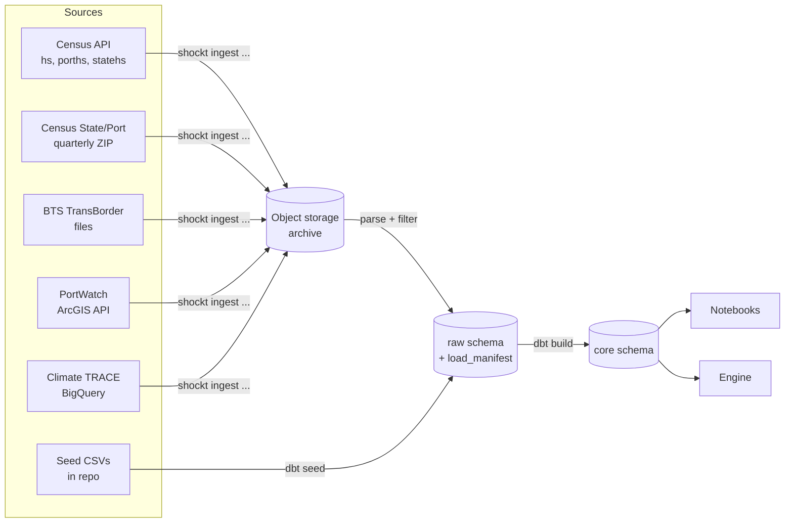

# Data Ingestion Pipelines: Technical Design

**Status:** Draft · **Workstream:** Data engineering · **Date:** 2026-10-08

This plan covers getting source data into the `raw` and `core` layers of the ShockT Climate Postgres database: the fetched pipelines (Census, BTS TransBorder, IMF PortWatch, Climate TRACE) and the reference loaders (country and port codes, emission factors, product weights, distances). It does not cover the `inputs` and `outputs` layers, the engine, or the app.

## 1. Decisions

| Area | Decision |
|---|---|
| Database | One Neon Postgres project in AWS us-east-2 on the free tier (1 GB Postgres storage, 100 compute-hours a month). Local Docker Postgres for development and tests. |
| Archive | Neon Object Storage in the same project (S3-compatible, 5 GB on the free tier, separate from Postgres storage). Every downloaded source file is archived before it's parsed. |
| Layers in scope | `raw` (data as fetched) and `core` (cleaned, modeled tables). |
| Language and tooling | Python, managed with `uv`. `httpx` for HTTP, `polars` for parsing, `psycopg` for Postgres, `pydantic` for record validation, `typer` for the CLI, `tenacity` for retries. |
| Schema management | Alembic migrations (raw SQL inside each migration) for the `raw` schema, roles and grants. dbt (`dbt-core` + `dbt-postgres`) builds `core` from `raw`. |
| Running | A Python CLI (`shockt`), run by hand. One idempotent command per source. No orchestrator or schedule. |
| Refresh | Load once for the MVP. Each load records its source vintage in `raw.load_manifest`. |
| HS level | HS-10 from the `hs` endpoint; the port and state endpoints serve HS-6 at most (spike 1). `core` models at HS-6 and keeps HS-10 as a column where it exists. |
| Case codes | HS-6 847150 (servers) and HS-4 headings 8504, 8537, 8507, 8415 (heavy electrical gear), set in `config/hs_codes.yaml`. |
| Date range | January 2022 through the latest month available at load time. The resolved end month is recorded per load. |
| Climate TRACE access | The public BigQuery dataset `trace-data-383422.climate_trace`, queried from a BigQuery sandbox project (no billing account). |
| Census State/Port file | The full quarterly files are archived; Postgres holds a filtered subset (Section 5.4). |

## 2. Source access summary

| Source | Access | Auth | Grain | Weight available | Notes |
|---|---|---|---|---|---|
| Census imports by HS (`hs`) | REST API | API key (required on every data request) | Month × HS-10 × country | Air and vessel shipping weight | `api.census.gov/data/timeseries/intltrade/imports/hs` |
| Census imports by port (`porths`) | REST API | API key | Month × HS × country × port of unlading | Air and vessel | Includes `PORT_NAME` |
| Census imports by state (`statehs`) | REST API | API key | Month × HS × country × state of destination | Air and vessel | `STATE` is state of destination; `XX` = unidentified |
| Census State/Port Imports | Quarterly ZIP of fixed-width files | None | Quarter × state × port of unlading × port of entry × country, all goods | Air, vessel and containerized vessel | No HS code; about 185k rows per quarter |
| BTS TransBorder | CSV/ZIP files | None, but scripted downloads return HTTP 403 | Month × state or port × HS-2 × mode × Canada/Mexico | Weight for imports by land modes only, not air or vessel | Manual download fallback (Section 5.5) |
| IMF PortWatch chokepoints | ArcGIS FeatureServer query API | None | Day × chokepoint | Vessel counts and capacity by ship type | 1,000 records per page |
| Climate TRACE `shipping_voyages` | BigQuery public dataset | Google account + sandbox project | Voyage | Distance and emissions per voyage; no cargo tonnage | Column names to be confirmed (Section 9) |

The Climate TRACE REST API (`api.climatetrace.org/v7`) only serves shipping as annual totals per port. It has no voyages and no monthly data, so it isn't used.

## 3. Architecture



### 3.1 Repository layout

The pipelines live in their own Python project, `data-pipelines/`, next to the other parts of the monorepo:

```
shockt-climate/
  data-pipelines/   # this plan
  engine/           # emissions engine package (Python, later)
  analysis/         # notebooks (Python, later)
  inputs/           # YAML inputs
  content/          # case-study markdown
  app/              # React / TypeScript
  docs/
```

When `engine/` and `analysis/` exist, a uv workspace (a root `pyproject.toml` listing the Python projects as members) can give them one lockfile. Until then `data-pipelines/` is a standalone uv project. Every path in the rest of this plan is relative to `data-pipelines/`.

```
data-pipelines/
  pyproject.toml              # uv project; CLI entry point `shockt`
  .env.example                # DATABASE_URL, object storage (NEON_S3_*), ARCHIVE_BUCKET, CENSUS_API_KEY, GCP_PROJECT_ID, BQ_MAX_BYTES
  config/
    hs_codes.yaml             # case HS prefixes
    sources.yaml              # date range, chokepoints, Asia country list, State/Port filter
  src/shockt/
    cli.py                    # typer app
    db.py                     # connection, transactions, bulk COPY
    manifest.py               # load_manifest helpers
    http.py                   # httpx client with retries and rate limiting
    archive.py                # boto3 client for Neon Object Storage; upload, checksum, fetch
    sources/
      census_api.py           # hs, porths, statehs
      census_state_port.py    # fixed-width parser + downloader
      bts_transborder.py
      portwatch.py
      climatetrace.py
    reference/
      sea_distances.py        # writes dbt/seeds/sea_distances.csv
      air_distances.py        # writes dbt/seeds/air_distances.csv
  migrations/                 # Alembic: raw schema, roles, grants
  dbt/
    dbt_project.yml
    profiles.yml              # reads DATABASE_URL parts from env
    seeds/                    # reference CSVs (Section 6)
    models/
      staging/                # stg_* views over raw (schema: core_staging)
      core/                   # core tables
    macros/generate_schema_name.sql   # write to `core`, not `<target>_core`
  data/manual/                # manually downloaded files (gitignored), e.g. BTS
  tests/
    fixtures/                 # small real samples of each source format
```

### 3.2 Load manifest and idempotency

Every fetch is a **load** of one **partition** of one dataset, for example `census_hs` for `2025-03`. A load writes one `raw.load_manifest` row and its data rows in a single transaction.

- **Archive, then parse.** Each load first uploads what it fetched, unchanged, to the archive bucket at `raw/{dataset}/{partition}/{filename}`. That covers the Census JSON responses, the State/Port ZIPs, the BTS files, the PortWatch pages, and Climate TRACE query results as Parquet. The loader then parses the archived copy. The manifest records the object key and its SHA-256, so any `raw` row can be traced to the exact file it came from. Re-parsing a partition (for example with a wider filter) reads the archive instead of fetching again.
- **Rerunning a partition replaces it.** The new load inserts its rows, marks the earlier successful load `superseded`, and deletes the earlier load's data rows. The manifest keeps the history. Deleting superseded rows is a storage trade-off for the free tier: `raw` holds one copy per partition, and the manifest records what was replaced.
- **A failed load leaves nothing behind.** The transaction rolls back and a separate `failed` manifest row records the error.
- **Each load records** its parameters, its source vintage (Census `LAST_UPDATE`, the Climate TRACE table release label, the file name and its SHA-256), its row count and the git commit of the code.

```sql
CREATE SCHEMA raw;

CREATE TABLE raw.load_manifest (
  load_id         uuid PRIMARY KEY DEFAULT gen_random_uuid(),
  dataset         text        NOT NULL,             -- e.g. 'census_hs', 'portwatch_chokepoints'
  partition_key   text        NOT NULL,             -- e.g. '2025-03', '2024Q4', 'chokepoint2:2023'
  params          jsonb       NOT NULL,             -- request parameters and filters applied
  source_vintage  text,                             -- LAST_UPDATE, release label or file checksum
  status          text        NOT NULL CHECK (status IN ('running','succeeded','failed','superseded')),
  row_count       integer,
  bytes_processed bigint,                           -- BigQuery only
  error           text,
  object_key      text,                             -- archived source file: raw/{dataset}/{partition}/{filename}
  object_sha256   text,
  code_version    text        NOT NULL,             -- git commit
  started_at      timestamptz NOT NULL DEFAULT now(),
  finished_at     timestamptz,
  superseded_by   uuid REFERENCES raw.load_manifest(load_id)
);

CREATE UNIQUE INDEX load_manifest_one_live_partition
  ON raw.load_manifest (dataset, partition_key) WHERE status = 'succeeded';
```

Every raw data table has `load_id uuid NOT NULL REFERENCES raw.load_manifest(load_id)`. Raw columns keep the source's field names in snake case and are typed (numbers as `bigint`/`numeric`, dates as `date`). Nothing is renamed, recoded or aggregated in `raw`. The only change is filtering, which is recorded in `params`.

#### Archive bucket

The archive is one bucket (`ARCHIVE_BUCKET`, default `shockt-raw-archive`) in the Neon project's object storage. Neon Object Storage speaks the S3 API, so `archive.py` uses `boto3` with Neon's branch endpoint, path-style addressing, and a Neon credential as the access key. It isn't an AWS bucket in our own account, so there's no AWS console or IAM. The settings use project-specific names (`NEON_S3_ENDPOINT_URL`, `NEON_S3_ACCESS_KEY_ID`, `NEON_S3_SECRET_ACCESS_KEY`, `NEON_S3_REGION`), and `archive.py` passes them to `boto3` explicitly. A developer's own `AWS_PROFILE`, `AWS_REGION` or `~/.aws` credentials therefore never reach the Neon endpoint.

Storage is branch-scoped like the database: a child branch sees its parent's files as of the fork, and its own writes stay on that branch. The team works off `main`, so all loads use `main`'s endpoint and credential.

### 3.3 Roles

The Alembic migrations create these roles and grants. Neon role creation may need its console or API; the migration then grants to existing roles.

| Role | `raw` | `core` |
|---|---|---|
| `shockt_ingest` | read and write | none |
| `shockt_transform` (dbt) | read | read and write |
| `shockt_analyst` | read | read |
| `shockt_app` | none | read (later the app reads `inputs` and `outputs` only) |

### 3.4 CLI

```
shockt db migrate                                   # alembic upgrade head
shockt ingest census --dataset hs|porths|statehs --from 2022-01 [--to 2026-08]
shockt ingest census-state-port --from 2022Q1 [--to 2026Q2]
shockt ingest bts-transborder --from-dir data/manual/bts
shockt ingest portwatch --from 2022-01-01 [--to ...]
shockt ingest climatetrace-voyages --from 2022-01-01 [--dry-run]
shockt ref sea-distances                            # regenerates dbt/seeds/sea_distances.csv
shockt ref air-distances                            # regenerates dbt/seeds/air_distances.csv
shockt loads list [--dataset ...]                   # manifest summary
shockt build                                        # dbt seed && dbt build
```

When `--to` is omitted, it resolves to the latest month the source has published, and the resolved value is stored in the manifest.

## 4. Shared behavior

- **HTTP:** retries on timeouts, 429 and 5xx responses, with exponential backoff and jitter. Requests to one host run one at a time with a short delay between them. User agent: `shockt-climate/<version> (<repo url>)`.
- **Validation:** each source has a pydantic model for one record. Any record that fails validation fails the load. Partial loads are never committed.
- **Bulk insert:** rows are written with `COPY` through `psycopg`.
- **Secrets:** read from the environment (`.env` in development). `CENSUS_API_KEY` is never written to the manifest or into archived request metadata; `params` stores the request without it. The object storage secret is shown once by Neon when the credential is created, so it goes straight into `.env` or a password manager.
- **Object storage:** uploads retry on `503 SlowDown`, which Neon returns when it throttles heavy use.
- **Observability:** each command prints a one-line summary per partition (rows, duration, vintage), and `shockt loads list` reads the manifest.

## 5. Fetched pipelines

### 5.1 Census imports by HS (`census_hs`)

- **Endpoint:** `GET https://api.census.gov/data/timeseries/intltrade/imports/hs`
- **Request, one per month:** `get=I_COMMODITY,I_COMMODITY_SDESC,CTY_CODE,CTY_NAME,GEN_VAL_MO,CON_VAL_MO,AIR_VAL_MO,AIR_WGT_MO,VES_VAL_MO,VES_WGT_MO,CNT_VAL_MO,CNT_WGT_MO,GEN_QY1_MO,UNIT_QY1,GEN_QY2_MO,UNIT_QY2,LAST_UPDATE&time=YYYY-MM&COMM_LVL=HS10&key=...`, filtered to the case HS prefixes.
- **Quantities:** `GEN_QY1_MO` with `UNIT_QY1` (for example a count of units) covers all modes combined. `core` uses it to estimate land-mode weight (Section 7.3).
- **Partition:** month. **Vintage:** the maximum `LAST_UPDATE`.
- **Rows:** the response includes country-group rows (`SUMMARY_LVL = 'CGP'`) and a world total (`CTY_CODE = '-'`). Raw keeps them, and `core` excludes them.
- **Prefix wildcards work** (spike 1): `I_COMMODITY=847150*` with `COMM_LVL=HS10` returns both HS-10 codes. One request per prefix per month. An HS-4 prefix at HS-10 can take about a minute (`8504*` returned 2,989 rows in 57 s), so the HTTP timeout is at least 5 minutes.


```sql
CREATE TABLE raw.census_hs (
  load_id            uuid    NOT NULL REFERENCES raw.load_manifest(load_id),
  time               text    NOT NULL,     -- 'YYYY-MM'
  i_commodity        text    NOT NULL,     -- HS-10
  i_commodity_sdesc  text,
  cty_code           text    NOT NULL,     -- Census Schedule C, 4 digits
  cty_name           text,
  summary_lvl        text,
  gen_val_mo         bigint,               -- USD
  con_val_mo         bigint,
  air_val_mo         bigint,
  air_wgt_mo         bigint,               -- kg
  ves_val_mo         bigint,
  ves_wgt_mo         bigint,               -- kg
  cnt_val_mo         bigint,
  cnt_wgt_mo         bigint,               -- kg, subset of vessel
  gen_qy1_mo         bigint,               -- quantity, all modes
  unit_qy1           text,                 -- unit of quantity 1
  gen_qy2_mo         bigint,
  unit_qy2           text,
  last_update        date,
  PRIMARY KEY (load_id, time, i_commodity, cty_code)
);
```

### 5.2 Census imports by port (`census_porths`)

- **Endpoint:** `.../imports/porths`, with the same request shape as 5.1 plus `PORT,PORT_NAME`.
- **Partition:** month.
- **HS-6 is the deepest level** (spike 1): `COMM_LVL=HS10` returns HTTP 204 (no content), even for an exact code. Requests use `COMM_LVL=HS6`; `comm_lvl` stays in the row in case Census adds detail later.
- **Total rows:** besides country groups (`SUMMARY_LVL = 'CGP'`) and the world total (`CTY_CODE = '-'`), each country has an all-ports total (`PORT = '-'`). Raw keeps them; `core` excludes them.

```sql
CREATE TABLE raw.census_porths (
  load_id            uuid    NOT NULL REFERENCES raw.load_manifest(load_id),
  time               text    NOT NULL,
  comm_lvl           text    NOT NULL,     -- 'HS6' (deepest level served)
  i_commodity        text    NOT NULL,
  cty_code           text    NOT NULL,
  cty_name           text,
  port               text    NOT NULL,     -- Schedule D district (2) + port (2)
  port_name          text,
  gen_val_mo         bigint,
  air_val_mo         bigint,
  air_wgt_mo         bigint,
  ves_val_mo         bigint,
  ves_wgt_mo         bigint,
  cnt_val_mo         bigint,
  cnt_wgt_mo         bigint,
  last_update        date,
  PRIMARY KEY (load_id, time, i_commodity, cty_code, port)
);
```

### 5.3 Census imports by state of destination (`census_statehs`)

- **Endpoint:** `.../imports/statehs`, with the same request shape plus `STATE`. It supports the Case 2 inland-routing check: imports of the case HS codes by state group (Section 5.4), by vessel and air. It loads all states, not only those in the groups.
- **Partition:** month. **HS-6 is the deepest level**, as in 5.2.

```sql
CREATE TABLE raw.census_statehs (
  load_id            uuid    NOT NULL REFERENCES raw.load_manifest(load_id),
  time               text    NOT NULL,
  comm_lvl           text    NOT NULL,
  i_commodity        text    NOT NULL,
  cty_code           text    NOT NULL,
  cty_name           text,
  state              text    NOT NULL,     -- USPS code; 'XX' = unidentified
  gen_val_mo         bigint,
  con_val_mo         bigint,
  air_val_mo         bigint,
  air_wgt_mo         bigint,
  ves_val_mo         bigint,
  ves_wgt_mo         bigint,
  cnt_val_mo         bigint,
  cnt_wgt_mo         bigint,
  last_update        date,
  PRIMARY KEY (load_id, time, i_commodity, cty_code, state)
);
```

### 5.4 Census State/Port Imports (`census_state_port`)

- **Download:** `https://www.census.gov/trade/downloads/additional/ISTPORT/ISTPORT{YY}Q{N}.ZIP`, which contains `IQ953_{YYYY}_Q{N}.dat`.
- **Format:** fixed width, per the [Census record layout](https://www.census.gov/foreign-trade/reference/products/layouts/istport.html):

| Position | Field | Description |
|---|---|---|
| 1–2 | `state` | State of destination |
| 3 | filler | |
| 4–5 | `district_unlading` | Customs district of unlading |
| 6–7 | `port_unlading` | Customs port of unlading |
| 8–9 | `district_entry` | Customs district of entry |
| 10–11 | `port_entry` | Customs port of entry |
| 12–15 | `country` | Country of origin (Schedule C) |
| 16 | `time_period` | Quarter `1`–`4` in quarterly files; `5` = annual |
| 17–28 | `value` | Total value |
| 29–40 | `air_val` | Air value |
| 41–52 | `air_swt` | Air shipping weight |
| 53–64 | `ves_val` | Vessel value |
| 65–76 | `cnt_val` | Containerized vessel value |
| 77–88 | `ves_swt` | Vessel shipping weight |
| 89–100 | `cnt_swt` | Containerized vessel shipping weight |
| 101–104 | `stat_year` | Statistical year |

- **Archive:** the full ZIP is archived unfiltered. Only the filtered rows below go into Postgres, so a wider filter later means re-parsing the archive, not downloading again.
- **Filter on load** (set in `config/sources.yaml` and recorded in `params`):
  - `country` in the Asia list (Schedule C codes beginning with `5`), plus Mexico (`2010`).
  - `state` in `dbt/seeds/seed_state_groups.csv`, which the loader reads so the filter and `core` use one list. The defaults:

    | `state_group` | States | Role in the Case 2 inland-routing check |
    |---|---|---|
    | `east_bound` | VA, GA, OH | The test group: Asian cargo would normally land at East or Gulf Coast ports. A rise in the share unladen on the West Coast during a shock window supports "West Coast + rail east". |
    | `west_control` | CA, OR, WA, AZ | Cargo lands on the West Coast regardless. A shift here in the same months points to something other than a shock response. |
    | `ambiguous` | TX, IL | Reported separately. Texas is served by Houston, the West Coast plus rail, or the Mexican border; Chicago's Asian cargo routinely lands on the West Coast and goes by rail. |

    The groups cover large data center markets (Northern Virginia, Atlanta, Columbus, Dallas-Fort Worth, Chicago, Phoenix, Silicon Valley, and Hillsboro in Oregon). They also allow for state of destination naming an integrator or distributor rather than the data center.
  - Rows where both `air_swt` and `ves_swt` are zero are dropped.
- **Partition:** quarter. **Vintage:** the file's SHA-256 and name.
- **Each file holds one quarter, not the year to date** (spike 3). 2024 Q1 totals $755.6B and Q2 $812.2B, against roughly $3.2T of US goods imports a year, and only 52% of rows grow from Q1 to Q2. Each ZIP is about 2.2 MB (about 18.5 MB unzipped, ~175k rows).

```sql
CREATE TABLE raw.census_state_port (
  load_id            uuid    NOT NULL REFERENCES raw.load_manifest(load_id),
  stat_year          smallint NOT NULL,
  time_period        text    NOT NULL,
  state              text    NOT NULL,
  district_unlading  text    NOT NULL,
  port_unlading      text    NOT NULL,
  district_entry     text    NOT NULL,
  port_entry         text    NOT NULL,
  country            text    NOT NULL,
  value              bigint,
  air_val            bigint,
  air_swt            bigint,
  ves_val            bigint,
  cnt_val            bigint,
  ves_swt            bigint,
  cnt_swt            bigint,
  PRIMARY KEY (load_id, state, district_unlading, port_unlading, district_entry, port_entry, country)
);
```

### 5.5 BTS TransBorder Freight (`bts_transborder`)

- **What it adds:** truck and rail imports from Mexico with shipping weight. TransBorder captures weight for imports by land modes, not by air or vessel ([BTS](https://www.bts.gov/statistical-products/transborder-freight-data/north-american-transborder-freight-data-faqs)).
- **Commodity detail is HS-2 only** (`COMMODITY2`). Chapter 84 includes all computers, so TransBorder can't isolate 847150. `core` estimates overland weight for the case codes from a kg-per-dollar ratio (Section 7.3).
- **Access:** bts.gov returns HTTP 403 to scripted requests. One person downloads the files into `data/manual/bts/`, and `--from-dir` uploads them to the archive before parsing. After that, anyone can reload from the archive without downloading again. A spike checks whether the same tables are on `data.bts.gov` with an API.
- **Fields:** taken from the [BTS codes document](https://www.bts.gov/sites/bts.dot.gov/files/docs/browse-statistical-products-and-data/transborder-freight-data/220171/all-codes-north-american-transborder-freight-raw-data.pdf). Confirm them against the file headers.
- **Filter on load:** `TRDTYPE = 2` (imports), `COUNTRY = 2010` (Mexico), `COMMODITY2 IN ('84','85')`.
- **Partition:** month and table (`dot2` state × commodity; `dot3` port × commodity).

```sql
CREATE TABLE raw.bts_transborder (
  load_id         uuid    NOT NULL REFERENCES raw.load_manifest(load_id),
  source_table    text    NOT NULL,     -- 'dot2' or 'dot3'
  year            smallint NOT NULL,
  month           smallint NOT NULL,
  trdtype         smallint NOT NULL,    -- 2 = import
  usastate        text,                 -- dot2
  depe            text,                 -- dot3: port code
  commodity2      text    NOT NULL,     -- HS-2
  disagmot        smallint NOT NULL,    -- 1 vessel, 3 air, 4 mail, 5 truck, 6 rail, 7 pipeline, 8 other, 9 FTZ
  mexstate        text,
  country         text    NOT NULL,     -- 2010 = Mexico
  value           bigint,               -- USD
  shipwt          bigint,               -- kg
  freightcharges  bigint,
  df              smallint,             -- domestic/foreign
  contcode        text                  -- containerized indicator
);
CREATE INDEX ON raw.bts_transborder (load_id);
```

### 5.6 IMF PortWatch chokepoint transits (`portwatch_chokepoints`)

- **Endpoint:** `https://services9.arcgis.com/weJ1QsnbMYJlCHdG/arcgis/rest/services/Daily_Chokepoints_Data/FeatureServer/0/query`
- **Request:** `where=portid IN (...) AND date >= DATE '2022-01-01'`, `outFields=*`, `returnGeometry=false`, `f=json`, paged with `resultOffset` and `resultRecordCount=1000` (the layer's maximum).
- **Chokepoints (config):** Panama Canal (`chokepoint2`), Suez Canal (`chokepoint1`), Bab el-Mandeb Strait (`chokepoint4`), Cape of Good Hope (`chokepoint7`).
- **Partition:** chokepoint × year.

```sql
CREATE TABLE raw.portwatch_chokepoints (
  load_id                 uuid    NOT NULL REFERENCES raw.load_manifest(load_id),
  object_id               bigint  NOT NULL,
  date                    date    NOT NULL,
  portid                  text    NOT NULL,
  portname                text,
  n_container             integer,
  n_dry_bulk              integer,
  n_general_cargo         integer,
  n_roro                  integer,
  n_tanker                integer,
  n_cargo                 integer,
  n_total                 integer,
  capacity_container      bigint,
  capacity_dry_bulk       bigint,
  capacity_general_cargo  bigint,
  capacity_roro           bigint,
  capacity_tanker         bigint,
  capacity_cargo          bigint,
  capacity                bigint,       -- units per PortWatch documentation; confirm
  PRIMARY KEY (load_id, portid, date)
);
```

### 5.7 Climate TRACE ship voyages (`climatetrace_voyages`)

- **Source:** `trace-data-383422.climate_trace.shipping_voyages`. Climate TRACE describes it as individual voyages with vessel identifiers (IMO/MMSI), voyage emissions, distances and port information, for domestic and international shipping ([BigQuery guide](https://media.climatetrace.org/Climate_TRACE_Big_Query_Data_8713215f81.pdf)). The data is licensed CC BY 4.0.
- **Access, confirmed:**
  - The BigQuery sandbox needs no billing account and gives the free tier's 1 TB of query processing a month and 10 GB of storage. Its own tables expire after 60 days, and DML and streaming are unavailable ([Google](https://cloud.google.com/bigquery/docs/sandbox)). None of those limits matter here, because results go straight to Postgres.
  - Querying a public dataset is billed to the querying project. Climate TRACE pays for storage only.
- **Setup:** create a GCP project in sandbox mode. Run `gcloud auth application-default login`, then set `GCP_PROJECT_ID`.
- **Cost guard:** BigQuery bills by bytes scanned in the selected columns. A `WHERE` on dates reduces bytes only if the table is partitioned on that column. Every query therefore:
  1. Runs as a **dry run** first, and the CLI prints the bytes it would scan.
  2. Aborts if the estimate exceeds `BQ_MAX_BYTES` (default 100 GB).
  3. Runs with `maximum_bytes_billed` set to the same cap, so BigQuery refuses anything larger.
  4. Selects only the needed columns, never `SELECT *`.
  5. Records `bytes_processed` in the manifest.
- **Result download:** use the standard REST result pages (`create_bqstorage_client=False`). The BigQuery Storage Read API is billed separately, so the loader doesn't use it.
- **Archive:** each query's result is archived as Parquet, so `raw` can be rebuilt without spending BigQuery quota again.
- **Step 1 is schema discovery.** Run `client.get_table()` to read the columns, partitioning and release label; reading table metadata isn't a query and isn't billed. Write the confirmed column names into this plan, then finalize the DDL below.
- **Filter:**
  - Voyages that start at a port in the Asia ISO3 list (or Mexico) and end at a US port.
  - Start date from 2022-01-01.
  - Container ships, if a vessel type column exists.
- **Partition:** calendar year of the voyage start. **Vintage:** the table's release label (e.g. `v5_1_0`).

Provisional DDL, to be replaced once the schema is confirmed:

```sql
CREATE TABLE raw.climatetrace_voyages (
  load_id                uuid    NOT NULL REFERENCES raw.load_manifest(load_id),
  voyage_id              text    NOT NULL,
  imo                    text,
  mmsi                   text,
  vessel_type            text,
  start_time             timestamptz,
  end_time               timestamptz,
  start_port             text,
  start_port_country     text,          -- ISO3
  end_port               text,
  end_port_country       text,          -- ISO3
  distance_nm            numeric,
  emissions_co2e_100yr_t numeric,
  extra                  jsonb,         -- any selected columns not mapped above
  PRIMARY KEY (load_id, voyage_id)
);
```

## 6. Reference loaders

Reference data lives in the repo as CSV files under `dbt/seeds/` and loads with `dbt seed` into `raw` as `raw.seed_*`. Git history versions it, and every file has a `source` column. Two seeds are generated by CLI commands and committed; the rest are maintained by hand.

| Seed | How it's made | Columns |
|---|---|---|
| `seed_country_codes` | By hand from Census Schedule C, with ISO3 added | `census_cty_code, cty_name, iso3, region (asia, mexico, other), source` |
| `seed_port_regions` | By hand from Census Schedule D, reviewed by an analyst | `district, port, port_name, state, coast_region (east, west, gulf, border_south, border_north, inland, noncontiguous), is_seaport, is_airport, source` |
| `seed_hs_case_codes` | By hand | `hs_prefix, level, label, case (tariffs_2025, panama_red_sea), source` |
| `seed_state_groups` | By hand; also the State/Port load filter (Section 5.4) | `state, state_group (east_bound, west_control, ambiguous), rationale, source` |
| `seed_emission_factors` | Transcribed from the GLEC Framework (or UK government factors as the fallback; Section 9) | `factor_set, factor_version, mode, sub_mode, kg_co2e_per_tkm, boundary ('well_to_wheel'), source_ref (document, table, page), notes` |
| `seed_product_weights` | By hand from manufacturer product carbon footprint documents | `product, hs_code, model_ref, unit_weight_kg, packaged_weight_kg, source_url, notes` |
| `seed_nodes` | By hand | `node_id, name, kind (seaport, airport, assembly_site, market), iso3, lon, lat, source` |
| `seed_sea_distances` | Generated by `shockt ref sea-distances` | `from_node, to_node, scenario (open, panama_closed, red_sea_closed, both_closed), restrictions, distance_km, searoute_version` |
| `seed_air_distances` | Generated by `shockt ref air-distances` (great-circle distance plus a configurable routing uplift, recorded per row) | `from_node, to_node, gcd_km, uplift_km, distance_km` |
| `seed_inland_legs` | By hand from documented route distances | `from_node, to_node, mode (rail, truck), distance_km, source` |

`shockt ref sea-distances` uses `searoute` (tested at 1.6.0), which supports closing passages through `restrictions`. Kaohsiung → Savannah, for example, measures:
- 19,813 km with all passages open
- 22,876 km with Panama closed
- 26,021 km with Panama and Bab el-Mandeb closed

Each run writes the `searoute` version into every row.

## 7. `core` schema (dbt)

`core` is built by dbt. Staging models (`stg_*`) are views in `core_staging` that rename, cast and filter one raw table each. Every staging model reads only rows whose load is `succeeded`. Core models are tables. `macros/generate_schema_name.sql` makes dbt write to `core` and `core_staging` exactly.

### 7.1 Conventions

- **Units:** weight in tonnes (`weight_t = kg / 1000`), value in USD, distance in km, emissions in t CO2e.
- **Month:** `month date` set to the first of the month.
- **Mode:** one long-format column (`air`, `vessel`, `vessel_containerized`, `land`, `truck`, `rail`) instead of one column per mode, which suits the diversion-rate calculation. `vessel_containerized` is a subset of `vessel` and is never summed with it.
- **Excluded from core:** Census country-group rows (`SUMMARY_LVL = 'CGP'`), world totals (`CTY_CODE = '-'`) and all-ports totals (`PORT = '-'`).
- **Lineage:** every core row carries the `load_id`s it came from (`source_load_ids uuid[]`).

### 7.2 Dimensions

```sql
-- core.dim_country
census_cty_code   text PRIMARY KEY,
cty_name          text NOT NULL,
iso3              text,
region            text NOT NULL            -- asia | mexico | other

-- core.dim_port
port_code         text PRIMARY KEY,        -- district (2) + port (2)
port_name         text,
state             text,
coast_region      text NOT NULL,
is_seaport        boolean NOT NULL,
is_airport        boolean NOT NULL

-- core.dim_hs
hs10              text PRIMARY KEY,
hs6               text NOT NULL,
hs4               text NOT NULL,
description       text,
case_codes        text[] NOT NULL          -- cases this code belongs to
```

### 7.3 Facts

```sql
-- core.fct_imports_monthly            grain: month × hs10 × country × mode
month date, hs10 text, hs6 text, census_cty_code text, mode text,
value_usd bigint, weight_t numeric,        -- weight null for modes Census doesn't weigh
weight_method text,                        -- 'reported' | 'estimated_units' | 'estimated_bts_ratio' | null
source_load_ids uuid[]

-- core.fct_imports_port_monthly       grain: month × hs × country × port × mode
month date, hs_code text, hs_level text, hs6 text, census_cty_code text,
port_code text, coast_region text, mode text, value_usd bigint, weight_t numeric,
source_load_ids uuid[]

-- core.fct_imports_state_monthly      grain: month × hs × country × state × mode
month date, hs_code text, hs_level text, hs6 text, census_cty_code text,
state text, state_group text,              -- null for states outside seed_state_groups
mode text, value_usd bigint, weight_t numeric, source_load_ids uuid[]

-- core.fct_imports_state_port_quarterly   grain: quarter × state × port of unlading × port of entry × country × mode (all goods)
quarter date, state text, state_group text NOT NULL, unlading_port_code text, unlading_coast_region text,
entry_port_code text, census_cty_code text, mode text, value_usd bigint, weight_t numeric,
source_load_ids uuid[]

-- core.fct_mexico_overland_monthly    grain: month × HS-2 × US state or port × mode (truck, rail)
month date, hs2 text, usastate text, port_code text, mode text,
value_usd bigint, weight_t numeric, kg_per_usd numeric, source_load_ids uuid[]

-- core.fct_chokepoint_transits_daily  grain: day × chokepoint
date date, chokepoint_id text, chokepoint_name text,
n_container int, n_cargo int, n_total int, capacity_container bigint, capacity bigint,
source_load_ids uuid[]

-- core.fct_chokepoint_transits_monthly   monthly sums and daily means of the above

-- core.fct_voyages                    grain: voyage (Asia or Mexico → US)
voyage_id text, start_month date, start_iso3 text, end_port text, end_coast_region text,
vessel_type text, distance_km numeric, duration_h numeric, emissions_t numeric,
emissions_t_per_km numeric, source_load_ids uuid[]

-- core.agg_voyage_lanes_monthly       grain: month × origin region × US coast region
month date, origin_region text, end_coast_region text, n_voyages int,
mean_distance_km numeric, median_distance_km numeric, mean_emissions_t_per_km numeric

-- core.ref_emission_factors, core.ref_product_weights, core.ref_nodes,
-- core.ref_sea_distances, core.ref_air_distances, core.ref_inland_legs
-- typed copies of the seeds, with the same columns
```

**Land-mode weight for Mexico.** Census weighs only air and vessel imports. For imports from Mexico, `fct_imports_monthly` adds a `land` row per month × HS-10:

- **Value:** general imports value minus air and vessel value.
- **Weight, first choice (`weight_method = 'estimated_units'`):** when `UNIT_QY1` is a unit count, land units are total units × (land value ÷ total value), and weight is land units × `ref_product_weights.unit_weight_kg`. This applies to servers, where the product weight seed is reliable.
- **Weight, fallback (`weight_method = 'estimated_bts_ratio'`):** land value × TransBorder's kg per dollar for the HS-2 chapter that month. Chapter 84 mixes light, valuable goods with heavy machinery, so this ratio can be far from the right figure for servers. It is used only when no unit-based estimate exists.

The split of `land` into `truck` and `rail` uses TransBorder's value shares for the chapter that month. Every estimated row names its method, and the case pages show it.

### 7.4 dbt tests

- **Uniqueness:** `unique` and `not_null` on each fact's grain columns, with a `dbt_utils.unique_combination_of_columns` test per fact.
- **Relationships:** facts to `dim_country`, `dim_port` and `dim_hs`. Unmapped codes fail the build, which forces the seeds to stay complete.
- **Accepted values:** `mode`, `coast_region`, `region`, `weight_method`, `state_group`.
- **Reconciliation, as custom tests:**
  - Per month × HS × country, the port-level vessel weight summed over ports is within 1% of `fct_imports_monthly` (it differs only by suppression).
  - The same check for state-level weight.
  - `vessel_containerized` weight ≤ `vessel` weight.
- **Freshness:** warn when any core table's newest month is more than 4 months old.

## 8. Storage budget (Neon free tier)

The free tier allows 1 GB of Postgres storage and, separately, 5 GB of object storage per project. All figures are estimates to check after the first loads. `shockt loads list` reports table sizes via `pg_total_relation_size`.

### Postgres (1 GB)

| Table | Estimated rows | Estimated size with indexes |
|---|---|---|
| `raw.census_hs` | ~200k | ~40 MB |
| `raw.census_porths` | ~600k | ~120 MB |
| `raw.census_statehs` | ~400k | ~80 MB |
| `raw.census_state_port` (filtered to 9 states) | ~80k | ~15 MB |
| `raw.bts_transborder` (filtered) | ~100k | ~15 MB |
| `raw.portwatch_chokepoints` | ~6k | < 2 MB |
| `raw.climatetrace_voyages` (filtered) | ~50–200k | ~20–60 MB |
| `core` tables | about 60% of raw | ~150 MB |

The estimate comes to roughly 0.45 GB, under half the limit. Load the Census API datasets first and measure them. If Postgres grows past 750 MB, trim in this order:

1. Restrict `porths` and `statehs` to the case countries (Asia list + Mexico) instead of all countries.
2. Make the large core facts dbt views instead of tables.

### Object storage (5 GB)

| Archived files | Estimated size |
|---|---|
| Census API JSON responses (3 datasets × ~55 months) | ~200 MB |
| Census State/Port ZIPs (~18 quarters, about 2.2 MB each) | ~40 MB |
| BTS TransBorder files | ~100 MB |
| PortWatch pages | < 10 MB |
| Climate TRACE query results (Parquet) | ~50 MB |

The archive comes to roughly 0.4 GB, under a tenth of the allowance.

## 9. Spikes and open questions

Each spike is a short task with a written result, completed before the pipeline it affects is built.

| # | Question | Affects | How to answer |
|---|---|---|---|
| 1 | Does `I_COMMODITY` accept a prefix wildcard? What is the deepest HS level `porths` and `statehs` serve? | 5.1–5.3 | **Answered:** wildcards work on all three endpoints; `hs` serves HS-10, `porths` and `statehs` HS-6 at most (HS-10 returns HTTP 204). |
| 2 | What are the HS-10 codes under 847150, and does any of them isolate AI servers? | `seed_hs_case_codes` | **Answered:** two codes, `8471.50.0110` (with a CRT monitor) and `8471.50.0150` (other); neither isolates AI servers. Both are counted in units (`No.`), which the unit-based land weight estimate (Section 7.3) relies on. Source: USITC HTS search API. |
| 3 | Is each State/Port file one quarter or the year to date? What do `time_period` codes `1`–`4` mean? | 5.4 | **Answered:** one quarter; `time_period` is the quarter number (Section 5.4). |
| 4 | Can TransBorder files be fetched without manual download (e.g. from `data.bts.gov`)? Do the field names match the codes document? | 5.5 | Try data.bts.gov; inspect a downloaded file |
| 5 | What are `shipping_voyages`'s columns, partitioning and size, and how many bytes does the filtered query scan? | 5.7, storage budget | `get_table()` and a dry run |
| 6 | Are GLEC default factors licensed for use in the app? | `seed_emission_factors` | Ask Smart Freight Centre; otherwise use UK government factors (Open Government Licence) |
| 7 | What units does PortWatch's `capacity` use? | 5.6 | PortWatch documentation |
| 8 | Is Neon Object Storage generally available or in preview? The docs don't say. | Archive | Neon status or support |

## 10. Build order

1. Scaffold `data-pipelines/`: `uv` project, CLI skeleton, `.env.example`, Docker Postgres for development, Alembic with `raw` schema, manifest and roles, the archive bucket on `main` and `archive.py`.
2. Spikes 1–3, then the Census API pipelines (5.1–5.3) with fixture-based parser tests.
3. dbt project: seeds for country codes, port regions and HS codes; staging and core models for the Census API datasets; tests. **Checkpoint:** analysts can query `core.fct_imports_port_monthly` for Case 1.
4. Census State/Port loader (5.4).
5. PortWatch (5.6).
6. Spike 4, then BTS TransBorder (5.5) and the overland weight estimate.
7. Spike 5, then Climate TRACE voyages (5.7) and `fct_voyages`/`agg_voyage_lanes_monthly`.
8. Reference generators (`sea-distances`, `air-distances`), the hand-maintained seeds and the `ref_*` core tables. Spike 6 decides the factor set.
9. A full load into Neon, then a storage check against Section 8.

## 11. Testing

- **Parsers:** unit tests per source against small real samples in `tests/fixtures/`. Examples: a 20-line State/Port `.dat` extract, a Census JSON response, a PortWatch page, a TransBorder CSV extract.
- **Loads:** integration tests against Docker Postgres. They check that a rerun supersedes the previous load, that a failed load leaves no rows, and that the manifest records vintages.
- **HTTP:** recorded responses (e.g. `respx`) so tests don't call live APIs or need keys.
- **dbt:** `dbt build` against a fixture-loaded database runs every model and test in CI.

## References

- Census International Trade API datasets: `https://api.census.gov/data/timeseries/intltrade/imports.json`; [key signup](https://api.census.gov/data/key_signup.html)
- [Census State/Port Imports downloads](https://www.census.gov/foreign-trade/data/ISTPORT.html) and [record layout](https://www.census.gov/foreign-trade/reference/products/layouts/istport.html)
- [BTS TransBorder FAQs](https://www.bts.gov/statistical-products/transborder-freight-data/north-american-transborder-freight-data-faqs) and [codes document](https://www.bts.gov/sites/bts.dot.gov/files/docs/browse-statistical-products-and-data/transborder-freight-data/220171/all-codes-north-american-transborder-freight-raw-data.pdf)
- [IMF PortWatch Daily Chokepoints layer](https://services9.arcgis.com/weJ1QsnbMYJlCHdG/ArcGIS/rest/services/Daily_Chokepoints_Data/FeatureServer/0)
- [Climate TRACE data access](https://climatetrace.org/data) and [BigQuery guide](https://media.climatetrace.org/Climate_TRACE_Big_Query_Data_8713215f81.pdf)
- [BigQuery sandbox](https://cloud.google.com/bigquery/docs/sandbox)
- [Neon pricing](https://neon.com/pricing); Neon Object Storage [overview](https://neon.com/docs/storage/overview.md), [buckets and branches](https://neon.com/docs/storage/buckets.md), [authentication](https://neon.com/docs/storage/authentication.md)
- [searoute (PyPI)](https://pypi.org/project/searoute/)
