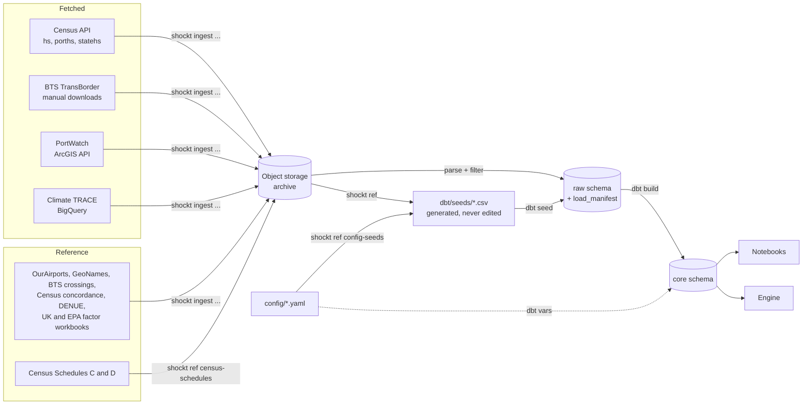

# Data Ingestion Pipelines: Technical Design

**Status:** Draft · **Workstream:** Data engineering · **Date:** 2026-10-08 · **Updated:** 2026-10-12

This plan covers getting source data into the `raw` and `core` layers of the ShockT Climate Postgres database: the fetched pipelines (Census, BTS TransBorder, IMF PortWatch, Climate TRACE) and the reference data (country and port codes, locations for ports, airports, crossings and assembly sites, emission factors, distances). It does not cover the `inputs` and `outputs` layers, the engine, or the app.

## 1. Decisions

| Area | Decision |
|---|---|
| Emission factors | One factor per mode, chosen by where the leg runs: UK government conversion factors 2026 for ocean and international air; EPA GHG Emission Factors Hub 2025 for North American truck and rail. Both workbooks are loaded whole and `core.ref_emission_factors` derives every factor (Section 6.1). GLEC pending a licence request. |
| Database | One Neon Postgres project in AWS us-east-2 on the free tier (1 GB Postgres storage, 100 compute-hours a month). Local Docker Postgres for development; a throwaway Postgres testcontainer per test session. |
| Archive | Neon Object Storage in the same project (S3-compatible, 5 GB on the free tier, separate from Postgres storage). Every downloaded source file is archived before it's parsed. |
| Layers in scope | `raw` (data as fetched) and `core` (cleaned, modeled tables). |
| Language and tooling | Python, managed with `uv`. `httpx` for HTTP, `polars` for parsing, `psycopg` for Postgres, `pydantic` for config validation, `typer` for the CLI, `tenacity` for retries. |
| Schema management | Alembic migrations (raw SQL inside each migration) for the `raw` schema, roles and grants. dbt (`dbt-core` + `dbt-postgres`) builds `core` from `raw`. |
| Running | A Python CLI (`shockt`), run by hand. One idempotent command per source. No orchestrator or schedule. |
| Refresh | Load once for the MVP. Each load records its source version in `raw.load_manifest`. |
| Adding cases | Adding HS codes to `config/hs_codes.yaml` and rerunning the loaders and `shockt build` regenerates everything downstream. Census loads are partitioned by month × HS prefix, so a new prefix fetches only that prefix. Staging reads only loads whose prefix is in the config, so a removed prefix drops out of `core` at the next build; `shockt loads retire` then deletes its rows from `raw` (the archive keeps its files). No prefix may start with another, so no row is loaded twice. |
| Nodes | **Planned.** Built by a dbt model (`dim_nodes`) from loaded data, including **every** port, airport, crossing and assembly site that carries case freight, weighted by volume; no top-N cutoff (Section 6.2). |
| HS level | HS-10 from the `hs` endpoint; the port and state endpoints serve HS-6 at most (spike 1). `core` models at HS-6 and keeps HS-10 as a column where it exists. |
| Case codes | Set in `config/hs_codes.yaml`: HS-6 847150 (servers) for both cases; for Case 2's heavy electrical gear, liquid-dielectric transformers (850421, 850422, 850423), larger dry transformers (850433, 850434) and switchgear above 1,000 V (853720). Census's description of each code is in `core.dim_hs`. |
| Date range | `date_range` in `config/sources.yaml`: January 2022 through the latest month available at load time. Every loader honors both ends: monthly sources request only those months, and year-partitioned sources (PortWatch, Climate TRACE) archive the whole year and load only the rows inside the range. The resolved range is recorded per load. |
| Climate TRACE access | The public BigQuery dataset `trace-data-383422.climate_trace`, queried from a BigQuery sandbox project (no billing account). |
| Census State/Port file | **Planned.** The full quarterly files are archived; Postgres holds a filtered subset (Section 5.4). |

## 2. Source access summary

| Source | Access | Auth | Grain | Weight available | Notes |
|---|---|---|---|---|---|
| Census imports by HS (`hs`) | REST API | API key (required on every data request) | Month × HS-10 × country | Air and vessel shipping weight | `api.census.gov/data/timeseries/intltrade/imports/hs` |
| Census imports by port (`porths`) | REST API | API key | Month × HS × country × port of unlading | Air and vessel | Includes `PORT_NAME` |
| Census imports by state (`statehs`) | REST API | API key | Month × HS × country × state of destination | Air and vessel | `STATE` is state of destination; `XX` = unidentified |
| Census State/Port Imports | Quarterly ZIP of fixed-width files | None | Quarter × state × port of unlading × port of entry × country, all goods | Air, vessel and containerized vessel | No HS code; loader not built yet (Section 5.4) |
| BTS TransBorder | CSV/ZIP files | None, but scripted downloads return HTTP 403 | Month × state or port × HS-2 × mode × Canada/Mexico | Weight for imports by land modes only, not air or vessel | Manual download fallback (Section 5.5) |
| IMF PortWatch chokepoints | ArcGIS FeatureServer query API | None | Day × chokepoint | Vessel counts and capacity by ship type | Page size from the layer's `maxRecordCount` (1,000) |
| OurAirports | CSV download | None | Airport | n/a | Airport coordinates, by IATA code; public domain |
| GeoNames cities5000 | ZIP download | None | City (population ≥ 5,000) | n/a | City coordinates; CC BY 4.0 |
| BTS Border Crossing Entry Data | data.bts.gov API | None | Port of entry × month × measure | n/a | Crossing coordinates by Census port code |
| INEGI DENUE, manufacturing (sector 31–33) | ZIP download (57.6 MB) | None | Establishment | n/a | Mexican manufacturing establishments with industry (SCIAN), coordinates and employee band; INEGI free-use terms, attribution |
| Census import concordance | Excel download (yearly) | None | HS-10 | n/a | HS-10 → NAICS industry |
| UK government GHG conversion factors | XLSX download (flat file) | None | Factor row | n/a | Ocean and air freight factors, and fuel well-to-tank ratios (Section 6.1); Open Government Licence |
| EPA GHG Emission Factors Hub | XLSX download | None | Vehicle type; gas | n/a | North American truck and rail factors (Table 8) and GWPs (Table 11); public domain |
| Census Schedules C and D | Text and HTML downloads | None | Country; district and port | n/a | Census country and port code lists (Section 6) |
| Climate TRACE `shipping_voyages` | BigQuery public dataset | Google account + sandbox project | Voyage | Distance and emissions per voyage; no cargo tonnage | Port fields in generic `other*` columns (Section 5.7) |

The Climate TRACE REST API (`api.climatetrace.org/v7`) only serves shipping as annual totals per port. It has no voyages and no monthly data, so it isn't used.

## 3. Architecture



Config holds only declared choices (case HS codes, date range, origin regions, load filters, source URLs and versions). Everything a source publishes is fetched, archived and loaded; seeds are generated by `shockt ref` commands from config or archived sources. The Census State/Port loader (Section 5.4) and the distance generators (Section 6.3) are planned.

### 3.1 Repository layout

The pipelines live in their own Python project, `data-pipelines/`, next to the other parts of the monorepo:

```
shockt-climate/
  data-pipelines/   # this plan
  engine/           # emissions engine package (Python, later)
  analysis/         # notebooks (Python, later)
  inputs/           # YAML inputs
  content/          # case-study markdown
  app/              # React / TypeScript
  docs/
```

When `engine/` and `analysis/` exist, a uv workspace (a root `pyproject.toml` listing the Python projects as members) can give them one lockfile. Until then `data-pipelines/` is a standalone uv project. Every path in the rest of this plan is relative to `data-pipelines/`.

```
data-pipelines/
  pyproject.toml              # uv project; CLI entry point `shockt`
  compose.yaml                # Docker Postgres for development; tests use the same image
  .env.example                # MIGRATIONS_DATABASE_URL, DATABASE_URL, DBT_DATABASE_URL, NEON_S3_*, ARCHIVE_BUCKET, CENSUS_API_KEY, GCP_PROJECT_ID, BQ_MAX_BYTES
  config/
    hs_codes.yaml             # case HS prefixes
    origins.yaml              # origin regions in scope, by Census Schedule C code
    sources.yaml              # date range, source URLs and versions, load filters
    transforms.yaml           # settings dbt models read, passed in as dbt vars
  src/shockt/
    cli.py                    # typer app
    config.py                 # pydantic models for config/*.yaml (unknown keys fail)
    settings.py               # environment settings; .env takes priority over the shell
    db.py                     # connection, transactions, bulk COPY
    loading.py                # archive-then-parse load of one partition
    manifest.py               # load_manifest helpers: supersede, retire, list
    http.py                   # httpx client with retries and rate limiting
    archive.py                # boto3 client for Neon Object Storage; upload, checksum, fetch
    dbt.py                    # runs dbt with the connection and config vars
    months.py                 # month ranges for the date range
    origins.py                # ISO3 codes of the configured origins, from seed_census_countries
    sources/
      census_api.py           # hs, porths, statehs
      bts_transborder.py
      portwatch.py
      climatetrace.py
      reference.py            # OurAirports, GeoNames cities, BTS border crossings
      census_concordance.py   # Census HS-10 → NAICS import concordance
      denue.py                # INEGI DENUE establishments in the case industries
      ghg_factors.py          # UK conversion factors and EPA Hub workbooks, loaded whole
      census_state_port.py    # planned (Section 5.4)
    reference/
      config_seeds.py         # writes seed_hs_case_codes.csv from config
      census_schedules.py     # writes the Census country and port seeds
      sea_distances.py        # planned (Section 6.3)
      air_distances.py        # planned (Section 6.3)
  migrations/                 # Alembic: raw schema, roles, grants
  dbt/
    dbt_project.yml
    profiles.yml              # connection from DBT_* variables that `shockt` sets from DBT_DATABASE_URL
    seeds/                    # generated reference CSVs (Section 6)
    models/
      staging/                # stg_* views over raw (schema: core_staging)
      core/                   # core tables
    macros/                   # rules (coast_region, census_country_region, freight_mode, …) and generate_schema_name
    tests/                    # singular tests that pin rules to known cases
  data/manual/                # manually downloaded files (gitignored), e.g. BTS
  tests/
    fixtures/                 # small real samples of each source format
```

### 3.2 Load manifest and idempotency

Every fetch is a **load** of one **partition** of one dataset, for example `census_hs` for `2025-03:847150` (month × HS prefix). A load writes one `raw.load_manifest` row and its data rows in a single transaction.

- **Archive, then parse.** Each load first uploads what it fetched, unchanged, to the archive bucket at `raw/{dataset}/{partition}/{filename}`. That covers the Census JSON responses, the State/Port ZIPs, the BTS files, the PortWatch pages, and Climate TRACE query results as Parquet. The loader then parses the archived copy. The manifest records the object key and its SHA-256, so any `raw` row can be traced to the exact file it came from. Re-parsing a partition (for example with a wider filter) reads the archive instead of fetching again.
- **Rerunning a partition replaces it.** The new load inserts its rows, marks the earlier successful load `superseded`, and deletes the earlier load's data rows. The manifest keeps the history. Deleting superseded rows is a storage trade-off for the free tier: `raw` holds one copy per partition, and the manifest records what was replaced.
- **A failed load leaves nothing behind.** The transaction rolls back and a separate `failed` manifest row records the error.
- **A load whose partition left the config is retired.** `shockt loads retire --apply` deletes its data rows and marks it `retired` in one transaction; its archived file stays, so it can be reloaded if the config changes back.
- **Each load records** its parameters, its source version (which edition of the source it came from, as the source exposes it: the Climate TRACE release label, the PortWatch last-edited date, a `Last-Modified` header or the fetch time), the archived file's key and SHA-256, its row count and the git commit of the code. A reload from the archive keeps the version recorded when the file was archived.

```sql
CREATE SCHEMA raw;

CREATE TABLE raw.load_manifest (
  load_id         uuid PRIMARY KEY DEFAULT gen_random_uuid(),
  dataset         text        NOT NULL,             -- e.g. 'census_hs', 'portwatch_chokepoints'
  partition_key   text        NOT NULL,             -- e.g. '2025-03:847150', '2024', 'chokepoint2:2023', 'latest'
  params          jsonb       NOT NULL,             -- request parameters and filters applied
  source_version  text,                             -- release label, last-edited date, Last-Modified or fetch time
  status          text        NOT NULL CHECK (status IN ('running','succeeded','failed','superseded','retired')),
  row_count       integer,
  bytes_processed bigint,                           -- BigQuery only
  error           text,
  object_key      text,                             -- archived source file: raw/{dataset}/{partition}/{filename}
  object_sha256   text,
  code_version    text        NOT NULL,             -- git commit
  started_at      timestamptz NOT NULL DEFAULT now(),
  finished_at     timestamptz,
  superseded_by   uuid REFERENCES raw.load_manifest(load_id)
);

CREATE UNIQUE INDEX load_manifest_one_live_partition
  ON raw.load_manifest (dataset, partition_key) WHERE status = 'succeeded';
```

Every raw data table has `load_id uuid NOT NULL REFERENCES raw.load_manifest(load_id)`. Raw columns keep the source's field names in snake case and are typed (numbers as `bigint`/`numeric`, dates as `date`). Nothing is renamed, recoded or aggregated in `raw`. The only change is filtering, which is recorded in `params`.

#### Archive bucket

The archive is one bucket (`ARCHIVE_BUCKET`, default `shockt-raw-archive`) in the Neon project's object storage. Neon Object Storage speaks the S3 API, so `archive.py` uses `boto3` with Neon's branch endpoint, path-style addressing, and a Neon credential as the access key. It isn't an AWS bucket in our own account, so there's no AWS console or IAM. The settings use project-specific names (`NEON_S3_ENDPOINT_URL`, `NEON_S3_ACCESS_KEY_ID`, `NEON_S3_SECRET_ACCESS_KEY`, `NEON_S3_REGION`), and `archive.py` passes them to `boto3` explicitly. A developer's own `AWS_PROFILE`, `AWS_REGION` or `~/.aws` credentials therefore never reach the Neon endpoint.

Storage is branch-scoped like the database: a child branch sees its parent's files as of the fork, and its own writes stay on that branch. The team works off `main`, so all loads use `main`'s endpoint and credential.

### 3.3 Roles

The Alembic migrations create these roles and grants. Neon role creation may need its console or API; the migration then grants to existing roles.

| Role | `raw` | `core` |
|---|---|---|
| `shockt_ingest` | read and write | none |
| `shockt_transform` (dbt) | read | read and write |
| `shockt_analyst` | read | read |
| `shockt_app` | none | read (later the app reads `inputs` and `outputs` only) |

### 3.4 CLI

```
uv run alembic upgrade head                          # migrations, run by the database owner (MIGRATIONS_DATABASE_URL)
shockt ingest census [-d hs|porths|statehs] [--from 2022-01] [--to 2026-08] [--skip-existing] [--from-archive]
shockt ingest bts-transborder [--from-dir data/manual/bts] [--from …] [--to …] [--skip-existing] [--from-archive]
shockt ingest portwatch [--from 2022-01] [--to 2026-08] [--chokepoint …] [--skip-existing] [--from-archive]
shockt ingest climatetrace-voyages [--from 2022-01] [--to 2026-08] [--dry-run] [--skip-existing] [--from-archive]
shockt ingest ourairports [--from-archive]
shockt ingest geonames-cities [--from-archive]
shockt ingest bts-border-crossings [--from-archive]
shockt ingest census-concordance [--year 2024 …] [--from-archive]
shockt ingest denue [--from-archive]                 # after census-concordance
shockt ingest uk-ghg-factors [--from-archive]        # UK conversion factors workbook, every row
shockt ingest epa-ghg-hub [--from-archive]           # EPA Hub Tables 8 and 11
shockt ref config-seeds                              # seed_hs_case_codes from config/hs_codes.yaml
shockt ref census-schedules                          # seed_census_countries and seed_census_ports
shockt loads list [--dataset …]                      # manifest summary and raw table sizes
shockt loads retire [--apply]                        # Census loads whose HS prefix left the config
shockt build                                         # dbt deps (first run) and dbt build, with the config vars
shockt dbt <command> …                               # any dbt command, with the config vars
```

Planned: `shockt ingest census-state-port` (Section 5.4), `shockt ref sea-distances` and `shockt ref air-distances` (Section 6.3).

`--from` and `--to` default to `date_range` in `config/sources.yaml`. When the end month is unset there too, it resolves to the latest month the source has published, and the resolved value is stored in the manifest. `shockt build` and `shockt dbt` pass `config/transforms.yaml` and the regions of `config/origins.yaml` to dbt as vars; `dbt_project.yml` defines none, so running dbt without them fails.

## 4. Shared behavior

- **HTTP:** retries on transport errors, 429 and 5xx responses, with exponential backoff and jitter. Loaders send one request at a time, with no added delay. User agent: `shockt-climate/<version>`.
- **Config:** every section of `config/*.yaml` is parsed by a pydantic model that forbids unknown keys, so a misspelled or unread key fails the command instead of being ignored.
- **Validation:** each parser checks the shape and types of every row it reads (expected columns, numeric fields, the partition's period) and raises on anything unexpected, which fails the load. Partial loads are never committed.
- **Bulk insert:** rows are written with `COPY` through `psycopg`.
- **Secrets:** read from the environment (`.env` in development). `CENSUS_API_KEY` is never written to the manifest or into archived request metadata; `params` stores the request without it. The object storage secret is shown once by Neon when the credential is created, so it goes straight into `.env` or a password manager.
- **Object storage:** `boto3` runs in its standard retry mode (6 attempts), which retries the `503 SlowDown` Neon returns when it throttles heavy use.
- **Observability:** each command prints a one-line summary per partition (rows, duration), and `shockt loads list` reads the manifest.

## 5. Fetched pipelines

### 5.1 Census imports by HS (`census_hs`)

- **Endpoint:** `GET https://api.census.gov/data/timeseries/intltrade/imports/hs`
- **Request, one per month × HS prefix:** `get=I_COMMODITY,I_COMMODITY_SDESC,CTY_CODE,CTY_NAME,SUMMARY_LVL,GEN_VAL_MO,AIR_VAL_MO,AIR_WGT_MO,VES_VAL_MO,VES_WGT_MO,CNT_VAL_MO,CNT_WGT_MO,CON_VAL_MO,GEN_QY1_MO,UNIT_QY1,GEN_QY2_MO,UNIT_QY2,LAST_UPDATE&time=YYYY-MM&COMM_LVL=HS10&I_COMMODITY={prefix}*&key=...`. Each endpoint's deepest HS level (`COMM_LVL`) is a constant in `census_api.py`, not config.
- **Quantities:** `GEN_QY1_MO` with `UNIT_QY1` (for example a count of units) covers all modes combined. It isn't used for weight: weight per unit varies about fortyfold across origins for 847150, while weight per dollar is nearly constant (Section 7.3).
- **Partition:** month × HS prefix (`2025-03:847150`), one request per partition, so adding a case's HS codes fetches only the new prefixes and leaves existing loads and archives untouched. Applies to all three Census API endpoints. **Version:** the fetch time. `LAST_UPDATE` comes back as `"0"`, so it can't serve as a version.
- **Filter on load** (per endpoint in `config/sources.yaml`, recorded in the manifest `params` with the number of rows received): every endpoint drops country-group rows and rows whose values, weights and quantities are all zero; `porths` and `statehs` also keep only the origins in `config/origins.yaml` (`origins_only`) and the all-countries total. Unfiltered, one month of the three endpoints took 24.7 MB in Postgres, about 1.4 GB for 2022–2026; the archive keeps every response, so `--from-archive` can reload with a wider filter.
- **Rows:** the response includes country-group rows (`SUMMARY_LVL = 'CGP'`) and a world total (`CTY_CODE = '-'`). Raw keeps them, and `core` excludes them.
- **Prefix wildcards work** (spike 1): `I_COMMODITY=847150*` with `COMM_LVL=HS10` returns both HS-10 codes. One request per prefix per month. An HS-4 prefix at HS-10 can take about a minute (`8504*` returned 2,989 rows in 57 s), so the HTTP timeout is at least 5 minutes.


```sql
CREATE TABLE raw.census_hs (
  load_id            uuid    NOT NULL REFERENCES raw.load_manifest(load_id),
  time               text    NOT NULL,     -- 'YYYY-MM'
  i_commodity        text    NOT NULL,     -- HS-10
  i_commodity_sdesc  text,
  cty_code           text    NOT NULL,     -- Census Schedule C, 4 digits
  cty_name           text,
  summary_lvl        text,
  gen_val_mo         bigint,               -- USD
  con_val_mo         bigint,
  air_val_mo         bigint,
  air_wgt_mo         bigint,               -- kg
  ves_val_mo         bigint,
  ves_wgt_mo         bigint,               -- kg
  cnt_val_mo         bigint,
  cnt_wgt_mo         bigint,               -- kg, subset of vessel
  gen_qy1_mo         bigint,               -- quantity, all modes
  unit_qy1           text,                 -- unit of quantity 1
  gen_qy2_mo         bigint,
  unit_qy2           text,
  last_update        text,                 -- comes back as "0"
  PRIMARY KEY (load_id, time, i_commodity, cty_code)
);
```

### 5.2 Census imports by port (`census_porths`)

- **Endpoint:** `.../imports/porths`, with the same request shape as 5.1 plus `PORT,PORT_NAME`.
- **Partition:** month × HS prefix, as in 5.1.
- **HS-6 is the deepest level** (spike 1): `COMM_LVL=HS10` returns HTTP 204 (no content), even for an exact code. Requests use `COMM_LVL=HS6`; `comm_lvl` stays in the row in case Census adds detail later.
- **Total rows:** besides country groups (`SUMMARY_LVL = 'CGP'`) and the world total (`CTY_CODE = '-'`), each country has an all-ports total (`PORT = '-'`). Raw keeps them; `core` excludes them.

```sql
CREATE TABLE raw.census_porths (
  load_id            uuid    NOT NULL REFERENCES raw.load_manifest(load_id),
  time               text    NOT NULL,
  comm_lvl           text    NOT NULL,     -- 'HS6' (deepest level served)
  i_commodity        text    NOT NULL,
  cty_code           text    NOT NULL,
  cty_name           text,
  port               text    NOT NULL,     -- Schedule D district (2) + port (2)
  port_name          text,
  summary_lvl        text,
  gen_val_mo         bigint,
  air_val_mo         bigint,
  air_wgt_mo         bigint,
  ves_val_mo         bigint,
  ves_wgt_mo         bigint,
  cnt_val_mo         bigint,
  cnt_wgt_mo         bigint,
  last_update        text,
  PRIMARY KEY (load_id, time, i_commodity, cty_code, port)
);
```

### 5.3 Census imports by state of destination (`census_statehs`)

- **Endpoint:** `.../imports/statehs`, with the same request shape plus `STATE`. It supports the Case 2 inland-routing check: imports of the case HS codes by state of destination, by vessel and air. It loads all states.
- **Partition:** month × HS prefix, as in 5.1. **HS-6 is the deepest level**, as in 5.2.

```sql
CREATE TABLE raw.census_statehs (
  load_id            uuid    NOT NULL REFERENCES raw.load_manifest(load_id),
  time               text    NOT NULL,
  comm_lvl           text    NOT NULL,
  i_commodity        text    NOT NULL,
  cty_code           text    NOT NULL,
  cty_name           text,
  state              text    NOT NULL,     -- USPS code; 'XX' = unidentified
  summary_lvl        text,
  gen_val_mo         bigint,
  con_val_mo         bigint,
  air_val_mo         bigint,
  air_wgt_mo         bigint,
  ves_val_mo         bigint,
  ves_wgt_mo         bigint,
  cnt_val_mo         bigint,
  cnt_wgt_mo         bigint,
  last_update        text,
  PRIMARY KEY (load_id, time, i_commodity, cty_code, state)
);
```

### 5.4 Census State/Port Imports (`census_state_port`)

**Planned; not built yet.** The raw table exists (migration `0002`) and its filter is configured, but there is no loader.

- **Download:** `https://www.census.gov/trade/downloads/additional/ISTPORT/ISTPORT{YY}Q{N}.ZIP`, which contains `IQ953_{YYYY}_Q{N}.dat`.
- **Format:** fixed width, per the [Census record layout](https://www.census.gov/foreign-trade/reference/products/layouts/istport.html):

| Position | Field | Description |
|---|---|---|
| 1–2 | `state` | State of destination |
| 3 | filler | |
| 4–5 | `district_unlading` | Customs district of unlading |
| 6–7 | `port_unlading` | Customs port of unlading |
| 8–9 | `district_entry` | Customs district of entry |
| 10–11 | `port_entry` | Customs port of entry |
| 12–15 | `country` | Country of origin (Schedule C) |
| 16 | `time_period` | Quarter `1`–`4` in quarterly files; `5` = annual |
| 17–28 | `value` | Total value |
| 29–40 | `air_val` | Air value |
| 41–52 | `air_swt` | Air shipping weight |
| 53–64 | `ves_val` | Vessel value |
| 65–76 | `cnt_val` | Containerized vessel value |
| 77–88 | `ves_swt` | Vessel shipping weight |
| 89–100 | `cnt_swt` | Containerized vessel shipping weight |
| 101–104 | `stat_year` | Statistical year |

- **Archive:** the full ZIP is archived unfiltered. Only the filtered rows below go into Postgres, so a wider filter later means re-parsing the archive, not downloading again.
- **Filter on load** (set in `config/sources.yaml` and recorded in `params`):
  - `country` in the origins in `config/origins.yaml`.
  - `state` in `census_state_port.states`: VA, GA, OH, CA, OR, WA, AZ, TX and IL, the destination states the case analyses look at. The list exists because every state doesn't fit in the free tier, not as an analytical grouping: which states a case compares, and how, is that case's decision, made in its analysis, not in `core`.
  - Rows where both `air_swt` and `ves_swt` are zero are dropped.
- **Partition:** quarter. **Version:** the file name; the manifest also records its SHA-256.
- **Each file holds one quarter, not the year to date** (spike 3). 2024 Q1 totals $755.6B and Q2 $812.2B, against roughly $3.2T of US goods imports a year, and only 52% of rows grow from Q1 to Q2. Each ZIP is about 2.2 MB (about 18.5 MB unzipped, ~175k rows).

```sql
CREATE TABLE raw.census_state_port (
  load_id            uuid    NOT NULL REFERENCES raw.load_manifest(load_id),
  stat_year          smallint NOT NULL,
  time_period        text    NOT NULL,
  state              text    NOT NULL,
  district_unlading  text    NOT NULL,
  port_unlading      text    NOT NULL,
  district_entry     text    NOT NULL,
  port_entry         text    NOT NULL,
  country            text    NOT NULL,
  value              bigint,
  air_val            bigint,
  air_swt            bigint,
  ves_val            bigint,
  cnt_val            bigint,
  ves_swt            bigint,
  cnt_swt            bigint,
  PRIMARY KEY (load_id, state, district_unlading, port_unlading, district_entry, port_entry, country)
);
```

### 5.5 BTS TransBorder Freight (`bts_transborder`)

- **What it adds:** truck and rail imports from Mexico with shipping weight. TransBorder captures weight for imports by land modes, not by air or vessel ([BTS](https://www.bts.gov/statistical-products/transborder-freight-data/north-american-transborder-freight-data-faqs)).
- **Commodity detail is HS-2 only** (`COMMODITY2`). Chapter 84 includes all computers, so TransBorder can't isolate 847150. Overland weight for the case codes comes from Census instead (Section 7.3); TransBorder gives the truck/rail split and a cross-check.
- **Access (spike 4):** there's no API. data.bts.gov publishes only TransBorder dashboards and a national total (Monthly Transportation Statistics, `crem-w557`, value only), and bts.gov blocks scripted downloads with HTTP 403. One person downloads each month from the [raw data page](https://www.bts.gov/topics/transborder-raw-data) into `data/manual/bts/<Mon><YYYY>/` (e.g. `Jan2024/dot2_0124.csv`), and `--from-dir` archives the files before parsing. After that, anyone can reload from the archive.
- **Files:** one folder per month with three CSVs (`dot1`, `dot2`, `dot3`) and a header row. `dot1` is state × port with no commodity, so it isn't loaded. `dot2` and `dot3` give identical Mexico totals per mode, and every kept row has a weight, including air and vessel. `MONTH` is zero-padded (`01`).
- **Fields** (confirmed against January 2024): `TRDTYPE, USASTATE, COMMODITY2, DISAGMOT, MEXSTATE, CANPROV, COUNTRY, VALUE, SHIPWT, FREIGHT_CHARGES, DF, CONTCODE, MONTH, YEAR` in `dot2`; `dot3` has `DEPE` and no state columns. Codes: [BTS codes document](https://www.bts.gov/sites/bts.dot.gov/files/docs/browse-statistical-products-and-data/transborder-freight-data/220171/all-codes-north-american-transborder-freight-raw-data.pdf).
- **The chapter-level weight ratio is only a cross-check.** For servers it is far too heavy: chapter 84 imports from Mexico by truck average about 47 kg per $1,000 (2022 onward) because the chapter mixes servers with heavy machinery, against about 2.4–3.2 kg per $1,000 for servers' own air and vessel shipments. For the Case 2 electrical gear, chapter 85's 54 kg per $1,000 falls inside the range across origins.
- **Filter on load:** `TRDTYPE = 2` (imports), `COUNTRY` in the origins in `config/origins.yaml` (TransBorder's only one is Mexico), and `COMMODITY2` in the HS-2 chapters of every case code in `config/hs_codes.yaml` (today 84 for servers and 85 for the Case 2 electrical gear). Chapter 85 keeps Mexico's overland supply of Case 2 gear measurable, though Case 2's lanes don't use it.
- **Partition:** month, covering both `dot2` (state × commodity) and `dot3` (port × commodity); `source_table` records which. Each month's ZIP is archived unchanged at `raw/bts_transborder/{YYYY-MM}/transborder_{YYYY-MM}.zip`, with the downloaded file name in the manifest `params`. The month comes from the CSV names inside the ZIP (BTS's ZIP names vary: `Feb-2022.zip`, `sept2023.zip`, `February_2026.zip`), and every row's `YEAR`/`MONTH` must match it. Year-to-date (`dotN_ytd_MMYY.csv`), annual (`dotN_YYYY.csv`) and `dot1` files are ignored. About 775 rows a month are kept.
- **Browser downloads can be cut short:** 6 of 56 ZIPs arrived truncated. The loader checks each ZIP before loading and names any it can't read.

```sql
CREATE TABLE raw.bts_transborder (
  load_id         uuid    NOT NULL REFERENCES raw.load_manifest(load_id),
  source_table    text    NOT NULL,     -- 'dot2' or 'dot3'
  year            smallint NOT NULL,
  month           smallint NOT NULL,
  trdtype         smallint NOT NULL,    -- 2 = import
  usastate        text,                 -- dot2
  depe            text,                 -- dot3: port code
  commodity2      text    NOT NULL,     -- HS-2
  disagmot        smallint NOT NULL,    -- 1 vessel, 3 air, 4 mail, 5 truck, 6 rail, 7 pipeline, 8 other, 9 FTZ
  mexstate        text,
  country         text    NOT NULL,     -- 2010 = Mexico
  value           bigint,               -- USD
  shipwt          bigint,               -- kg
  freight_charges bigint,
  df              smallint,             -- domestic/foreign
  contcode        text                  -- containerized indicator
);
CREATE INDEX ON raw.bts_transborder (load_id);
```

### 5.6 IMF PortWatch chokepoint transits (`portwatch_chokepoints`)

- **Endpoint:** `https://services9.arcgis.com/weJ1QsnbMYJlCHdG/arcgis/rest/services/Daily_Chokepoints_Data/FeatureServer/0/query`
- **Request, one per chokepoint and year:** `where=portid='chokepoint2' AND year=2023`, `outFields=*`, `returnGeometry=false`, `orderByFields=date`, `f=json`, paged with `resultOffset` and `resultRecordCount` set to the layer's `maxRecordCount`, read from its metadata.
- **Fields:** daily ship counts (`n_*`) and estimated trade volume in metric tons (`capacity_*`) by ship type: container, dry bulk, general cargo, ro-ro, tanker. Volume is each ship's estimated payload share × its deadweight tonnage. There is no commodity or destination.
- **Chokepoints (config, by PortWatch ID):** `chokepoint1` (Suez Canal), `chokepoint2` (Panama Canal), `chokepoint4` (Bab el-Mandeb Strait), `chokepoint7` (Cape of Good Hope). Names come from PortWatch's `portname`.
- **Partition:** chokepoint × year (`chokepoint2:2023`); about 365 rows each, archived as one JSON bundle at `raw/portwatch_chokepoints/{portid}_{year}/responses.json`. The whole year is fetched and archived; only days inside the date range load, and the manifest `params` record the first and last month loaded. **Version:** the layer's `dataLastEditDate`. `--skip-existing` skips a partition only when its loaded months match the requested ones, and never skips the current year, which PortWatch keeps extending.
- **Errors arrive as HTTP 200** with an `error` object, so the loader checks every response body.
- **Core:** `fct_chokepoint_transits_daily` (day × chokepoint) and `fct_chokepoint_transits_monthly` (totals, daily means and `days_reported`).

```sql
CREATE TABLE raw.portwatch_chokepoints (
  load_id                 uuid    NOT NULL REFERENCES raw.load_manifest(load_id),
  object_id               bigint  NOT NULL,
  date                    date    NOT NULL,
  portid                  text    NOT NULL,
  portname                text,
  n_container             integer,
  n_dry_bulk              integer,
  n_general_cargo         integer,
  n_roro                  integer,
  n_tanker                integer,
  n_cargo                 integer,
  n_total                 integer,
  capacity_container      bigint,
  capacity_dry_bulk       bigint,
  capacity_general_cargo  bigint,
  capacity_roro           bigint,
  capacity_tanker         bigint,
  capacity_cargo          bigint,
  capacity                bigint,       -- estimated trade volume, metric tons (all ship types)
  PRIMARY KEY (load_id, portid, date)
);
```

### 5.7 Climate TRACE ship voyages (`climatetrace_voyages`)

- **Source:** `trace-data-383422.climate_trace.shipping_voyages`. Climate TRACE describes it as individual voyages with vessel identifiers (IMO/MMSI), voyage emissions, distances and port information, for domestic and international shipping ([BigQuery guide](https://media.climatetrace.org/Climate_TRACE_Big_Query_Data_8713215f81.pdf)). The data is licensed CC BY 4.0.
- **Access, confirmed:**
  - The BigQuery sandbox needs no billing account and gives the free tier's 1 TB of query processing a month and 10 GB of storage. Its own tables expire after 60 days, and DML and streaming are unavailable ([Google](https://cloud.google.com/bigquery/docs/sandbox)). None of those limits matter here, because results go straight to Postgres.
  - Querying a public dataset is billed to the querying project. Climate TRACE pays for storage only.
- **Setup:** create a GCP project in sandbox mode. Run `gcloud auth application-default login`, then set `GCP_PROJECT_ID`.
- **Cost guard:** BigQuery bills by bytes scanned in the selected columns. A `WHERE` on dates reduces bytes only if the table is partitioned on that column. Every query therefore:
  1. Runs as a **dry run** first, and the CLI prints the bytes it would scan.
  2. Aborts if the estimate exceeds `BQ_MAX_BYTES` (default 100 GB).
  3. Runs with `maximum_bytes_billed` set to the same cap, so BigQuery refuses anything larger.
  4. Selects only the needed columns, never `SELECT *`.
  5. Records `bytes_processed` in the manifest.
- **Result download:** use the standard REST result pages (`create_bqstorage_client=False`). The BigQuery Storage Read API is billed separately, so the loader doesn't use it.
- **Archive:** each query's result is archived as Parquet, so `raw` can be rebuilt without spending BigQuery quota again.
- **Table (spike 5, release `v5_11_0`, modified 2026-09-24):** 266.8 million voyages, 130 GB, partitioned by year on `start_date`, not clustered. Two models are mixed: OceanMind (`asset_identifier` `om-imo-…`) and Global Fishing Watch (`gfw-imo-…`, or `gfw-mmsi-…` for ships without an IMO number), with different ship-type names (`container` vs. `cargo.container`). A check on 2026-10-12 found no IMO number under both models, and no MMSI-identified container voyage matching an IMO-identified one on route and timing, so voyages aren't double-counted.
- **Columns.** The port and voyage fields are in generic `other*` columns with no definitions in BigQuery; their meanings below were read from sample voyages and checked where possible:

  | Column | Meaning | How we know |
  |---|---|---|
  | `activity` | Distance sailed, nautical miles | **Confirmed**: Kaohsiung → Long Beach voyages show 6,268–6,468 nm against `searoute`'s 6,191 nm shortest path |
  | `CO2_emissions_factor` | t CO2 per nautical mile | **Confirmed**: factor × `activity` is within 2% of the voyage's emissions |
  | `total_CO2e_100yrGWP` | Voyage emissions, t CO2e (100-year GWP) | Column name |
  | `other1` | Duration, `d.hh:mm:ss` | Matches `end_date − start_date` |
  | `other2` / `other3` | Start / end port name (e.g. `Kaohsiung`, `Port of Long Beach,CA`) | Sample values |
  | `other4` / `other5` | Start / end port country, ISO3 | Sample values |
  | `other6` / `other7` | Start / end port ID | Sample values |
  | `other8` | International voyage flag | Inferred: `true` on international, `false` on domestic samples |
  | `other9` / `other10` | Start / end exclusive economic zone | Sample values |
  | `capacity` | Probably gross tonnage | Inferred from ship sizes; unconfirmed |
  | `other11` | Probably deadweight tonnage | Inferred from ship sizes; unconfirmed |
  | `capacity_factor`, `other12` | Unknown | Not used until Climate TRACE confirms |

- **Lane volume (spike 5, 12 origin countries):** about 15,000 voyages a year to US ports across all ship types, of which about 2,500–3,000 are container ships; every ship type for 2022 onward is about 70,000 rows. `core` filters to container ships. The origins now cover all 42 countries of Schedule C's `5` block, so the next load will be larger.
- **Query size:** the full extraction for 2022 onward scans 29.5 GB (6.7 GB for one year), about 3% of the free monthly 1 TB. Partition pruning on `start_date` works.
- **Filter:** `start_date` in the date range's years, `other5 = 'USA'` (the product's scope, a constant rather than config), `other4` in the ISO3 codes of the origins in `config/origins.yaml`, looked up in `seed_census_countries` (Census Schedule C). All ship types.
- **Partition:** calendar year of `start_date`, matching the table's partitioning. A year costs the same to scan whole or in part, so the whole year is queried and archived; only voyages starting inside the date range load, and the manifest `params` record the first and last month loaded. `--skip-existing` skips a year only when its loaded months and origin countries both match the request, so widening the origins reloads every year. **Version:** the table's `release` label.

Raw keeps the source column names, including `other*`; staging renames them using the meanings above.

**Built:** migration `0006` creates the raw table below. `shockt ingest climatetrace-voyages` passes values as query parameters, dry-runs each year (5.9–7.0 GB per full year, 29.5 GB in total) and archives the result as Parquet at `raw/climatetrace_voyages/{year}/voyages_{year}.parquet`, with the query, release label and bytes scanned in the file metadata; the manifest records `bytes_processed`. Duplicate (`asset_identifier`, `start_date`) rows are dropped. `stg_climatetrace_voyages` names the `other*` columns, and `fct_voyages` keeps container ships by the `is_container_ship` rule (`container` from OceanMind, `cargo.container` from Global Fishing Watch). `dim_climatetrace_ports` places each US arrival port from the voyages' own coordinates: the source `location` is a two-point line from start port to end port, and migration `0007` loads its end points (`start_lon`, `start_lat`, `end_lon`, `end_lat`, adding 7.3 GB to the full extraction, 36.8 GB in total). The model takes each port ID's median coordinates and most common name, assigns a coast region with the `coast_region(lon, lat)` macro (Hawaii, Alaska and Puerto Rico `noncontiguous`; Pacific `west`; Texas to Florida's west coast `gulf`; Atlantic `east`; the Great Lakes and the rest of the contiguous interior `inland`; no coordinates `unknown`; anything no rule matches `other`), and counts voyages. It rebuilds on every run, so new years, lanes or ports are classified automatically; `assert_coast_region_rules` pins the macro to known ports, and `assert_no_container_ports_in_other_region` fails the build if a port classed `other` has container voyages, so a gap in the rules surfaces instead of being absorbed into a region. `agg_voyage_lanes_monthly` (month × origin country × US coast region) is built.

```sql
CREATE TABLE raw.climatetrace_voyages (
  load_id                    uuid        NOT NULL REFERENCES raw.load_manifest(load_id),
  start_date                 timestamptz NOT NULL,
  end_date                   timestamptz,
  asset_identifier           text        NOT NULL,   -- e.g. om-imo-9347566
  model_number               text,
  asset_name                 text,
  iso3_country               text,                   -- flag state
  type                       text,                   -- ship type
  capacity                   double precision,
  capacity_factor            double precision,
  activity                   double precision,       -- distance sailed, nautical miles
  co2_emissions_factor       double precision,       -- t CO2 per nautical mile
  co2_emissions              double precision,
  total_co2e_100yrgwp        double precision,
  other1                     text,                   -- duration
  other2                     text,                   -- start port
  other3                     text,                   -- end port
  other4                     text,                   -- start port country (ISO3)
  other5                     text,                   -- end port country (ISO3)
  other6                     text,                   -- start port ID
  other7                     text,                   -- end port ID
  other8                     boolean,                -- international voyage (inferred)
  other11                    double precision,       -- deadweight tonnage (inferred)
  other12                    double precision,       -- unknown
  original_inventory_sector  text,
  start_lon                  double precision,       -- start and end points of `location` (migration 0007)
  start_lat                  double precision,
  end_lon                    double precision,
  end_lat                    double precision,
  PRIMARY KEY (load_id, asset_identifier, start_date)
);
```

## 6. Reference data

Reference data reaches the database in two ways, both reproducible from the repo:

- **Loaded into `raw`** by `shockt ingest`, archived like any other source: OurAirports, GeoNames cities, BTS Border Crossing Entry Data, the Census import concordance, INEGI DENUE, and the UK and EPA emission factor workbooks.
- **Seeds** in `dbt/seeds/`, loaded with `dbt seed` into `raw` as `raw.seed_*`. **Every seed is generated by a `shockt ref` command** from config or an archived source; none is edited by hand (see `CLAUDE.md`, Data Provenance, and `dbt/seeds/README.md`).

| Seed | Command | Input | Columns |
|---|---|---|---|
| `seed_hs_case_codes` | `shockt ref config-seeds` | `config/hs_codes.yaml` | `hs_prefix, cases, source` |
| `seed_census_countries` | `shockt ref census-schedules` | Census Schedule C; ISO3 via `pycountry`, and for Census-specific ISO2 codes, `census_schedules.iso3_overrides` in `config/sources.yaml` (Gaza Strip and West Bank → PSE). A Census code with neither, such as Kosovo, has no ISO3 | `census_cty_code, cty_name, iso2, iso3, source` |
| `seed_census_ports` | `shockt ref census-schedules` | Census Schedule D | `port_code, port_name, district_code, source` |
| `seed_sea_distances`, `seed_air_distances` | planned (Section 6.3) | `dim_nodes` port pairs and `searoute` | |

Rules applied to reference data live in dbt macros or models, each with a test pinning it to known cases.

`dim_country` and `dim_port` combine the Census lists with any code seen in the loaded data and flag codes missing from the published lists. `dim_country` applies `census_country_region`, which `shockt build` generates from `config/origins.yaml` (Asia is Schedule C's `5` block, from the Middle East to Japan; Mexico is `2010`); `assert_census_region_rules` pins it to known countries. `dim_port` places each port at a point and classifies it with the same `coast_region(lon, lat)` rule as the Climate TRACE ports, so one tested rule assigns every coast region. The point comes, in order, from the port's US–Mexico crossing in BTS Border Crossing Entry Data; the OurAirports airport its Schedule D name names ("LOS ANGELES INTL AIRPORT"); its city in GeoNames, in the port's state ("SAVANNAH, GA"); or an airport in its state whose municipality is the city, for cities GeoNames lacks ("SAN JUAN, PR", "NEW YORK, NY"). A port with no point gets `unknown`; `assert_census_ports_located` fails if those ports carry more than `census_ports.max_unlocated_share` (`config/transforms.yaml`) of case vessel or air tonnage, and `assert_no_case_ports_in_other_region` fails if a port with case vessel or air tonnage matches no coast rule. Whether a port is a land border crossing is its own column, `is_border_crossing`, from the BTS crossing data, not a region; the trade mode says whether freight came by land. The World Port Index was considered for port coordinates but blocks scripted downloads.

### 6.1 Emission factors

Factors are loaded whole, not selected. `shockt ingest uk-ghg-factors` and `shockt ingest epa-ghg-hub` archive the two workbooks pinned under `emission_factors` in `config/sources.yaml` (URL, version, publication page) and load every row into `raw`:

| Raw table | From |
|---|---|
| `raw.uk_ghg_conversion_factors` | UK DESNZ conversion factors 2026, flat file, sheet "Factors by Category": every row, with its ID, Level 1–4, Column Text, unit, GHG unit and factor |
| `raw.epa_ghg_transport_factors` | EPA GHG Emission Factors Hub 2025, Table 8: every vehicle type and unit |
| `raw.epa_ghg_gwp` | The same workbook, Table 11: every gas's 100-year GWP |

`core.ref_emission_factors` holds every freight factor per tonne-km from both sources, in kg CO₂e, split into tank-to-wheel (fuel burned), well-to-tank (producing and delivering the fuel) and their sum, well-to-wheel. Each rule below is a dbt macro or model with a test:

- **UK factors:** the `Freighting goods` rows in tonne-km and kg CO₂e that have a published value (the UK leaves some blank, such as 0%-laden HGVs). Each is paired with its well-to-tank row, which the UK file keeps under `WTT- delivery vehs & freight` with the same labels and `WTT- ` before Level 2. A test fails unless every freight row has exactly one pair.
- **EPA factors:** the short ton-mile rows of Table 8. CO₂ plus CH₄ and N₂O weighted by the Table 11 GWPs, converted at 1 short ton-mile = 0.90718474 t × 1.609344 km. EPA covers combustion only, so well-to-tank is tank-to-wheel × the UK ratio for the vehicle's fuel: well-to-tank ÷ combustion per litre, from the UK `WTT- fuels` and `Fuels` rows. The `epa_vehicle_fuel` macro names the fuel each EPA vehicle burns (truck and rail: `Diesel (100% mineral diesel)`); a vehicle without a fuel gets no well-to-wheel value. Mineral diesel because EPA counts fossil CO₂ only, while the UK biofuel-blend rows reflect the UK's own blend.
- **Mode:** the `freight_mode` macro maps the UK Level 2 and the EPA vehicle type to `ocean`, `air`, `truck` or `rail`.
- **Columns:** `source`, `source_row_id`, `mode`, `variant` (the source's labels, joined), the three factors, `wtt_method`, the well-to-tank source row and the `load_id`s.

**Why two sources:** the EPA Hub reflects the US truck and rail fleet, and its rail factor is well below the UK's. The EPA has no ocean container or international air factors, which the UK set has, with size classes and radiative-forcing variants.

**Which factor a leg uses** is a rule in the engine, with a test that every factor it names exists exactly once in `core.ref_emission_factors` with a well-to-wheel value:

| Leg | Factor (`source`, `variant`) |
|---|---|
| Ocean, any lane | `uk_desnz`, `Cargo ship / Container ship / Average` |
| Air, any lane | `uk_desnz`, `Freight flights / International, to/from non-UK / With RF`; the method page shows `… / Without RF` alongside |
| Truck, in the US or Mexico | `epa_hub`, `Medium- and Heavy-Duty Truck` |
| Rail, in the US or Mexico | `epa_hub`, `Rail` |
| Any other leg | an error, so a new leg type needs a decision before it gets a number |

- **Ocean legs use the container-ship average.** The UK factors vary about threefold by ship size class (container capacity in TEU), and no source we load gives a ship's TEU, so every ocean leg uses the fleet average.
- **Licences:** UK factors under the Open Government Licence (attribution required); EPA factors are US government works in the public domain.

### 6.2 Nodes

**Planned; `dim_nodes` isn't built yet.** Its inputs are loaded and modeled: `dim_climatetrace_ports`, `dim_census_air_ports`, the BTS crossings, DENUE and GeoNames. Nodes are the places that distances are measured between. They will be built by a dbt model, `dim_nodes`, from loaded data, not declared. It includes every node that carries case freight, with a volume weight, so lane distances can be volume-weighted averages and the long tail contributes little. When HS codes or cases change, the nodes and weights change with them.

| Kind | Which nodes | Coordinates | Weight |
|---|---|---|---|
| Asian and Mexican departure ports | Every Climate TRACE start port on the configured lanes | Median voyage start point | Container voyages |
| US arrival seaports | Every Climate TRACE end port | Median voyage end point (`dim_climatetrace_ports`) | Container voyages |
| US air gateways | Every Census port with air imports of the case HS codes | OurAirports airports in the US and its territories (Schedule C's `1000` and `9` block, from `seed_census_countries`) of the types in `air_ports.airport_types`, with scheduled service if `air_ports.scheduled_service_only` (`config/transforms.yaml`), by a scripted match in `dim_census_air_ports`: by airport name when the port name names an airport, else the nearest large airport within `air_ports.city_radius_km` of the port's GeoNames city, in any state. Unmatched ports are dropped; a dbt test fails if they carry more than `air_ports.max_unmatched_share` of air tonnage. All these settings are in `config/transforms.yaml` | Air tonnage |
| Mexico–US border crossings | Every crossing with truck or rail imports in the case HS-2 chapters | BTS Border Crossing Entry Data, by Census port code | Truck and rail value (BTS TransBorder) |
| Mexican assembly sites | Every DENUE establishment in an industry that makes the case products: the HS-10 codes of the cases in `reference_sources.denue.cases` → NAICS (Census concordance) → DENUE industries matched at 5 digits | DENUE coordinates | Employee-size band, converted to a number by a rule in code (open question 11) |
| US destination states | Every state with case imports in `census_statehs` | Population-weighted centroid of the state's GeoNames cities | Case air and vessel tonnage by state (`fct_imports_state_monthly`) |

- **Destination limits:** state of destination is where the importer says the goods are going, which can be an integrator or distributor rather than a data center, and a state's population centroid is not its data-center market (Virginia's is not at Ashburn). Against a cross-country inland leg the error is modest, and it applies equally to the baseline and to a shock.
- **Airport match limits:** OurAirports has no traffic figures, so a city port gets the large airport nearest the city centre, which is not always the cargo gateway (Chicago gets Midway, not O'Hare; Dallas/Fort Worth gets Love Field). Within the match radius the difference is small against an air leg.
- **DENUE caveats:** it records establishments, not their products or customers; a computer plant may not make servers. Only Case 1's codes select industries (847150 → NAICS 33411, computer and peripheral equipment manufacturing), which keeps out industries the Case 2 headings brought in, such as ceramics through 8504.
- **Industry level:** DENUE's SCIAN and the concordance's NAICS are matched at 5 digits (`industry_digits`), the industry level at which the US, Canada and Mexico agreed a comparable classification; manufacturing isn't among the exceptions ([2022 NAICS Manual](https://www.census.gov/naics/reference_files_tools/2022_NAICS_Manual.pdf); [Statistics Canada, three-country comparability](https://www.statcan.gc.ca/en/subjects/standard/manual2002)).
- **DENUE load filter:** only the HS prefixes of the cases in `reference_sources.denue.cases` (Case 1, whose route runs through Mexican assembly) select industries. The loader reads those industries from `raw.census_import_concordance` (every loaded year) and records them in the manifest `params`, so the concordance loads first. After an HS code change, `shockt ingest denue --from-archive` re-filters the archived ZIP.

### 6.3 Distances

**Planned.** Observed sea distances come from Climate TRACE's distance sailed. Counterfactual sea distances (Panama or the Red Sea closed) come from `searoute`, a Python library, so they're computed outside dbt for every observed port pair and each scenario, and written to a seed by `shockt ref sea-distances`. Air distances (`shockt ref air-distances`) between air nodes; the method is open question 12.

`shockt ref sea-distances` uses `searoute` (tested at 1.6.0), which supports closing passages through `restrictions`. Kaohsiung → Savannah, for example, measures:
- 19,813 km with all passages open
- 22,876 km with Panama closed
- 26,021 km with Panama and Bab el-Mandeb closed

Each run writes the `searoute` version into every row.

## 7. `core` schema (dbt)

`core` is built by dbt. Staging models (`stg_*`) are views in `core_staging` that rename, cast and filter one raw table each. Every staging model reads only rows whose load is `succeeded`; the Census staging models also read only loads whose HS prefix is in `config/hs_codes.yaml`. Core models are tables. `macros/generate_schema_name.sql` makes dbt write to `core` and `core_staging` exactly.

### 7.1 Conventions

- **Units:** weight in tonnes (`weight_t = kg / 1000`), value in USD, distance in km, emissions in t CO2e.
- **Month:** `month date` set to the first of the month.
- **Mode:** one long-format column (`air`, `vessel`, `vessel_containerized`, `other`; `truck` and `rail` once `fct_mexico_overland_monthly` is built) instead of one column per mode, which suits the diversion-rate calculation. `vessel_containerized` is a subset of `vessel` and is never summed with it.
- **Excluded from core:** Census country-group rows (`SUMMARY_LVL = 'CGP'`), world totals (`CTY_CODE = '-'`) and all-ports totals (`PORT = '-'`).
- **Lineage:** every core fact row carries the `load_id` it came from.

### 7.2 Dimensions

```sql
-- core.dim_country
census_cty_code   text PRIMARY KEY,
cty_name          text NOT NULL,
iso3              text,
region            text NOT NULL,           -- a region of config/origins.yaml, or other
missing_from_schedule boolean NOT NULL     -- a code seen in the data but not in Schedule C

-- core.dim_port
port_code         text PRIMARY KEY,        -- district (2) + port (2)
port_name         text,
district_code     text NOT NULL,
state             text,                    -- from the Schedule D name
is_border_crossing boolean NOT NULL,       -- a US–Mexico crossing in BTS Border Crossing Entry Data
lat, lon          double precision,        -- the port's point (see Section 6)
location_method   text NOT NULL,           -- border_crossing | airport_name | geonames_city | airport_municipality | unmatched
coast_region      text NOT NULL,           -- coast_region(lon, lat), or unknown without a point
named_airport_iata, municipality_airport_iata text,  -- airport matches, reused by dim_census_air_ports
city_lat, city_lon double precision,       -- the port's GeoNames city, reused by dim_census_air_ports
missing_from_schedule boolean NOT NULL     -- a code seen in the data but not in Schedule D

-- core.dim_hs
hs10              text PRIMARY KEY,
hs6               text NOT NULL,
hs4               text NOT NULL,
description       text,
cases             text[] NOT NULL          -- cases whose HS prefix this code matches
```

### 7.3 Facts

```sql
-- core.fct_imports_monthly            grain: month × hs10 × country × mode
month date, hs10 text, hs6 text, census_cty_code text, mode text,
value_usd bigint, weight_t numeric,        -- weight null for `other`, which Census doesn't weigh
weight_method text,                        -- 'reported' | 'estimated_value_ratio' (planned) | null
weight_t_low numeric, weight_t_high numeric, -- the range of an estimated weight; equal to weight_t when reported
load_id uuid

-- core.fct_imports_port_monthly       grain: month × HS-6 × country × port × mode
month date, hs6 text, census_cty_code text, port_code text, mode text,
value_usd bigint, weight_t numeric, weight_method text, load_id uuid, coast_region text

-- core.fct_imports_state_monthly      grain: month × HS-6 × country × state × mode
month date, hs6 text, census_cty_code text, state text, mode text,
value_usd bigint, weight_t numeric, weight_method text, load_id uuid

-- core.fct_imports_state_port_quarterly   grain: quarter × state × port of unlading × port of entry × country × mode (all goods)
quarter date, state text, unlading_port_code text, unlading_coast_region text,
entry_port_code text, census_cty_code text, mode text, value_usd bigint, weight_t numeric,
load_id uuid

-- core.fct_mexico_overland_monthly    grain: month × HS-2 × US state or port × mode (truck, rail)
month date, hs2 text, usastate text, port_code text, mode text,
value_usd bigint, weight_t numeric, kg_per_usd numeric, load_id uuid

-- core.fct_chokepoint_transits_daily  grain: day × chokepoint
date date, chokepoint_id text, chokepoint_name text,
n_container, n_dry_bulk, n_general_cargo, n_roro, n_tanker, n_cargo, n_total int,
container_t, dry_bulk_t, general_cargo_t, roro_t, tanker_t, cargo_t, total_t bigint,  -- estimated trade volume, metric tons
load_id uuid

-- core.fct_chokepoint_transits_monthly   monthly sums and daily means of the above

-- core.fct_voyages                    grain: container-ship voyage (Asia or Mexico → US)
asset_identifier text, model_source text, started_at timestamptz, start_month date, ended_at timestamptz,
vessel_name text, start_port text, start_iso3 text, origin_region text, end_port text, end_port_id text,
end_coast_region text, distance_nm float, distance_km float, duration_h numeric, co2e_t float,
co2e_t_per_km float, load_id uuid

-- core.agg_voyage_lanes_monthly       grain: month × origin country × US coast region
month date, origin_iso3 text, origin_region text, end_coast_region text, n_voyages int,
total_distance_km float, mean_distance_km float, median_distance_km float, mean_duration_h numeric,
total_co2e_t float, co2e_t_per_km float

-- core.ref_emission_factors        every UK and EPA freight factor per tonne-km (Section 6.1)
```

**Built:** `dim_country`, `dim_port`, `dim_hs`, `dim_census_air_ports`, `dim_climatetrace_ports`; `fct_imports_monthly`, `fct_imports_port_monthly`, `fct_imports_state_monthly`; `fct_chokepoint_transits_daily` and `_monthly`; `fct_voyages`, `agg_voyage_lanes_monthly`; `ref_emission_factors`. Every Census fact unpivots air, vessel, containerized vessel and `other` (general imports value minus air and vessel value; overland for Mexico and Canada) with the `unpivot_modes` macro, and drops rows with neither value nor weight; `weight_method` is `reported` wherever Census gives a weight.

**Planned:**

- `fct_imports_state_port_quarterly`, once the State/Port loader (Section 5.4) exists.
- `fct_mexico_overland_monthly`, from the loaded BTS TransBorder data.
- The estimated land-mode weights below (`estimated_value_ratio`), derived from loaded Census data.
- `dim_nodes` (Section 6.2) and the distance tables (Section 6.3). Inland legs will be built from the nodes; they have no separate source.

**Land-mode weight for Mexico (planned).** Census weighs only air and vessel imports. For imports from Mexico, the `other` row (general imports value minus air and vessel value) gets an estimated weight from value, because for these codes shipped weight tracks value far more closely than unit count: across origins, 847150's weight per unit varies about fortyfold while its weight per dollar stays within about 2.4–3.2 kg per $1,000 (China, at about 6, is the exception).

- **Ratio:** kg per dollar of the same HS-10 code's air and vessel shipments over the loaded date range. The origin's own ratio when its air and vessel shipments of the code reach a minimum value (a setting in `config/transforms.yaml`, for example $50M); otherwise the ratio across all origins. Mexico's servers use Mexico's own ratio (about $1.9B of air and vessel shipments); Mexico ships the Case 2 gear almost entirely overland, so those codes use the all-origins ratio.
- **Weight (`weight_method = 'estimated_value_ratio'`):** land value × the ratio.
- **Range (`weight_t_low`, `weight_t_high`):** land value × the lowest and highest ratio among origins whose air and vessel shipments of the code reach the minimum. It is narrow for servers and wide for the Case 2 gear: about 4–7 times between the lightest and heaviest origin for each transformer and switchgear code. Any analysis that uses an estimated weight shows its range.

The split of that weight into `truck` and `rail` uses TransBorder's value shares for the chapter that month. Every estimated row names its method, and the case pages show it.

### 7.4 dbt tests

**Built:**

- **Uniqueness:** `unique` and `not_null` on each fact's grain columns, with a `dbt_utils.unique_combination_of_columns` test per fact.
- **Relationships:** facts to `dim_country`, `dim_port` and `dim_hs`. The dimensions add any code seen in the data and flag it `missing_from_schedule`, so a code the Census lists lack shows up as a flag, not a gap.
- **Accepted values:** `mode`, `coast_region`, `location_method`, emission factor `source` and `mode`. Values that come from config (origin regions) are checked by `assert_regions_are_configured_origins`, so a config change doesn't break a hard-coded list.
- **Rules pinned to known cases:** `assert_coast_region_rules`, `assert_census_region_rules`, `assert_census_port_coast_regions`, `assert_epa_vehicle_fuels_match_loaded_vehicles`, `assert_container_ship_rule`, `assert_us_territories_from_schedule_c`.
- **Coverage:** `assert_census_ports_located` and `assert_air_ports_unmatched_share_within_limit` bound the tonnage at ports that can't be placed; `assert_no_case_ports_in_other_region` and `assert_no_container_ports_in_other_region` fail when a port matches no coast rule.
- **Reconciliation (warn):** per month × HS-6 × country, port-level air and vessel weight summed over ports is within 1% or 1 tonne of `fct_imports_monthly`, for the configured origins.

**Planned:** the same reconciliation for state-level weight; `vessel_containerized` weight ≤ `vessel` weight; a freshness warning when a core table's newest month is more than 4 months old.

## 8. Storage budget (Neon free tier)

The free tier allows 1 GB of Postgres storage and, separately, 5 GB of object storage per project. All figures are estimates to check after the first loads. `shockt loads list` reports table sizes via `pg_total_relation_size`.

### Postgres (1 GB)

`shockt loads list` reports every raw table's size; it, not this plan, is the current figure. Measured on Neon on 2026-10-12, before the Case 2 codes were narrowed to six HS-6 codes: `raw.census_hs` 58 MB, `raw.census_porths` 103 MB, `raw.census_statehs` 87 MB, most of it the HS-4 headings that `shockt loads retire` will remove. The other raw tables are small: PortWatch a few thousand rows (one per chokepoint per day), Climate TRACE about 54k voyages (before the origins widened to all of Schedule C's `5` block), the UK factor workbook 8,740 rows, EPA Tables 8 and 11 under 50 rows, plus OurAirports, GeoNames, the BTS crossings, the concordance and DENUE.

If Postgres grows past 750 MB, trim in this order:

1. Restrict `porths` and `statehs` to the configured origins instead of all countries (done).
2. Retire loads whose HS prefix left the config (`shockt loads retire --apply`).
3. Make the large core facts dbt views instead of tables.

### Object storage (5 GB)

| Archived files | Estimated size |
|---|---|
| Census API JSON responses (3 datasets × ~55 months) | ~200 MB |
| Census State/Port ZIPs (~18 quarters, about 2.2 MB each) | ~40 MB |
| BTS TransBorder files | ~100 MB |
| PortWatch pages | < 10 MB |
| Climate TRACE query results (Parquet) | ~50 MB |
| Reference downloads (DENUE ZIP 57.6 MB, GeoNames, OurAirports, concordance workbooks, UK and EPA factor workbooks) | ~100 MB |

The archive comes to roughly 0.5 GB, about a tenth of the allowance. These are estimates; the bucket's own usage is the current figure.

## 9. Spikes and open questions

Each spike is a short task with a written result, completed before the pipeline it affects is built.

| # | Question | Affects | How to answer |
|---|---|---|---|
| 1 | Does `I_COMMODITY` accept a prefix wildcard? What is the deepest HS level `porths` and `statehs` serve? | 5.1–5.3 | **Answered:** wildcards work on all three endpoints; `hs` serves HS-10, `porths` and `statehs` HS-6 at most (HS-10 returns HTTP 204). |
| 2 | What are the HS-10 codes under 847150, and does any of them isolate AI servers? | `seed_hs_case_codes` | **Answered:** two codes, `8471.50.0110` (with a CRT monitor) and `8471.50.0150` (other); neither isolates AI servers. Both are counted in units (`No.`). Source: USITC HTS search API. |
| 3 | Is each State/Port file one quarter or the year to date? What do `time_period` codes `1`–`4` mean? | 5.4 | **Answered:** one quarter; `time_period` is the quarter number (Section 5.4). |
| 4 | Can TransBorder files be fetched without manual download (e.g. from `data.bts.gov`)? Do the field names match the codes document? | 5.5 | **Answered:** no API, so downloads stay manual; field names match except `FREIGHT_CHARGES` (migration `0005` renames the raw column). |
| 5 | What are `shipping_voyages`'s columns, partitioning and size, and how many bytes does the filtered query scan? | 5.7, storage budget | **Answered:** 130 GB, partitioned by year on `start_date`; port fields are in `other2`–`other7`; `activity` is distance in nautical miles; the 2022-onward extraction scans 29.5 GB (Section 5.7). |
| 6 | Are GLEC default factors licensed for use in the app? | `core.ref_emission_factors` | **Requested** from Smart Freight Centre on 2026-10-09. Meanwhile the UK and EPA factors are in use (Section 6.1); switching to GLEC means loading it and changing the engine's factor rule. |
| 7 | What units does PortWatch's `capacity` use? | 5.6 | **Answered:** estimated trade volume in metric tons: each ship's estimated payload share × its deadweight tonnage, summed by ship type; `capacity_cargo` excludes tankers ([layer metadata](https://services9.arcgis.com/weJ1QsnbMYJlCHdG/ArcGIS/rest/services/Daily_Chokepoints_Data/FeatureServer/info/metadata)). |
| 8 | Is Neon Object Storage generally available or in preview? The docs don't say. | Archive | **Answered:** generally available since September 17, 2026, after a public beta from [July 15, 2026](https://neon.com/blog/neon-backend-is-beta). |
| 9 | Should Case 2 include water chillers (HS 8418.69), a large part of data-center cooling? | `config/hs_codes.yaml` | **Open; left out for now.** At HS-10 the country-level data separates chillers (8418.69.0140–0160, and possibly some of 0180), but the port and state endpoints stop at HS-6, where 8418.69 also holds ice makers, drinking-water coolers and beverage dispensers. To decide: load 841869 and measure the chillers' share of its tonnage at HS-10; include it only if chillers dominate. |
| 10 | What source gives product weights (kg per unit) to estimate overland tonnage? | 7.3 | **Answered: none needed.** Overland tonnage is estimated from value with the code's kg per dollar in Census air and vessel shipments, with a low–high range across origins (Section 7.3). A query on 2026-10-12 found weight per dollar nearly constant across origins for servers and spread about 4–7 times for the Case 2 gear. |
| 11 | How does a DENUE employee-size band (e.g. "6 a 10 personas") become a weight for an assembly site? | 6.2 | **Open; needed before `dim_nodes`.** For example the band's midpoint, with the open top band at its lower bound; a rule in code with a test. |
| 12 | How are air leg distances measured? | 6.3 | **Open; needed before `shockt ref air-distances`.** Great-circle distance between airports is the usual basis; some methods add a fixed uplift for routing and stacking. The choice should match the factor set's method. |
| 13 | What units are Climate TRACE's `capacity` and `other11`? | 5.7 | **Open, not blocking.** Inferred as gross and deadweight tonnage. They'd only matter for choosing a container-ship size class, which no source we load supports (every ocean leg uses the UK average, Section 6.1). |

## 10. Build order

1. **Done.** Scaffold `data-pipelines/`: `uv` project, CLI, `.env.example`, Docker Postgres for development, Alembic with the `raw` schema, manifest and roles, the archive bucket on `main` and `archive.py`.
2. **Done.** Spikes 1–3, then the Census API pipelines (5.1–5.3) with fixture-based parser tests.
3. **Done.** dbt project: generated seeds for HS case codes and the Census country and port lists; staging and core models for the Census API datasets; tests. **Checkpoint:** analysts can query `core.fct_imports_port_monthly` for Case 1.
4. Census State/Port loader (5.4).
5. **Done.** PortWatch (5.6).
6. **Done:** spike 4 and the BTS TransBorder loader (5.5). **Planned:** `fct_mexico_overland_monthly` and the overland weight estimate (Section 7.3).
7. **Done.** Spike 5, then Climate TRACE voyages (5.7), `fct_voyages` and `agg_voyage_lanes_monthly`.
8. **Done:** reference loaders (OurAirports, GeoNames, BTS crossings, concordance, DENUE), `dim_port` placement and `dim_census_air_ports`, and the emission factors (6.1). **Planned:** `dim_nodes` (6.2) and the distance generators (6.3).
9. **In progress.** A full load into Neon with migrations `0011` and `0012` applied, the six Case 2 HS-6 codes loaded and the HS-4 loads retired, Climate TRACE reloaded for the 42-country origins, the factor workbooks and DENUE loaded, then a storage check against Section 8.

## 11. Testing

- **Parsers:** unit tests per source against small real samples in `tests/fixtures/` (a Census JSON response, a PortWatch page, TransBorder CSV extracts) or small workbooks built in the test (UK and EPA factors).
- **Loads:** integration tests against a Postgres testcontainer started for the session, with the `compose.yaml` image. They check that a rerun supersedes the previous load, that a failed load leaves no rows, that a retired load loses its rows, and that the manifest records source versions and filters. They need Docker and fail without it.
- **Config:** tests that the committed config files load, that unknown keys and nested HS prefixes fail, and that config-derived seeds match their generators.
- **HTTP:** recorded responses (`respx`) so tests don't call live APIs or need keys.
- **dbt:** **Planned:** `dbt build` against a fixture-loaded database for every model and test, in CI once the repo has it. Until then `shockt build` runs every model and test against the loaded data.

## References

- Census International Trade API datasets: `https://api.census.gov/data/timeseries/intltrade/imports.json`; [key signup](https://api.census.gov/data/key_signup.html)
- [Census State/Port Imports downloads](https://www.census.gov/foreign-trade/data/ISTPORT.html) and [record layout](https://www.census.gov/foreign-trade/reference/products/layouts/istport.html)
- [BTS TransBorder FAQs](https://www.bts.gov/statistical-products/transborder-freight-data/north-american-transborder-freight-data-faqs) and [codes document](https://www.bts.gov/sites/bts.dot.gov/files/docs/browse-statistical-products-and-data/transborder-freight-data/220171/all-codes-north-american-transborder-freight-raw-data.pdf)
- [IMF PortWatch Daily Chokepoints layer](https://services9.arcgis.com/weJ1QsnbMYJlCHdG/ArcGIS/rest/services/Daily_Chokepoints_Data/FeatureServer/0)
- [Climate TRACE data access](https://climatetrace.org/data) and [BigQuery guide](https://media.climatetrace.org/Climate_TRACE_Big_Query_Data_8713215f81.pdf)
- [BigQuery sandbox](https://cloud.google.com/bigquery/docs/sandbox)
- [Neon pricing](https://neon.com/pricing); Neon Object Storage [overview](https://neon.com/docs/storage/overview.md), [buckets and branches](https://neon.com/docs/storage/buckets.md), [authentication](https://neon.com/docs/storage/authentication.md)
- [searoute (PyPI)](https://pypi.org/project/searoute/)
- [UK government GHG conversion factors 2026](https://www.gov.uk/government/publications/greenhouse-gas-reporting-conversion-factors-2026) and [EPA GHG Emission Factors Hub](https://www.epa.gov/climateleadership/ghg-emission-factors-hub)
- [Census Schedule C](https://www.census.gov/foreign-trade/schedules/c/country.txt) and [Schedule D](https://www.census.gov/foreign-trade/schedules/d/distcode.html)
- [OurAirports data](https://davidmegginson.github.io/ourairports-data/airports.csv), [GeoNames cities5000](https://download.geonames.org/export/dump/cities5000.zip) and [BTS Border Crossing Entry Data](https://data.bts.gov/resource/keg4-3bc2.json)
- [INEGI DENUE](https://www.inegi.org.mx/contenidos/masiva/denue/denue_00_31-33_csv.zip) and the [2022 NAICS Manual](https://www.census.gov/naics/reference_files_tools/2022_NAICS_Manual.pdf)
